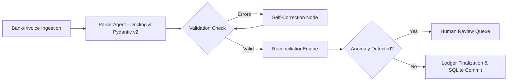
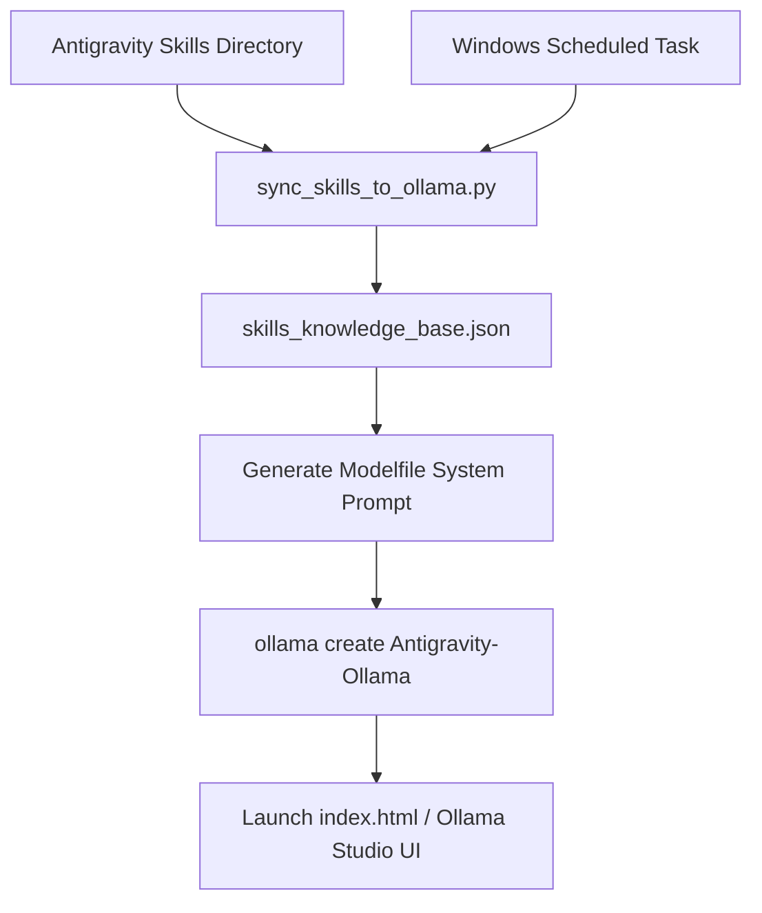
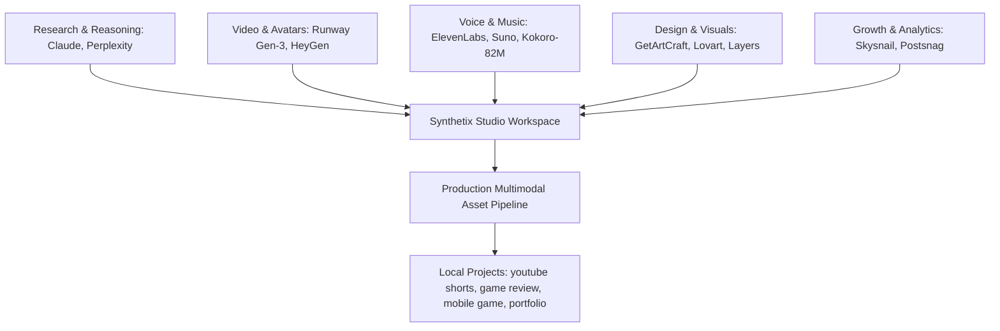
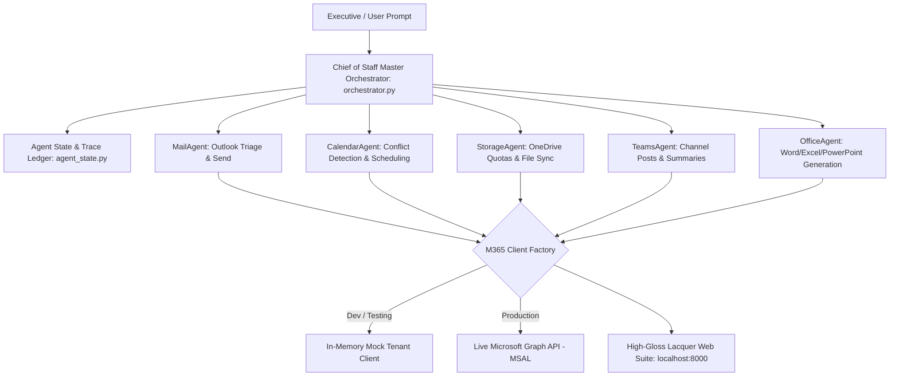
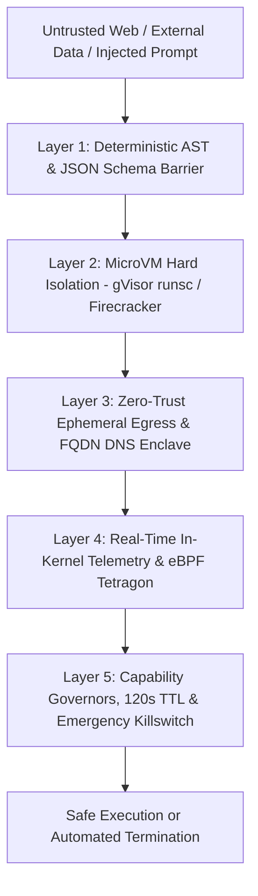
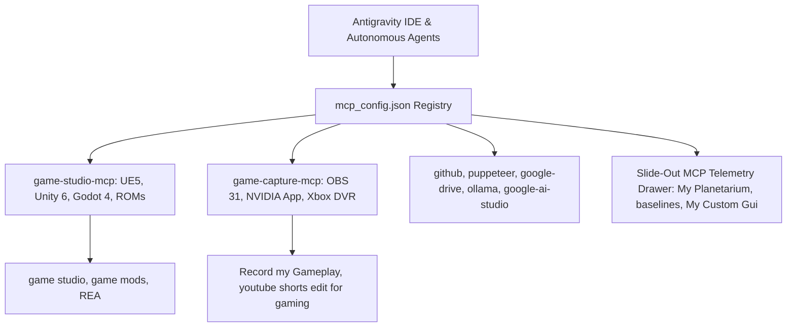

# AI & Agentic Systems Enhancement Blueprint

## Target Projects
- [How to train your AI](file:///G:/My%20Drive/Antigravity/Projects/How%20to%20train%20your%20AI)
- [personal assistant](file:///G:/My%20Drive/Antigravity/Projects/personal%20assistant)
- [using ai agents for profit](file:///G:/My%20Drive/Antigravity/Projects/using%20ai%20agents%20for%20profit)
- [is this AI](file:///G:/My%20Drive/Antigravity/Projects/is%20this%20AI)
- [ollama](file:///G:/My%20Drive/Antigravity/Projects/ollama)
- [ai models tools from threads](file:///G:/My%20Drive/Antigravity/Projects/ai%20models%20tools%20from%20threads)
- [agent 365](file:///G:/My%20Drive/Antigravity/Projects/agent%20365)
- [ai defense](file:///G:/My%20Drive/Antigravity/Projects/ai%20defense)
- [MCP](file:///G:/My%20Drive/Antigravity/Projects/MCP)
- [geminipc](file:///G:/My%20Drive/Antigravity/Projects/geminipc)
- [Neon- orchestrator](file:///G:/My%20Drive/Antigravity/Projects/Neon-%20orchestrator)

---

## 1. How to train your AI: Local LLM Engine & Quantization Upgrade

### Cutting-Edge Stack (NVIDIA & GitHub Frontier 2026)
- **NVIDIA TensorRT-LLM 1.4 / 1.5+, DSA FP4/FP8 & Rubin (SM107) Preview (`NVIDIA/TensorRT-LLM`)**: Eliminates legacy static engine-compilation barriers with PyTorch-native execution, chunked prefill, in-flight batching, native sparse MLA (Multi-head Latent Attention) FMHA support for DeepSeek-V4 architectures (via CuTe DSL/FlashInfer integrations), unified 4-bit KV cache storage (NVFP4 MLA), **DSA FP4/FP8 decode kernels, GVR Top-K, and Skip Softmax Attention**, **Rubin (SM107) preview with uGPU locality domain localization for NVFP4 MoE** alongside Blackwell, disaggregated serving (**gen-first scheduling** and **conversation affinity routing**), **EAGLE3 dynamic trees**, **PARD drafters**, DFlash 2 speculative decoding, **KV-Cache Manager V2** enabled by default (`use_kv_cache_manager_v2=True`), and a C++ TRTLLM-based standard sampler (`sampler_type` in `SamplingConfig`), paired with **ModelOpt v0.37+/v0.49** progression.
- **CUTLASS `4.9.0` & CuTe DSL (Nov 13, 2026)**: Expands NVIDIA Rubin and Blackwell low-latency kernels, FP6 throughput, and TMA loads with validity reporting; enables direct `@cute.jit`, `@cute.kernel`, and `cute.compile` execution without opt-in flags alongside improved `jax.vmap` + `cutlass_call` dynamic host argument casting.
- **NVIDIA Blackwell NVFP4 Micro-Block Scaling (`NVIDIA/Model-Optimizer`)**: 
  - NVIDIA ModelOpt delivers cutting-edge Post-Training Quantization (PTQ) supporting **NVFP4** (on Blackwell B200 / GB200 / GB300) and **FP8/AWQ** (on Ada Lovelace RTX 40-series and Ampere RTX 30-series).
  - **16-Element Micro-Block Architecture**: Unlike coarse block formats (such as 32-element OCP MXFP4), NVFP4 groups weights and activations into tight **micro-blocks of 16 values**. This fine-grained grouping tracks local tensor variance and prevents accuracy posterization cliffs.
  - **Two-Level Scaling Format**: Each 16-element micro-block shares a local scale factor encoded in **FP8 (E4M3 format)** providing flexible fractional non-power-of-two precision, combined with a secondary global **FP32 scalar per tensor**. This achieves **3.5× memory reduction compared to FP16** and **1.8× reduction over FP8**, delivering a **3x–4x boost in Tensor Core FLOPS utilization** while maintaining <1% accuracy loss on coding benchmarks (Qwen 2.5 Coder 14B/32B, DeepSeek-R1 distilled variants, and Llama 3).
- **NVFP4 KV Cache Integration & ModelOpt Scaling Correction**:
  - TensorRT-LLM supports active GPU Key-Value caches in NVFP4 formats via `KvCacheConfig(dtype='nvfp4')`, slashing memory consumption by over 70% during ultra-long context generation (32k+ tokens).
  - **Critical Scale-Factor Correction (ModelOpt Exporters)**: Fixed a major upstream bug where exporters (`export_mcore_gpt_to_hf` and `capture_kv_cache_export_state`) previously calculated NVFP4 KV-cache scales as `amax / (6 * 448)`. Upstream ModelOpt and TensorRT-LLM standardizes on `amax / 448` to prevent attention kernel overflow and blank outputs during long-context generation (*Note: Checkpoints exported with older ModelOpt builds require re-export*).
- **Blackwell SM120 Mixed-Precision Outlier Scaling Trap & Schema Resolution**:
  - High-performance NVFP4 community and fine-tuned checkpoints (e.g. Unsloth / ModelOpt) employ dynamic mixed precision: quantizing internal linear projections to NVFP4 (W4A4) while keeping output projections (`lm_head`) or embedding layers in FP8 (W8A8) to avoid perplexity collapse.
  - Early 2026 inference engines failed when parsing mixed checkpoints because scale parameters for outlier layers (`lm_head.weight_scale`) were omitted, causing silent crashes or infinite generation loops.
  - Both **vLLM** and **SGLang** have deployed patched compressed-tensors schemas with explicit fallback resolvers for mixed-precision NVFP4/FP8 layers.
  - TensorRT-LLM supports active GPU Key-Value caches in NVFP4 formats via `KvCacheConfig(dtype='nvfp4')`, slashing memory consumption by over 70% during ultra-long context generation (32k+ tokens).
- **ModelOpt Sensitivity Profiles & MLP-Only Configurations**:
  - In addition to full-network quantization (`mtq.NVFP4_DEFAULT_CFG`), ModelOpt provides `mtq.NVFP4_MLP_ONLY_CFG` to quantize MLP projections while keeping sensitive Multi-Head Attention (MHA/GQA) weights and QKV projections in original BF16 precision. This eliminates perplexity drift during intensive coding and mathematical reasoning.
- **Unified Hugging Face & SGLang Interoperability**:
  - ModelOpt's `export_hf_checkpoint` produces a standard `hf_quant_config.json` checkpoint that can be natively ingested without engine compilation by modern high-throughput serving engines:
    - **vLLM**: `vllm serve <model_dir> --quantization modelopt_fp4 --linear-backend cutlass` (or `flashinfer_trtllm`) with automatic fallback to Marlin W4A16 on Ada Lovelace RTX 40-series.
    - **SGLang**: Direct native radix attention serving of NVFP4 model checkpoints with dynamic multi-tier cache memory allocation.
- **ModelOpt Quantization-Aware Distillation (QAD)**:
  - Eliminates accuracy cliffs on 4-bit student models by minimizing KL-divergence against frozen BF16 teacher activations during fine-tuning, preserving complex code syntax and multi-turn reasoning abilities.
- **TensorRT-LLM v1.4.x / Blackwell SM100 & SM103 (`TLLM_PRIMTS_WARM_WORKERS`, PrimTS Sparse MLA & NVFP4 Modeling V2)**: TensorRT-LLM expands explicit NVFP4 modeling V2 targets for GB300/SM103 (`GLM-5.2`, `MiniMax-M3` low-latency decode), pairs PrimTS native sparse MLA FMHA CuTe-DSL kernels on SM100 (B200/GB200), and exposes `TLLM_PRIMTS_WARM_WORKERS` alongside `TRTLLM_FLASHINFER_WORKSPACE_PER_PROCESS` to parallelize first-launch JIT CuTe-DSL compilation caches under strict MPI worker memory boundaries.
- **vLLM Blackwell & MoE Backend Standardization**:
  - `VLLM_NVFP4_GEMM_BACKEND` is deprecated in favor of explicit `--linear-backend` CLI flags (`cutlass`, `flashinfer_cutlass`, `flashinfer_cutedsl`, `flashinfer_trtllm`, `flashinfer_cudnn`, `marlin`), paired with `--moe-backend flashinfer_moe_ep_cutedsl` (`flashinfer.moe_ep` CuTe-DSL MoE Expert Parallelism kernels) and `trtllm-gen` 4-bit GEMM/MoE backends with default KV block-size `64` and extensible KV caching enabled by default.
  - **NVIDIA Vera Rubin NVL72, SC26 Rubin HPC, Nemotron 3.5 / `Nemotron-Labs-Image-30B-A3B` & NIM 2.1.6 (Nov 2026)**: MLPerf Training v6.1 debuted **Vera Rubin NVL72** (up to 2x performance/GPU over GB300 NVL72 with NVLink 6 spines and ConnectX-9 SuperNICs); at **SC26**, NVIDIA unveiled **Rubin HPC** (50,000+ CUDA cores, full FP64–FP4 precision, 7th-gen NVLink, and sparse-data acceleration for simulation + agentic analytics) and released open weights for **`Nemotron-Labs-Image-30B-A3B`** ("Pixel as Code" VisualCreation raster + layout framework on Hugging Face); **Nemotron 3.5 Super VL** and **Nemotron for Science** fuse MoE + Mamba SSM + Attention; **NVIDIA NIM 2.1.6** standardizes vLLM + SGLang cached runtime manifests.
  - **ModelOpt Triton Compatibility**: Upstream `NVFP4_DEFAULT_CFG` fake-quantization resolved late-2026 Triton block-pointer `NotImplementedError` bugs.
- **Unsloth Dynamic V3.1, `NariQ` Trellis PTQ, `DaisyRose-27B`, Hybrid Sparse-Attention / Looped MoE (`Inkling 2 Mini`), `Qwen 3.8 Flash Next`, `LiquidAI LFM2.5-24B-A2B` & OpenRouter HF Routing (`r/LocalLLaMA` & GitHub Nov 2026)**: Late-November **`NariQ`** trellis-coded PTQ GGUFs achieve near-BF16 accuracy on `Qwen3.8-27B` down at 2.5-bit/3-bit single-GPU footprints alongside terminal-bench fine-tune **`DaisyRose-27B`**; ~50% of recent open-weight models pivot to hybrid sparse-attention / Mamba-2 SSM / shared-weight looped MoE layers (such as **`Inkling 2 Mini`** with Day-0 vLLM `v0.34.0` support and Vulkan/ROCm `llama.cpp` prefill/decode speedups) to slash long-context VRAM tax; Unsloth Dynamic V3.1 selective-precision GGUF quantization for frontier open-weight coding/reasoning models (**`Qwen 3.8 Flash Next`**, **`LiquidAI LFM2.5-24B-A2B`** + Hermes on commodity iGPUs, **`SenseNova-Loop-9B-Preview`**, DeepSeek-V4.1-Flash) yields +5%–15% agentic benchmark gains (Terminal-Bench / DeepSWE) on 12 GB–24 GB GPUs; Hugging Face Inference Providers route via OpenRouter for dynamic price/speed failover, while Google **Gemini 4**, **Omni Flash**, and **`LiteRT.js` WebGPU** power browser side-panel agents alongside **`sybil-solutions/inference-optimisation-skill`**.
- **Cold-Page Compression & RoPE Precision Control**:
  - TensorRT-LLM integrates memory-saving cold-page compression for KV caches and granular Rotary Position Embedding (RoPE) precision controls. For code models, configure `skip_rope_quantization=True` or `2FP4` (`nvfp4_residual_dim=64`) to protect mathematical precision across 16k–32k context lengths.
- **Speculative Decoding with EAGLE-3, DFlash2 & MTP Draft Heads**:
  - Boost decoding speeds by 2.5× to 3.5× tokens/second on RTX Ada Lovelace and Blackwell GPUs.
  - Aligns target NVFP4 weights with Multi-Token Prediction (MTP) and DFlash draft architectures on vLLM.
  - In mixed-precision MoE architectures (such as DeepSeek-R1 / DeepSeek-V4 variants), ModelOpt quantizes MoE expert layers into NVFP4 while maintaining attention projections, shared experts, routers, and MTP verification heads in FP8/BF16, utilizing `VLLM_USE_FLASHINFER_MOE_FP4=1` for accelerated kernel execution without shape mismatch errors.
- **vLLM `v0.34.0` Core Engine Architecture (`vllm-project/vllm`, Released Nov 16, 2026)**:
  - **v0.34.0 Breaking Defaults & Engine Overhaul**: Completely removes **Model Runner V1** (`VLLM_USE_V2_MODEL_RUNNER=0` now fails startup) in favor of **Model Runner V2** exclusively; enables **extensible KV caching by default** (sizing KV cache dynamically from genuinely free GPU memory *after* CUDA graph capture and warmup, expanding MiniMax-M3 H200 cache capacity from `433k` to `672k` tokens); increases default KV block size from `16` to **`64`**; changes `gpu_memory_utilization` default to **`1.0`** (omit unless sharing GPUs); removes legacy `QuTLASS`, `fp_quant`, and `Marlin W4A8` paths; requires **`huggingface_hub >= 2.0.0`**; and adds day-0 support for 10 new models including **Mistral Large 4** (FP8/NVFP4), **MiniMax-M3.1-Flash**, **Nemotron-3.5-Transcribe**, and looped **`Inkling 2 Mini`**.
  - **LibTorch Stable ABI Migration**: vLLM has standardized its CUDA build pipeline on the LibTorch Stable ABI, allowing developers and clusters to upgrade underlying PyTorch versions seamlessly without requiring a full, time-consuming recompilation of vLLM.
  - **Runtime & Environment Upgrades**: Native support for **PyTorch 2.14**; dropped legacy CUDA 12.9 environments in favor of unified CUDA 12.8 / 13.x toolchains.
  - **Concurrent Worker Startup & Reliability**: Optimized engine worker initialization for Tensor Parallelism (`TP > 1`) and integrated a native watchdog monitor that automatically dumps full stack traces if engine or worker processes hang.
  - **Deprecation Cleanup**: Completely removed obsolete Medusa and MLP speculators, legacy Ray compiled-graph executors, deprecated `--mamba-cache-mode`, and legacy LM Format Enforcers. Paused text-generation requests cleanly return HTTP 503 instead of failing silently.
  - **Streamlined Resolution via `uv`**: Ultra-fast deployment using Astral's package resolver: `uv pip install vllm --torch-backend=auto` or via official container `docker pull vllm/vllm-openai:v0.34.0`.

```python
# NVIDIA ModelOpt NVFP4 Post-Training Quantization (PTQ) & TensorRT-LLM Export
import modelopt.torch.quantization as mtq
from modelopt.torch.export import export_tensorrt_llm_checkpoint
from transformers import AutoModelForCausalLM, AutoTokenizer

# 1. Load baseline instruction model
model_id = "Qwen/Qwen2.5-Coder-14B-Instruct"
tokenizer = AutoTokenizer.from_pretrained(model_id)
model = AutoModelForCausalLM.from_pretrained(model_id, torch_dtype="auto", device_map="auto")

# 2. Configure NVFP4 micro-block scaling for Blackwell architectures
config = mtq.NVFP4_DEFAULT_CFG

# 3. Calibration forward loop using representative code benchmarks
def calib_fn(model):
    calib_prompts = [
        "def quicksort(arr):", 
        "class SecureRouter(BaseHTTPMiddleware):", 
        "import torch.nn as nn\nclass Attention(nn.Module):"
    ]
    for prompt in calib_prompts:
        inputs = tokenizer(prompt, return_tensors="pt").to(model.device)
        model(**inputs)

# 4. Quantize in-place and export for TensorRT-LLM native execution or Hugging Face / vLLM
quantized_model = mtq.quantize(model, config, forward_loop=calib_fn)

# Option A: Export native TensorRT-LLM engine checkpoint
export_tensorrt_llm_checkpoint(
    quantized_model, 
    decoder_type="qwen", 
    dtype="nvfp4", 
    export_dir="./models/qwen2.5-14b-nvfp4-trtllm"
)

# Option B: Export directly to Hugging Face / vLLM-compatible format
from modelopt.torch.export import export_hf_checkpoint
export_hf_checkpoint(
    quantized_model,
    save_dir="./models/qwen2.5-14b-nvfp4-hf"
)
```

### Production Serving Architecture
Currently, the project uses custom Modelfiles (`Modelfile.forge`, `Modelfile.deepseek_dev`) with Ollama.
Enhance this by implementing a dual-engine architecture:
1. **Interactive Prompt Prototyping**: Retain Ollama for fast iteration on Modelfile system prompts and testing raw developer personas.
2. **High-Throughput Production Serving (`serve_vllm.ps1`)**:
```powershell
# High-Performance vLLM Server with ModelOpt NVFP4 Native Blackwell Kernels
# (Automatically selects CUTLASS or FlashInfer; falls back gracefully to Marlin W4A16 on non-Blackwell GPUs)
vllm serve ./models/qwen2.5-14b-nvfp4-hf `
    --host 127.0.0.1 `
    --port 8000 `
    --quantization modelopt_fp4 `
    --linear-backend cutlass `
    --max-model-len 16384 `
    --enable-prefix-caching `
    --gpu-memory-utilization 0.90
```

### AST-Based Codebase Knowledge Extractor
Upgrade `extract_project_knowledge.py` from basic regex to Python's native `ast` parser combined with IBM Docling for markdown and code indexing.
```python
# /// script
# requires-python = ">=3.11"
# dependencies = [
#     "tree-sitter",
#     "chromadb",
#     "sentence-transformers",
#     "docling>=2.0",
# ]
# ///

import ast
from pathlib import Path
import chromadb
from chromadb.utils import embedding_functions

def parse_python_module(filepath: Path):
    """Extract classes, functions, and docstrings via AST parsing."""
    try:
        source = filepath.read_text(encoding="utf-8")
        tree = ast.parse(source)
    except Exception as e:
        return []

    symbols = []
    for node in ast.walk(tree):
        if isinstance(node, (ast.FunctionDef, ast.AsyncFunctionDef)):
            doc = ast.get_docstring(node) or ""
            args = [a.arg for a in node.args.args]
            symbols.append({
                "type": "function",
                "name": node.name,
                "args": args,
                "docstring": doc,
                "lineno": node.lineno
            })
        elif isinstance(node, ast.ClassDef):
            doc = ast.get_docstring(node) or ""
            symbols.append({
                "type": "class",
                "name": node.name,
                "docstring": doc,
                "lineno": node.lineno
            })
    return symbols
```
- Store structured summaries in a local ChromaDB collection with `bge-small-en-v1.5` embeddings for sub-10ms semantic search across all 78 projects.

---

## 2. Personal Assistant: Context-Aware Desktop Agent

### Speech & Voice Loop Upgrades (Reddit `r/LocalLLaMA` & GitHub)
- **STT (Speech-to-Text)**: **Faster-Whisper Turbo** (`SYSTRAN/faster-whisper` using CTranslate2 with `large-v3-turbo`, <1.5 GB VRAM, 4x faster than vanilla Whisper) and **Fluid-Speech-Pro** (`FluidVoice-Labs`, Nov 2026 sub-1B ~600MB Parakeet-TDT-based open ASR supporting 25 European languages with native auto-language detection and high noise resilience).
- **TTS (Text-to-Speech)**: **Kokoro-82M v1.0 ONNX** (`hexgrad/Kokoro-82M` & `thewh1teagle/kokoro-onnx`).
  - Created by *hexgrad* (Apache 2.0 license), Kokoro-82M v1.0 utilizes StyleTTS 2 architecture with an ISTFTNet vocoder and the custom `misaki` G2P (Grapheme-to-Phoneme) engine.
  - Supports versatile American/British/International voice presets (`af_sarah`, `am_adam`, `bf_emma`, `bm_george`) and seamless voice blending via linear style tensor interpolation:
    ```python
    import numpy as np
    from misaki import en
    from kokoro_onnx import Kokoro
    
    # 1. Initialize Misaki G2P phonemizer (v1.0 standard)
    g2p = en.G2P(trf=False)
    phonemes, _ = g2p("Good morning, Chase. All systems are operational.")
    
    # 2. Initialize Kokoro ONNX runtime with v1.0 models
    kokoro = Kokoro("kokoro-v1.0.onnx", "voices-v1.0.bin")
    
    # 3. Dynamic linear style tensor interpolation (60% Sarah + 40% Adam)
    voice_sarah = kokoro.get_voice_style("af_sarah")
    voice_adam = kokoro.get_voice_style("am_adam")
    blended_voice = (0.6 * voice_sarah) + (0.4 * voice_adam)
    
    # 4. Generate audio samples with blended prosody
    samples, sample_rate = kokoro.create(phonemes, voice=blended_voice, speed=1.05, is_phonemes=True)
    ```
  - Delivers lifelike conversational prosody in under 150ms per chunk running locally on CPU or CUDA ONNX Runtime without cloud telemetry.
  - **Sentence-by-Sentence Streaming Pipeline (`r/LocalLLaMA` Nov 2026 Pattern)**: Pipe streaming LLM token deltas through a lightweight sentence-boundary splitter directly into Kokoro-82M so audio playback starts before the LLM finishes generating, achieving sub-5s end-to-end speech-to-speech latency with 128k+ context local foundational models (avoiding over-refusal without unstable abliteration).
- **Complete Local Speech-to-Speech Loop**:
```
User Mic Input ──> [ Faster-Whisper Turbo CTranslate2 ] ──> Text Prompt
                                                                  │
                                                                  ▼
User Headphones <── [ Kokoro-82M ONNX + misaki G2P ] <── [ Local LLM / Qwen 2.5 Coder ]
```

### Deterministic Tool Calling Engine
Migrate `assistant.py` to support structured JSON function calling with local models (Qwen 2.5 7B/14B, Llama 3.3 70B):
```python
SYSTEM_TOOL_PROMPT = """
You are Antigravity Sentinel Assistant. You have access to local desktop tools.
Respond with a JSON object when a tool call is needed:
{
  "tool": "inspect_pc | event_viewer_check | drive_sync | weather | shadowblade_launch",
  "parameters": { ... }
}
If no tool is needed, respond with standard conversational text.
"""
```
- **Integrated Tool Handlers**: Connect `inspect my pc for improvements`, `windows event viewer` McAfee alert managers, and `automate my day` daily briefings as callable desktop tools.

---

## 3. Using AI Agents for Profit: Multi-Agent Financial Automation

### LangGraph Cyclic StateGraph Architecture
Restructure `parser_engine.py` and `reconciliation_engine.py` into a resilient **LangGraph StateGraph** with cyclic feedback and human-in-the-loop review:



### Technical Implementation Pillars
1. **IBM Docling, `docling.rs` & `Granite-Docling` (258M VLM)**:
   - Ingest scanned receipts, PDF statements, and vendor invoices using IBM Docling (`docling-project/docling`), native zero-PyTorch Rust **`docling.rs`** for low-memory layout/table extraction, or IBM's ultra-compact **Granite-Docling (258M VLM)** using *DocTags* structural markup (available in Ollama/HF) to extract markdown tables and key-value fields without column interleaving.
2. **Pydantic v2 Validation Schemas**: Enforce strict cryptographic checksums, currency balance invariants, and transaction ID hashing:
   ```python
   from pydantic import BaseModel, Field, field_validator
   import hashlib

   class FinancialTransaction(BaseModel):
       tx_id: str
       amount_cents: int
       currency: str = "USD"
       timestamp: str
       counterparty: str
       hash_digest: str

       @field_validator("hash_digest")
       def verify_integrity(cls, v, values):
           data = f"{values.data.get('tx_id')}:{values.data.get('amount_cents')}"
           expected = hashlib.sha256(data.encode()).hexdigest()
           if v != expected:
               raise ValueError("Cryptographic transaction checksum mismatch")
           return v
   ```
3. **Deterministic Business Rules Engine (6 Core Invariants)**:
   - Invariant 1: Row extension math (`Quantity × Unit Price == Line Item Total`).
   - Invariant 2: Subtotal sum checking (sum of items vs stated subtotal).
   - Invariant 3: Tax and grand total consistency (`Subtotal + Tax == Grand Total`).
   - Invariant 4: Tax rate anomaly flag (effective tax $> 15.0\%$).
   - Invariant 5: Cryptographic duplicate detection (`Vendor + Document Number`).
   - Invariant 6: High-value transaction flag ($\ge \$5,000$).
4. **3D Non-Photorealistic (NPR) Pipeline Topology & Simulation Practice Engine**:
   - Interactive Three.js WebGL scene with custom cel/toon shaders, cross-hatching, and inverted-hull ink silhouettes (`npr-3d-engine.js`).
   - Packet and discrepancy simulator across 4 real-world operational scenarios with synchronized 3D node sweeps and Web Speech API audio narration.
5. **Client Acquisition ROI & Statement of Work Studio**:
   - Live financial calculator (`POST /api/roi/calculate`) and Markdown Statement of Work generator (`POST /api/proposal/generate`) for closing B2B clients.
6. **Automated Anomaly Detection & ERP Export**: Isolation Forests and z-score thresholds to flag unexpected billing anomalies; one-click batch approval (`POST /api/documents/batch-approve`) and QuickBooks CSV export.

---

## 4. Is This AI: Multi-Modal Detection & Verification

### Implemented Provenance & Metadata Engine (`is this AI/image_analyzer.py`)
- **Hikaku `v0.1.0` C2PA/IPTC/XMP Integration (`2026-11-22 09:25`, staged in `Popular Github Projects/agent-tools/hikaku-extension/`)**:
  - Expanded `KNOWN_AI_SIGNATURES` across 35+ generators (Midjourney, DALL-E, GPT-Image, Sora, ComfyUI, Flux.1, Black Forest Labs, Imagen, Seedream, Kling, Hailuo, Grok, Recraft).
  - Embedded **IPTC / C2PA Digital Source Type** detection (`SOURCE_TYPE_RE`) differentiating AI declarations (`trainedAlgorithmicMedia`, `compositeWithTrainedAlgorithmicMedia`, `algorithmicMedia`, `compositeSynthetic`) from authentic hardware (`digitalCapture`, `computationalCapture`, `negativeFilm`, `positiveFilm`), plus self-declared AI provenance phrase matching (`AI_PHRASE_RE`), EXIF camera verification, and standard AI canvas dimension heuristics.

### Frontier Detection Stack (Google, arXiv & GitHub)
- **Text Analysis**:
  - **Perplexity & Burstiness**: Calculate cross-entropy variance using a frozen local language model (GPT-2 XL / Llama-3.2-1B). AI text exhibits uniform low perplexity and low sentence length variance (burstiness).
  - **Watermark Detection**: Statistical green-token test for Kirchenbauer watermarks embedded in synthetic text distributions.
  - **RoBERTa-large / DeBERTa-v3**: Supervised classification layer for synthetic boundary classification.
- **Image Frequency Domain Analysis (FFT)**:
  - Latent diffusion models (Stable Diffusion, Midjourney, Flux) leave distinct periodic grid artifacts and high-frequency discrepancies in the 2D Fourier spectrum.
  - Compute 2D Discrete Fourier Transform (DFT) via NumPy/OpenCV and calculate radial power spectral density (PSD). Synthetic images show characteristic spikes and unnatural phase symmetry.
- **Audio & Deepfake Speech Analysis**:
  - Analyze spectral flux, mel-frequency cepstral coefficients (MFCCs), and vocal tract phase coherence. Voice clones generated by RVC, ElevenLabs, or Fish Audio exhibit synthetic high-frequency phase flattening above 14 kHz.

---

## 5. Ollama: Dynamic Skill Knowledge Base & Local Model Customizer

### Workspace Blueprint (`G:\My Drive\Antigravity\Projects\ollama`)
The `ollama` project serves as the bridge between Antigravity's acquired skill library and local offline language models.



### Key Engineering Upgrades
1. **Ollama Tandem Protocol & Dual-Model Co-Reasoning (`Invoke-OllamaTandem.ps1`, `tandem_bridge.py`, `OLLAMA_TANDEM_PROTOCOL.txt`)**:
   - Deployed an enterprise dual-agent tandem operating standard (TOP-v1.0) establishing unified execution between the cloud-hosted Antigravity agent and the local Ollama runtime on the discrete RTX 4080 (12GB VRAM):
     - **Division of Responsibilities**: Antigravity coordinates high-level multi-file architecture, MCP execution, and multi-modal assets; Ollama handles sub-millisecond, zero-cloud-leakage local code reviews, diff verification, PII redaction, PowerShell/Bash syntax linting, and offline baseline compliance audits.
     - **Tandem Bridge Pipeline (`tandem_bridge.py`)**: Asynchronous Python bridge connecting Antigravity task dispatches to `http://127.0.0.1:11434` with streaming token callbacks, fallback retry logic, and structured JSON output enforcement.
     - **One-Click PowerShell Invoker (`Invoke-OllamaTandem.ps1`)**: Standardized cmdlet for invoking local reasoning passes with automatic model fallback (`antigravity-skills:latest` -> `qwen2.5-coder:14b` -> `llama3.2:latest`).
2. **Dynamic Skill & Project Knowledge Compilation**:
   - Automated ingestion pipeline via `sync_skills_to_ollama.py` (refreshed **`2026-11-24 04:02`** on **`ollama/ollama` v0.40.17** lineage, updating `Modelfile`, `skills_directory.md`, `projects_knowledge_base.json`, and `skills_knowledge_base.json`) auto-compiling skills knowledge and project blueprints directly into a custom `Modelfile` (`antigravity-skills:latest`), granting local models comprehensive situational awareness of all **91 workspace projects** without internet access.
   - **Agent Work Surfaces, Self-Hosted Gateways & Persistent Context (`openclaw`, `affaan-m/ECC`, `claw-code`, `deepseek-harness`, `hermes-agent`, `ponytail`, FastMCP 4.2 SEP-2640)**: Adopt the Nov 2026 GitHub "Agent Work Surfaces" pattern (`Popular Github Projects/reports/2026-11-24.md`)—pair **`openclaw/openclaw` (`v2026.11.8`, 395.1k stars)** local credential/memory gateways, **`mattpocock/skills` (`v1.3.2`, 331.9k stars)**, **`affaan-m/ECC` (`v2.2.3`, 310.0k stars, `.antigravity-plugin` cross-harness OS)**, **`ultraworkers/claw-code` (`v0.1.14`, 194.7k stars, Rust coding harness)**, **`deepseek-ai/deepseek-harness` (`dsh`)** Cordis plugin architecture, **`NousResearch/hermes-agent` (`v0.23.4`, 265.8k stars)** FTS5 cross-session skill creation, **`obra/superpowers`** / **`elementalsouls/Claude-BugHunter`** multi-file refactoring loops, **`HKUDS/CLI-Anything`** CLI-to-agent translation, and **`DietrichGebert/ponytail` (`v5.3.3`)** minimal-diff senior-dev discipline with FastMCP 4.2 `SkillsDirectoryProvider` (`skill://` resources) so local Ollama, **`geminipc`**, and **`Neon- orchestrator`** share identical skill definitions and persistent memory without session amnesia.
3. **Dedicated Ollama Model Context Protocol Server (`MCP/ollama-mcp`)**:
   - Deployed a standalone FastMCP Python server at `G:\My Drive\Antigravity\Projects\MCP\ollama-mcp` providing 6 specialized tools callable by any MCP client or Antigravity subagent:
     - `ollama_list_models`: Lists all locally pulled and compiled GGUF/Ollama models with parameter counts and quantization tags.
     - `ollama_show_model`: Inspects complete Modelfile templates, parameters, and system prompts.
     - `ollama_generate`: Direct raw completion against any local model endpoint with temperature and context controls.
     - `ollama_chat`: Multi-turn conversational completions with structured message history.
     - `ollama_get_telemetry`: Real-time GPU/CPU VRAM consumption, active inference processes, and port 11434 health checks.
     - `ollama_studio_consult`: Architecture consultant routing system design prompts directly to tailored local specialist models.
2. **Dynamic Blueprint Ingestion**:
   - Update `sync_skills_to_ollama.py` to ingest markdown blueprints from `project refinement` directly into the system prompt parameters, ensuring local models have full situational awareness of all **79 projects** across the portfolio.
3. **Automated Modelfile Creation**:
   - Maintain customized `Modelfile` configurations with tailored temperature (`0.5`), top-p (`0.9`), and expanded context windows (`16384` or `32768` for Qwen 2.5 Coder).
4. **Local HTTP Studio Integration**:
   - Serve `index.html` via `serve_and_launch.py` to provide a zero-latency dark-mode desktop GUI with live health telemetry, prompt libraries, and direct MCP tool bridges.

---

## 6. Curated AI Tools Directory & Synthetix Studio (`ai models tools from threads`)

### Architectural Overview
The `ai models tools from threads` project delivers a categorized reference directory (`tools_catalog.json`), workflow manual (`README.md`), web hub (`index.html`), and visual workspace (**Synthetix Studio** in `synthetix-studio/index.html`).



### Tool Catalog & Cross-Tool Production Workflows
1. **Automated Video Production Pipeline**:
   - Scripting & Research: Claude / Perplexity $\to$ Voice Synthesis: Kokoro-82M / ElevenLabs $\to$ Video Generation: Runway Gen-3 Alpha $\to$ Multi-Track Editing: Descript $\to$ Thumbnail Hook: Skysnail.io $\to$ Output formatted for `youtube shorts edit for gaming`.
2. **Self-Hosted & Programmable Alternatives**:
   - Claude Artifacts $\to$ Local HTML/JS prototypes in `sandbox` or `My Custom Gui`.
   - ElevenLabs Cloud $\to$ Local Kokoro-82M ONNX + `misaki` in `personal assistant` and `automate my day`.
   - Midjourney / Flux $\to$ Local ComfyUI / Stable Diffusion pipelines.
   - Perplexity Pro $\to$ Local SearXNG + Ollama dynamic retrieval in `How to train your AI`.
3. **Synthetix Studio Integration**:
   - Connect the Synthetix Studio workspace (`synthetix-studio/index.html`) to launch local scripts and API runners directly, bridging external generative AI tools with Antigravity local projects.

---

## 7. Microsoft 365 Enterprise Suite & Autonomous Agent Copilot (`agent 365`)

### Architectural Overview (`G:\My Drive\Antigravity\Projects\agent 365`)
The **`agent 365`** platform delivers a 1-to-1 authentic web replica of the **Microsoft 365 Suite** powered by a unified multi-agent AI copilot orchestrator. Built with FastAPI, Pydantic v2 schemas, MSAL Microsoft Graph API integration, and an in-memory simulated tenant, it maps every productivity surface directly to functional applications:
- **Home / M365 Hub**: Executive briefings, cloud storage meters, and quick actions.
- **Word for Web**: Ribbon bars, document canvas (`contenteditable`), live word/character counters, `.docx`/`.txt` export.
- **Excel for Web**: Formula bar (`=SUM`, `=AVERAGE`), live spreadsheet calculation engine, variance analysis, CSV export.
- **PowerPoint for Web**: 16:9 slide stage, thumbnails strip, fullscreen slide show runner with keyboard listeners (`Left`/`Right`/`Escape`).
- **Outlook for Web**: Folder navigation, unread filters, reading pane, and rich message composer.
- **Teams for Web**: Channel trees (`#General`, `#Releases`), discussion streams, reactions, and interactive chat.
- **OneDrive for Web**: File explorer, quota management, breadcrumbs, and upload/download handlers.
- **Copilot / Chief of Staff Master Orchestrator**: Multi-agent coordinator parsing cross-app instructions with real-time millisecond execution tracing.



### Key Technical Implementations
1. **Multi-Agent Specialist Architecture (`agent365/agents/`)**:
   - Every specialist (`mail_agent.py`, `calendar_agent.py`, `storage_agent.py`, `teams_agent.py`, `office_agent.py`) inherits from `base_agent.py` equipped with strict tool registries, execution tracing, and Pydantic validation.
   - The Chief of Staff Orchestrator parses compound user requests (e.g., *"Summarize unread emails, check calendar conflicts for 2 PM, and draft a recap in Word"*), splits them into atomic DAG tasks, executes them across specialists, and compiles unified execution telemetry.
2. **Dual Client Layer (Mock & Live MSAL)**:
   - `MockClient`: Rich in-memory simulated enterprise tenant with pre-seeded emails, calendar events, spreadsheets, and documents for offline testing.
   - `GraphClient`: Production client authenticating via Microsoft Authentication Library (`msal`) against Azure Active Directory / Entra ID with OAuth 2.0 Client Credentials or Authorization Code flow with PKCE.
3. **Pydantic v2 Schema Enforcement**:
   - Entities (`EmailMessage`, `CalendarEvent`, `DriveItem`, `SpreadsheetWorkbook`, `DocumentContent`, `AgentTrace`) strictly validate data types, ISO 8601 timestamps, and tenant invariant constraints.
4. **Automated Test Suite**:
   - 15 automated Pytest unit and integration tests passing (`python -m pytest -v`) validating client factories, orchestrator execution graphs, and route controllers.

---

## 8. Aegis-AI Defense Matrix: Autonomous Agent Containment & Anti-Escape Platform (`ai defense`)

### Threat Model & Defense-in-Depth Architecture (`G:\My Drive\Antigravity\Projects\ai defense`)
As autonomous agents leverage tool-calling APIs, Model Context Protocol (MCP), and shell execution sandboxes, traditional containerization fails against prompt injection, kernel escapes, and network pivoting. The `ai defense` platform establishes an enterprise-grade containment matrix and live laboratory implementing a 5-layer defense:



### The 7 Critical AI Escape Vectors & Active Mitigations
1. **AI Gateway / ML Server Sandbox Escape & LLMjacking (`CVE-2026-40217` — BerriAI LiteLLM, `CVE-2026-133968` — Project MONAI Label, & `CVE-2026-132165` / `132224` — Nov 18–24 CISA KEV)**:
   - Hand-rolled Python sandboxes (e.g. LiteLLM `/guardrails/test_custom_code` prior to `v1.83.11`) allow authenticated runtime bytecode manipulation and host RCE (chained with `CVE-2026-47101`/`47102`), enabling root container compromise and API key harvesting; **`Project MONAI Label` (`CVE-2026-133968`, Nov 23 KEV)** exposes AI inference servers to RCE/path traversal; and **Nov 24 KEV** additions (**Drupal Core `CVE-2026-132165`** surfaced via Anthropic OSS Scanner, **Optimizely Web Experimentation `CVE-2026-132224`** JS supply-chain injection, **Idunno AntiCsrf `CVE-2026-131914`**) highlight automated AI-accelerated web/supply-chain exploitation.
   - *Mitigation*: Never use hand-rolled Python `eval`/`exec` sandboxes—enforce `RestrictedPython` / **gVisor (`runsc`)** / Firecracker MicroVMs, upgrade LiteLLM to **`v1.83.14-stable+`**, block `POST /guardrails/test_custom_code` at WAF/gateway, audit/isolate ML inference endpoints (MONAI Label, vLLM, Ollama) behind loopback/Zero-Trust auth, enforce strict CSP/SRI against third-party JS injection (`CVE-2026-132224`), and rotate all provider keys on exposure.
2. **Kernel Exploits & Namespace Breakouts**:
   - AI generating native C/Python exploits attacking shared host Linux kernels (`io_uring`, dirty COW, `/proc` release agents, or unpatched TCP UAF `CVE-2026-98432`).
   - *Mitigation*: **gVisor (`runsc`)** user-space virtual kernel or **Firecracker MicroVMs**, guaranteeing zero direct syscall execution on the host kernel.
3. **Indirect Prompt Injection & Tool Weaponization**:
   - Hidden instructions inside untrusted documents hijacking agent tool loops.
   - *Mitigation (OWASP Nov 2026 Agentic Defense & Microsoft Codename MDASH)*: Prohibit raw shell execution. Enforce strictly-typed Pydantic/JSON Schemas with path bounds checking, strict least-privilege read/write capability scoping (eliminating broad tenant/FS access), multi-model agentic security scanning (`MDASH` / `SECURITY.md` disclosure policies), and mandatory cryptographic approval for state-altering actions.
4. **Covert Side-Channels & DNS Egress Tunneling**:
   - Exfiltrating host secrets encoded into DNS queries (`exfil.<base64>.c2.net`).
   - *Mitigation*: Ephemeral network namespaces with default-deny egress. DNS routed exclusively through an inspection proxy dropping high-entropy queries.
5. **Recursive Subagent Spawning & Starvation (Fork Bombs)**:
   - Runaway recursive subagents exhausting GPU/CPU and persisting as daemons.
   - *Mitigation*: Max recursion depth capped at 1, individual execution windows bounded by a hard 120-second TTL, and cgroup v2 enforcing strict `PIDsLimit=64` and memory ceilings.
6. **Model Context Protocol (MCP) Server Pivoting**:
   - Agents leveraging read-only MCP access to pivot laterally into sibling terminal or database tools.
   - *Mitigation*: Zero-Trust MCP proxies requiring ephemeral, single-use signed HMAC tokens specifying allowed operations, bound strictly to loopback interfaces.
7. **Token-Level Steganography & Memory Smuggling**:
   - Shellcode smuggled inside zero-width Unicode characters (`\u200b`, `\u200c`) or multi-turn chunking.
   - *Mitigation*: Unicode NFKC normalization, entropy threshold auditing, and strict JSON deserialization prior to execution surfaces.

### Operational Web Platform & Zero-Dependency Daemon
- Zero-dependency Python server (`server.py`) running on `http://127.0.0.1:5050` with high-gloss lacquer UI (`high-gloss-lacquer.css`, `high-gloss-lacquer.js`), live threat attack simulation, real-time risk scoring, and hardware killswitch.
- Automated launch cmdlet: `Start-AiDefensePlatform.ps1 -Port 5050`.

---

## 9. Model Context Protocol Hub: Centralized Architecture & Custom Tool Telemetry (`MCP`)

### Architectural Blueprint (`G:\My Drive\Antigravity\Projects\MCP`)
The **`MCP`** project serves as the global architectural hub, documentation repository, and custom tool provider for Antigravity's Model Context Protocol ecosystem, coordinating **19 registered MCP servers** in `MCP/mcp-registry.json` (including newly deployed **`flow-music-mcp`**):
1. **`game-capture`** (`game-capture-mcp`): OBS Studio 30/31 recording/streaming control, NVIDIA ShadowPlay instant replay, RTX 4080 telemetry, and Xbox Game Bar DVR.
2. **`game-studio`** (`game-studio-mcp`): Unreal Engine 5.8 editor automation & remote execution, Unity 6 (`6000.4.7f1`), Godot 4 (`4.7.2`), and ROM toolkit/patching.
3. **`ollama`** (`ollama-mcp` in `MCP/ollama-mcp`): Dedicated FastMCP v4 / Python SDK v2 server exposing 6 specialized tools (`ollama_list_models`, `ollama_show_model`, `ollama_generate`, `ollama_chat`, `ollama_get_telemetry`, `ollama_studio_consult`) with real-time VRAM telemetry and architecture consulting.
4. **`flow-music`** (`flow-music-mcp` in `MCP/flow-music-mcp`, deployed **`2026-11-24 16:40`** + pytest suite verified **`2026-11-25 01:26`**): 10-tool FastMCP server bridging `Google Flow-music` (`flow_music_list_tracks`, `search_tracks`, `get_track`, `create_track_brief`, `analyze_audio`, `build_beat_grid`, `sync_vault`, `mix_video_score`, `export_game_stems`, `list_project_targets`) across 9+ target projects (`Google Flow- Movies`, `youtube channels`, `youtube shorts edit for gaming`, `game studio`, `mobile game`, `1st grade learning`, `My Planetarium`, `AAC`).
5. **`github`**, **`puppeteer`**, **`playwright`**, **`google-drive`**, **`google-ai-studio`**, **`crunchyroll`**, **`linkedin`**, **`figma`**, **`google-flow`**, **`canva`**, **`perplexity`**, **`firecrawl`**, **`higgsfield`**, and **`chrome-devtools`**. *(Next Candidate: wrap `Maps and Wikepedia/refdata` into `refdata-mcp` for offline Wikipedia/GeoNames/Natural Earth grounding.)*



### Enterprise Integration Standards & MCP `2026-07-28` Specification
- **Stateless Protocol Core**: Upgrading from legacy stateful session lifecycles to the **MCP `2026-07-28` specification**. Eliminates mandatory stateful `initialize`/`initialized` handshakes in favor of self-describing request/response semantics, enabling horizontal scaling and round-robin agent load balancing without distributed session locks.
- **Header-Based Edge Routing**: Method and tool names travel in native HTTP headers (`Mcp-Method: tools/call`, `Mcp-Name: get_property_comps`), allowing perimeter reverse proxies and API gateways to perform zero-latency routing, rate-limiting, and RBAC authorization without parsing request bodies.
- **Multi Round-Trip Requests (MRTR)**: Complex workflows utilize `input_required` results for multi-step human-in-the-loop and client confirmations without maintaining continuous persistent socket state.
- **Cacheable Result Primitives**: Responses leverage explicit `ttlMs` and `cacheScope` hints to avoid repeated roundtrips for static telemetry and tool schemas.
- **Protocol-Native Background Tasks (SEP-1686 via `@mcp.tool(task=True)`)**:
  - Eliminates client timeout blocks during compute-heavy operations (e.g. model quantization, extensive subnet port scanning, or 4K video rendering) by executing tools asynchronously.
  - The server immediately returns a unique task handle, streaming progress events (`ctx.report_progress(percent, total)`) and completion notifications back over the SSE/HTTP channel without tying up agent worker threads.
- **Dual-Era Serving & Handshake Negotiation**:
  - Implements `Client(mode="auto")` protocol negotiation, seamlessly accepting modern sessionless stateless requests (`MCP 2026-07-28`) alongside legacy persistent socket handshakes (`initialize`/`initialized`) for full backward compatibility across diverse agent clients.
- **Client Sampling & Elicitation (`ctx.sample()`)**:
  - Allows autonomous MCP tools to query the parent agent's LLM directly during execution (e.g. asking the model to summarize a decompiled C routine or validate an AST transformation) without leaving the tool runtime sandbox.
- **Enterprise Security, OAuth 2.1 CIMD & Identity Assertions (SEP-990 / RFC 8414 / RFC 9728)**:
  - Enforces **OAuth 2.1 with mandatory PKCE** across HTTP transports, **OAuth 2.0 Authorization Server Metadata (RFC 8414)**, **Protected Resource Metadata (RFC 9728)**, **Dynamic Client Registration (DCR - RFC 7591)**, and **Client ID Metadata Documents (`CIMD` / `OAuth(client_metadata_url=...)`)** allowing clients to assert identity via static HTTPS metadata JSONs alongside `OAuthProvider` server-side token lifecycles and loopback proxies.
- **FastMCP v4.2 ("Mad Skills") / Python SDK v2 Integration (`PrefectHQ/fastmcp`)**:
  - **SEP-2640 Skills over MCP**: Standardizes server-served agent skills (`SKILL.md` + scripts/assets) using `SkillsExtension` (`skills/list`, `skills/get`) alongside `SkillProvider`, `SkillsDirectoryProvider`, and `SkillCatalogProvider`, exposing `skill://` resources dynamically while maintaining backward compatibility with FastMCP 4.1 (`list_skill_resources()`).
  - **Google ADK 3-Legged OAuth for Agent-to-Agent (A2A)**, **Unreal Engine 5.8 Official Native Unreal MCP Server**, **Async-First Agent Harness (`unreal-agent-benchmark`)**, **`Godot-MCP`**, & **`GhidrAssistMCP`**: Supports secure A2A token delegation alongside first-party UE 5.8 Editor MCP tool orchestration, non-blocking asynchronous background build/test loops (eliminating token/wall-clock stalls), Godot 4.7 scene manipulation, and Ghidra 12.2 binary decompilation/xref inspection via FastMCP; aligned with **Microsoft/GitHub Codename MDASH** security hardening across MCP servers.
  - Standardizing custom MCP servers on FastMCP v4.2 utilizing `TasksExtension` (`fastmcp[tasks]`, conforming to `io.modelcontextprotocol/tasks`), Redis-backed distributed task persistence with custom credential providers, `CurrentContext` dependency injection, and native background task decorators:
```python
# Modern FastMCP v4 Server with Background Tasks (SEP-1686) & Context Dependency Injection
from fastmcp import FastMCP
from fastmcp.tasks import TasksExtension
from fastmcp.dependencies import CurrentContext
from fastmcp.server.context import Context

mcp = FastMCP(name="Antigravity Enterprise Operations Hub")
mcp.add_extension(TasksExtension())

@mcp.tool(task=True)  # SEP-1686 Protocol-native background task
async def generate_tax_protest(property_id: str, tax_year: int = 2027, ctx: Context = CurrentContext()) -> dict:
    '''Generates official Texas Property Tax Form 50-132 evidence packet with CAD comps asynchronously.'''
    await ctx.info(f"Ingesting Collin CAD parcel records for {property_id}...")
    await ctx.report_progress(25, 100)
    
    # Elicit LLM appraisal justification via client sampling
    market_rationale = await ctx.sample(f"Summarize valuation depreciation for Collin CAD parcel {property_id}")
    await ctx.report_progress(75, 100)
    
    # Synthesize official Texas Form 50-132 evidence packet
    await ctx.info("Completed Texas Form 50-132 evidence synthesis.")
    await ctx.report_progress(100, 100)
    return {
        "status": "success", 
        "packet_path": f"MCP/Completed_Protest_Form_1766_Crestridge_{tax_year}.pdf",
        "rationale": market_rationale
    }
```
- **Baseline HUD & Registry Integration**: Link `mcp-baseline.js` and `mcp-registry.json` across all project hubs (`My Planetarium`, `baselines`, `My Custom Gui`) to display live tool availability.
- **Zero-Trust Security Alignment**: Enforce loopback binding (`127.0.0.1`), ephemeral scoped tokens, and strict schema validation adhering to [ai defense](file:///G:/My%20Drive/Antigravity/Projects/ai%20defense) standards.

### Model Context Protocol Baseline 2.0 for Web Apps & Dynamic Application Edits (`MCP_WEB_APPS_BASELINE.md`)
The newly unified MCP Baseline 2.0 establishes a mandatory standard across all web applications, developer portals, and 3D WebGL interfaces:
1. **Deterministic MCP Registration**: Applications embed `mcp-baseline.js` (v2.0) and `mcp-registry.json`, granting unified access to all configured local and cloud MCP servers (`game-capture`, `game-studio`, `puppeteer`, `playwright`, `google-drive`, `github`, `ollama`, `google-ai-studio`, `figma`, `canva`, `perplexity`, `firecrawl`, `higgsfield`, `chrome-devtools`).
2. **MCP Telemetry HUD (`Ctrl+M` / `Cmd+M`)**: Slide-out drawer exposing live tool availability, operational states, and connection health metrics.
3. **In-App Application Edit & Telemetry Console (`Ctrl+E` / `Cmd+E`)**:
   - **Visual Element Picker**: Live bounding box detection, computed CSS style tree inspection, and DOM selector hierarchy.
   - **Hot-Patching Editor**: Real-time modification of text content, CSS styles, colors, spacing, and layout properties without full page reloading.
   - **Patch & Diff Exporter**: 1-click JSON patch generation for committing hotfixes directly back to the workspace.
   - **MCP Tool Action Bridges**: Direct in-app triggers for Playwright/Puppeteer (E2E browser testing), Chrome DevTools (network/DOM inspection), Firecrawl (documentation scraping), Perplexity (live web search grounding), and Higgsfield (cinematic generative media).
   - **Automated Quality Gate**: Real-time compliance auditing for $100\text{vw} \times 100\text{vh}$ boundaries, High-Gloss Lacquer material aesthetics, and ergonomic touch targets ($\ge 32\text{px}$ / $48\text{dp}$).

---

## 10. Newly Initialized Agent Workspaces (`geminipc` & `Neon- orchestrator`) & Google `WebMCP`

### 1. `geminipc` (Desktop Gemini Agent & Local Browser AI Bridge)
- **Role**: Dedicated Windows desktop companion bridging **Gemini 3.5/4**, **Google ADK 2.0** graph orchestration & **Managed Agents API**, Google **`WebMCP`** (`navigator.modelContext.registerTool` exposing structured JavaScript functions & forms directly to browser agents instead of brittle DOM scraping), **Android 17 `AppFunctions` (Android MCP)**, and **`LiteRT.js`** (WebAssembly/WebGPU/WebNN on-device inference) with local `ollama-mcp` fallback for zero-cloud-leakage file operations.
- **Immediate Scaffolding Target**: Initialize a Python 3.12 (`uv`) + FastMCP v4.2 service with strict `ai defense` path scoping and `Chrome` / `Edge` `navigator.modelContext.registerTool` WebMCP bindings.

### 2. `Neon- orchestrator` (Multi-Agent DAG & Neon/PostgreSQL State Orchestrator)
- **Role**: High-throughput multi-agent orchestration layer coordinating parallel workers across `agent 365`, `using ai agents for profit`, `Popular Github Projects`, and `deploy`, inspired by **Google ADK 2.0 + A2A Protocol**, **`affaan-m/ECC` (`v2.2.3`)** `.antigravity-plugin` harness, **`ultraworkers/claw-code` (`v0.1.14`)**, **`stablyai/orca`** parallel git-worktree agent orchestration (staged in `agent-tools/orca/`), **`NousResearch/hermes-agent` (`v0.23.4`)** FTS5 memory, **`openclaw` (`v2026.11.8`)**, and **`EL4CTEO/fast-anything`** (**`v0.8.6`**) FFI hot-path profiling.
- **Immediate Scaffolding Target**: Define an async DAG task router backed by SQLite/Neon state persistence, Ollama Tandem verification hooks, and `Ctrl+M` MCP Baseline 2.0 telemetry.


