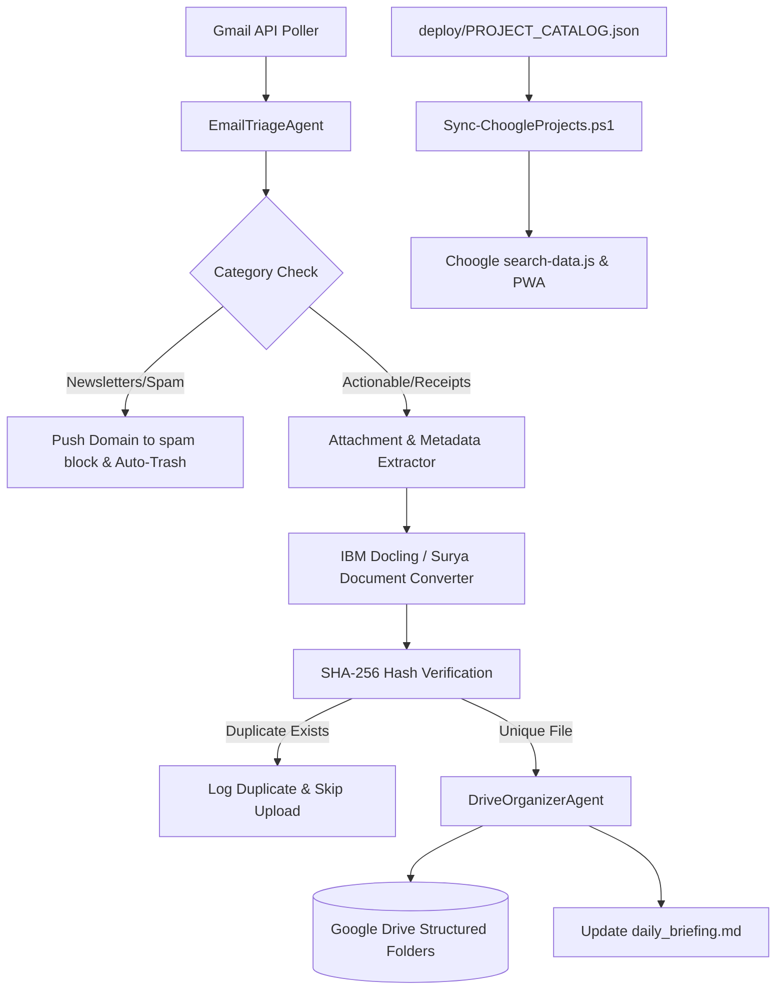
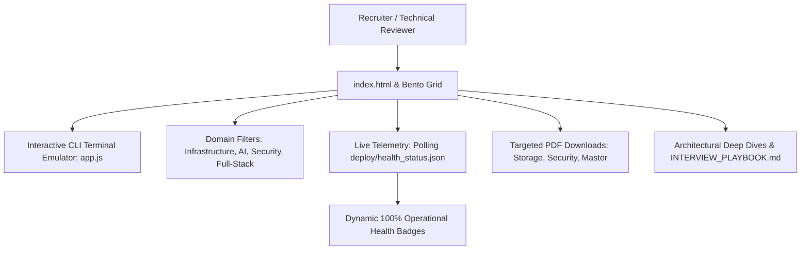
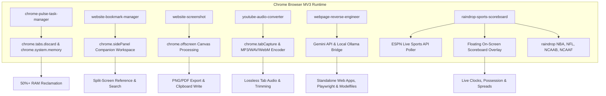
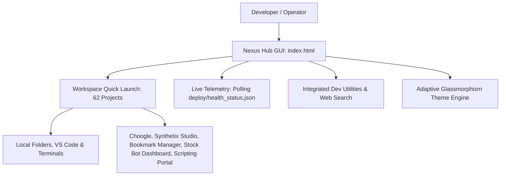
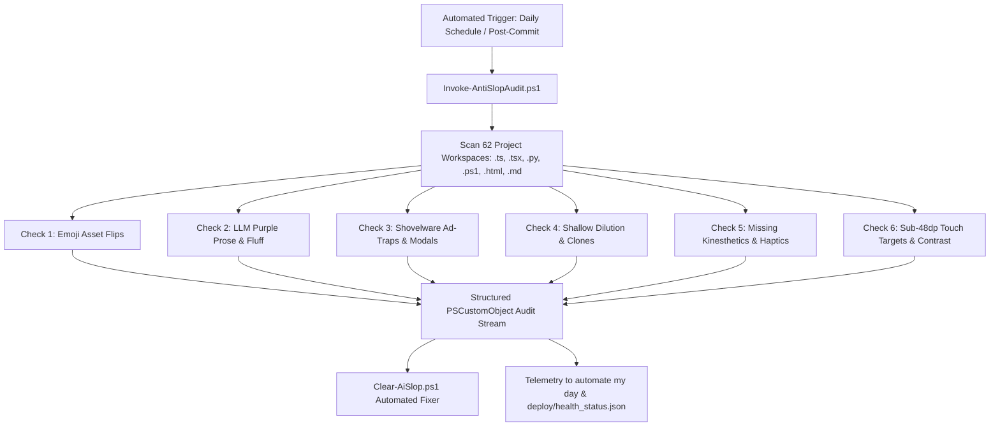
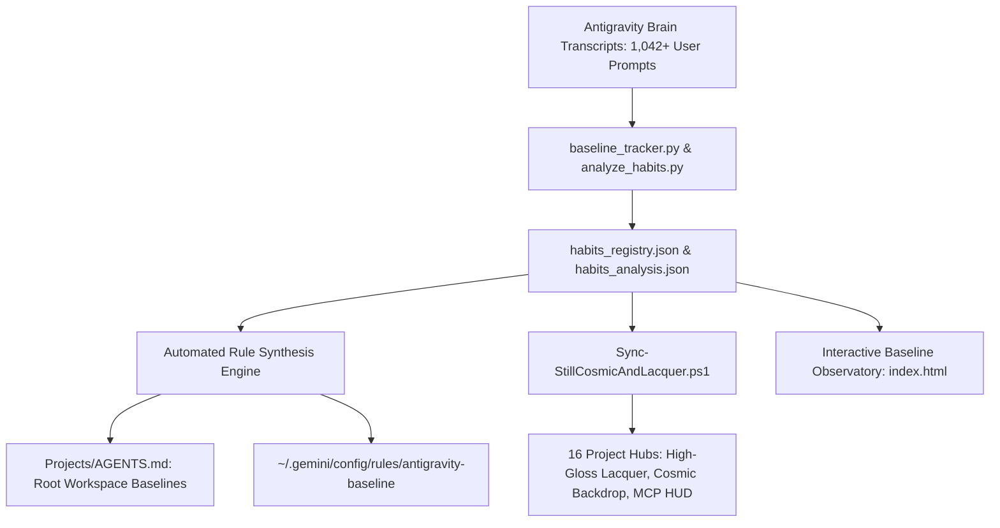
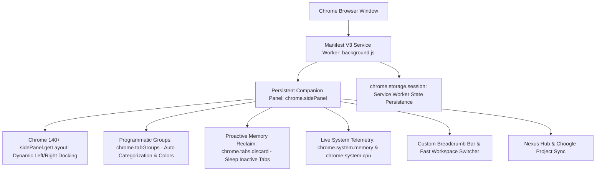
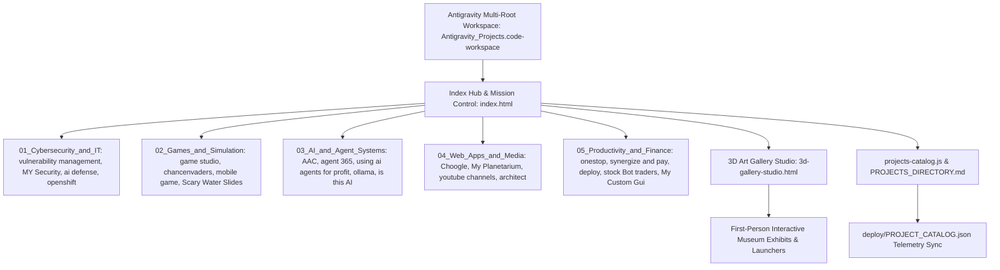
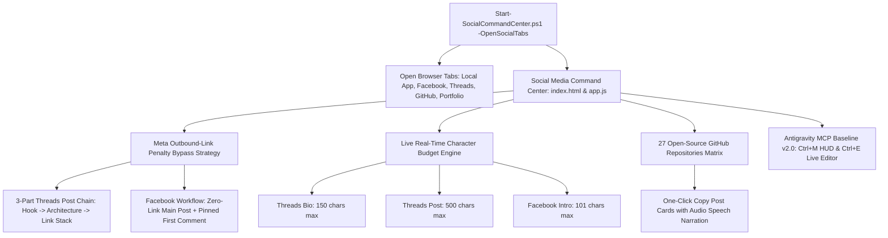
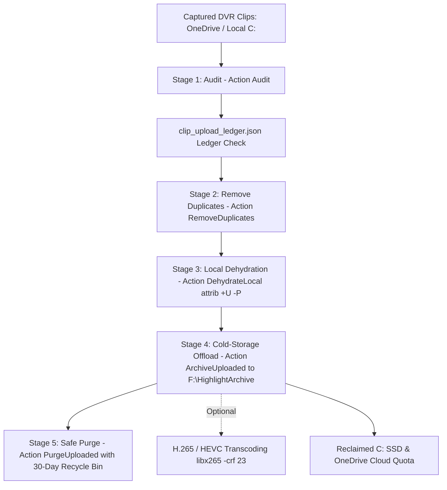

# Automation & Productivity Enhancement Blueprint

## Target Projects
- [google drive organizer](file:///G:/My%20Drive/Antigravity/Projects/google%20drive%20organizer)
- [email organizer](file:///G:/My%20Drive/Antigravity/Projects/email%20organizer)
- [automate my day](file:///G:/My%20Drive/Antigravity/Projects/automate%20my%20day)
- [screen reader](file:///G:/My%20Drive/Antigravity/Projects/screen%20reader)
- [note taker](file:///G:/My%20Drive/Antigravity/Projects/note%20taker)
- [inspect my pc for improvements](file:///G:/My%20Drive/Antigravity/Projects/inspect%20my%20pc%20for%20improvements)
- [improve gaming pc performance](file:///G:/My%20Drive/Antigravity/Projects/improve%20gaming%20pc%20performance)
- [zfold6 features](file:///G:/My%20Drive/Antigravity/Projects/zfold6%20features)
- [scheduled task](file:///G:/My%20Drive/Antigravity/Projects/scheduled%20task)
- [Choogle](file:///G:/My%20Drive/Antigravity/Projects/Choogle)
- [Github Portfolio](file:///G:/My%20Drive/Antigravity/Projects/Github%20Portfolio)
- [My Custom Gui](file:///G:/My%20Drive/Antigravity/Projects/My%20Custom%20Gui)
- [ai slop](file:///G:/My%20Drive/Antigravity/Projects/ai%20slop)
- [baselines](file:///G:/My%20Drive/Antigravity/Projects/baselines)
- [Plugins/chrome-pulse-task-manager](file:///G:/My%20Drive/Antigravity/Projects/Plugins/chrome-pulse-task-manager)
- [Plugins/website-bookmark-manager](file:///G:/My%20Drive/Antigravity/Projects/Plugins/website-bookmark-manager)
- [Plugins/website-screenshot](file:///G:/My%20Drive/Antigravity/Projects/Plugins/website-screenshot)
- [Plugins/youtube-audio-converter](file:///G:/My%20Drive/Antigravity/Projects/Plugins/youtube-audio-converter)
- [Plugins/webpage-reverse-engineer](file:///G:/My%20Drive/Antigravity/Projects/Plugins/webpage-reverse-engineer)
- [Plugins/raindrop-sports-scoreboard](file:///G:/My%20Drive/Antigravity/Projects/Plugins/raindrop-sports-scoreboard)
- [Plugins/raindrop-sports-nba](file:///G:/My%20Drive/Antigravity/Projects/Plugins/raindrop-sports-nba)
- [Plugins/raindrop-sports-nfl](file:///G:/My%20Drive/Antigravity/Projects/Plugins/raindrop-sports-nfl)
- [Plugins/raindrop-sports-ncaab](file:///G:/My%20Drive/Antigravity/Projects/Plugins/raindrop-sports-ncaab)
- [Plugins/raindrop-sports-ncaaf](file:///G:/My%20Drive/Antigravity/Projects/Plugins/raindrop-sports-ncaaf)
- [chrome tab and bar](file:///G:/My%20Drive/Antigravity/Projects/chrome%20tab%20and%20bar)
- [AAC](file:///G:/My%20Drive/Antigravity/Projects/AAC)
- [My Social Media](file:///G:/My%20Drive/Antigravity/Projects/My%20Social%20Media)
- [index folder](file:///G:/My%20Drive/Antigravity/Projects/index%20folder)
- [onedrive cleanup](file:///G:/My%20Drive/Antigravity/Projects/onedrive%20cleanup)
- [resume](file:///G:/My%20Drive/Antigravity/Projects/resume)

---

## 1. Unified Google Workspace & Choogle Portal Pipeline

### Multi-Agent Pipeline Architecture (Google ADK & LangGraph)
Unify **`email organizer`**, **`google drive organizer`**, and **`Choogle`** into an autonomous, event-driven pipeline:



### Technical Implementations
- **Astral `uv` Toolchain & PEP 723 Inline Metadata**: Standardize all automation scripts on PEP 723 inline dependencies for instant startup with zero manual virtualenv setup:
```python
# /// script
# requires-python = ">=3.12"
# dependencies = [
#     "google-api-python-client>=2.140",
#     "google-auth-oauthlib>=1.2",
#     "pydantic>=2.8",
#     "docling>=2.0",
#     "rich>=13.7",
# ]
# ///

from googleapiclient.discovery import build
from google.auth.transport.requests import Request
from docling.document_converter import DocumentConverter
import os, json, hashlib
```
- **Automated Token Lifecycle**: Ensure `token.json` refreshes automatically in the background using `google.auth.transport.requests.Request()`. If refresh fails, fall back to headless loopback authentication without stalling background tasks.
- **SHA-256 Pre-Flight Deduplication**: Compute hashes of all local and remote files before issuing Google Drive API write calls, eliminating redundant cloud storage usage and conserving quota.
- **Choogle Automated Search Sync (`Sync-ChoogleProjects.ps1`)**:
  - Automatically indexes all **79 active projects** (including newly added `resume`, `Cert Training Guide`, `onedrive cleanup`, `stock Bot traders`, `Scripting`, and `Record my Gameplay`) into `search-data.js` and syncs `index.html` with real-time operational status, health scores, and quick-launch links (verified executed in production on November 16, 2026 at 11:05:02 PM).

---

## 2. Automate My Day: The Morning Executive Sentinel

### Autonomous Telemetry Ingestion
Enhance `automate.bat` and `run_sentinel_silent.vbs` to execute at 6:00 AM daily, synthesizing telemetry from across the entire ecosystem:
1. **System Diagnostics**: Ingest SSD wear levels, RAM pressure, and battery health from `inspect my pc for improvements`.
2. **Security Posture**: Ingest Sysmon critical alerts and McAfee threat scans from `windows event viewer`.
3. **Communication Triage**: Summarize urgent school, family, and billing emails from `email organizer`.
4. **Storage & Cloud Health**: Monitor available space across Drive C: (OS), Drive F: (SSD), and Drive G: (Google Drive).
5. **Passive Income & Media Pipeline**:
   - Ingest completed YouTube gaming clips from `modules/youtube/` (`ready_for_upload` vs `uploaded`), review clip rotations across TEKKEN 8, Beast of Reincarnation, and Sonic Racing.
   - Monitor the **Passive Income Sentinel Daemon** (`modules/passive_income/sentinel_daemon.py`, `storage_cleaner.py`) and newly staged **Longform Video Pipeline** (`Invoke-LongformPipeline.ps1`, `longform_editor.py`, `smart_cutter.py`, `sfx_manager.py`, `audio_rotation...`), continuously watching captured gameplay directories, tracking processed clip hashes in `processed_clips.json`, and triggering automated conversion into both 9:16 Shorts and 16:9 longform montages across TEKKEN 8, Beast of Reincarnation, and Sonic Racing. **Production Status**: Actively executed and verified in production through **November 17, 2026 02:27 AM**, with automated audio rotation modules and ready-for-upload batching.
   - Monitor the 12-episode scheduled publishing queue from [youtube channels](file:///G:/My%20Drive/Antigravity/Projects/youtube%20channels) (`Invoke-AutoUploadQueue.ps1`, `youtube_api_upload.py`).
   - Audit new victory boss recordings saved by [Record my Gameplay](file:///G:/My%20Drive/Antigravity/Projects/Record%20my%20Gameplay) ready for short-form conversion.
6. **Quantitative Market & Trading Setups**: Ingest Carter Volatility Squeeze coiling alerts and Wyckoff Spring setups from `stock watch/screener/scanner.py` (`deploy/coiling_watchlist.json`), alongside active portfolio P&L, win rates, and daily upskill logs from `stock Bot traders/knowledge_base/daily_upskill_log.md`.
7. **Privacy & Data Broker Suppression**: Ingest active CCPA suppression requests and suppressed brokers count from `spam block/optout_tracker.json`.
8. **Scripting & Infrastructure Test Telemetry**: Ingest automated test execution passes/fails from `Scripting/powershell/Test-Runner.ps1` and `RHCSA Exam200/grade_rhcsa_lab.sh` to confirm systems and lab integrity.
9. **Spoken Audio Briefing**: Automatically synthesize `daily_briefing.md` into an audio briefing (`morning_brief.wav`) using **Kokoro-82M ONNX**:
```powershell
# Synthesize morning briefing to speech via Kokoro-82M ONNX
uv run --with kokoro-onnx --with soundfile python -c "
from kokoro_onnx import Kokoro
import soundfile as sf
kokoro = Kokoro('kokoro-v0_19.onnx', 'voices.bin')
with open('daily_briefing.md', 'r', encoding='utf-8') as f:
    text = f.read()
samples, sample_rate = kokoro.create(text, voice='af_sarah', speed=1.1)
sf.write('morning_brief.wav', samples, sample_rate)
"
```

---

## 3. Screen Reader & Note Taker: Accessibility & Spaced Repetition

### Document Intelligence & IBM Docling Frontier
- **IBM Docling (`docling-project/docling`) Integration**:
  - Migrate `ocr_engine.py` to use IBM Docling as the primary document converter.
  - Accurately converts complex multi-column technical PDFs, tables, diagrams, and OCR scans directly into structured markdown format:
```python
from docling.document_converter import DocumentConverter

converter = DocumentConverter()
result = converter.convert("technical_specification.pdf")
markdown_output = result.document.export_to_markdown()
```
- **Surya OCR & Piper TTS Fallback**: Maintain Surya OCR for live screen region snapshots and Piper TTS / Kokoro for sub-100ms auditory playback.
- **Snapshot Caching & Bookmarks (`bookmarks.json`)**: Persistent snapshot tagging allowing users to jump back to previously read pages with coordinate recall.
- **Note Taker with Anki / SM-2 Spaced Repetition**: Upgrade `note_generator.py` to automatically transform lecture notes, Security+ syllabus materials, and AWS architecture docs into Anki-compatible `.csv` flashcards using the SuperMemo SM-2 algorithm.

---

## 4. Hardware Diagnostics & Low-Latency Gaming PC Tuning

### Low-Latency Tuning (`inspect my pc for improvements` & `improve gaming pc performance`)
The **`improve gaming pc performance`** project provides an automated, real-time tuning engine tailored for the **Acer Predator PH16-71 (Intel Core i9-13900HX, 64 GB DDR5, NVIDIA GeForce RTX 4080 Laptop GPU 12GB VRAM)**.

#### 1. Real-Time Steam & Game Execution Watcher (`Start-SteamGamingPerformanceWatcher.ps1`)
- Runs as an ultra-lightweight background polling loop (every 5 seconds) detecting when Steam or 3D game executables (such as *Phantom Blade Zero* `PBZ.exe`, Unreal Engine 5, or Godot 4) launch.
- Automatically invokes the tuning engine (`Invoke-PBZOptimization.ps1`) without requiring manual user intervention or desktop context switching.

#### 2. Automated PBZ & System Optimization Suite (`Invoke-PBZOptimization.ps1`)
- **Ultimate Performance Power Plan Lock**:
  - Dynamically activates Windows Ultimate Performance power scheme (`$UltimatePlanGuid = "ce71df13-30de-418e-9c7c-7afb0a84dc89"`), unparking all 8 Performance cores (P-cores) and 16 Efficient cores (E-cores) and locking CPU core clock frequencies against thermal downclocking.
- **Discrete RTX 4080 GPU Preference Registry Enforcement**:
  - Automatically queries and registers the high-performance GPU preference (`GpuPreference=2;`) in the Windows DirectX Registry (`HKCU:\Software\Microsoft\DirectX\UserGpuPreferences`) for all detected game binaries (`F:\SteamLibrary\steamapps\common\PBZ\platform\steam\PBZ.exe` and `PBZ.exe`), bypassing hybrid graphics switching latency:
  ```powershell
  # Force Discrete RTX 4080 High Performance GPU in Registry
  Set-ItemProperty -Path 'HKCU:\Software\Microsoft\DirectX\UserGpuPreferences' `
      -Name $Path -Value 'GpuPreference=2;' -Type String -Force
  ```
- **Real-Time Process Priority Elevation**:
  - Identifies running game processes and programmatically elevates process priority class to `[System.Diagnostics.ProcessPriorityClass]::High`, ensuring CPU dispatch queues prioritize game render loops over background OS tasks.
- **Unreal Engine 5 `Engine.ini` Optimization Deployment**:
  - Automatically verifies and writes custom UE5 streaming, asynchronous compute, and Niagara VFX settings into `%LOCALAPPDATA%\ProjectPBZ\Saved\Config\Windows\Engine.ini`:
  ```ini
  [/Script/Engine.RendererSettings]
  r.Streaming.PoolSize=6144
  r.Streaming.LimitPoolSizeToVRAM=0
  r.Streaming.HLODStrategy=2
  r.Streaming.DefragDynamicBounds=1
  r.CreateShadersOnLoad=1
  r.Shaders.Optimize=1
  r.AsyncCompute=1
  r.FinishCurrentFrame=0
  r.D3D12.ZeroBufferSizeInMB=128
  FX.Niagara.AllowAsyncBudgeting=1

  [SystemSettings]
  r.Streaming.PoolSize=6144
  r.Streaming.LimitPoolSizeToVRAM=0
  r.CreateShadersOnLoad=1
  r.Shaders.Optimize=1
  r.AsyncCompute=1
  r.FinishCurrentFrame=0
  FX.Niagara.AllowAsyncBudgeting=1
  ```
  - **Memory Impact**: Allocates a dedicated 6,144 MB (6 GB) texture streaming pool within the RTX 4080's 12 GB VRAM, pre-compiles shaders on level load (`r.CreateShadersOnLoad=1`), and engages asynchronous compute shaders (`r.AsyncCompute=1`) to eliminate traversal hitching and micro-stutter.

#### 3. PCIe Interrupts & Windows 11 24H2 DirectStorage 1.2
- **GPU Message Signaled Interrupts (MSI-X Mode)**:
  - Verifies that the NVIDIA RTX GPU and PCIe NVMe SSDs use Message Signaled Interrupts (`MSISupported=1`) with interrupt affinities locked to dedicated P-cores, avoiding legacy shared IRQ interrupt storms:
  ```powershell
  # Verify MSI-X Mode on NVIDIA GPU
  $GpuKey = Get-ChildItem "HKLM:\SYSTEM\CurrentControlSet\Enum\PCI" -Recurse | Where-Object { $_.Name -match "Device Parameters\\Interrupt Management\\MessageSignaledInterruptProperties" }
  # Ensure MSISupported = 1
  ```
- **DirectStorage 1.2 GPU Decompression**:
  - Leverages GDeflate decompression on the RTX 4080 GPU, reducing asset load times from NVMe storage directly to VRAM by up to 70% compared to CPU decompression.

---

## 5. Mobile Power-User Recipes: Galaxy Z Fold 6

### Termux & Tasker Synergy (`zfold6 features`)
- **Termux Native Linux Shell**: Run Python scripts, SSH clients, and Git repositories directly on Android with local hardware acceleration.
- **Samsung DeX Multi-Window Layout**: Optimized desktop workspace configurations for multi-column terminal and coding interfaces when docked.
- **Automated Bi-Directional Sync**: Syncthing / Termux cron jobs syncing daily notes, flashcards, and shopping trackers between PC and Z Fold 6.

---

## 6. Interactive Developer & Infrastructure Showcase: Github Portfolio (`Github Portfolio`)

### Project Architecture & Leadership Profile
The **`Github Portfolio`** project serves as Chase Hamilton's interactive master showcase, fusing over 12 years of enterprise storage and systems leadership (Dell Technologies, Digital Realty Trust, 99.99%+ SAN/NAS uptime) with modern autonomous AI engineering, cybersecurity tooling, and full-stack development.



### Key Technical Implementations
1. **Dynamic Portfolio Telemetry & Health Badges**:
   - Instead of static portfolio cards, connect `app.js` to fetch `deploy/PROJECT_CATALOG.json` and `deploy/health_status.json`.
   - Projects display real-time uptime indicators (e.g., `🟢 17/17 Deploy Suite Healthy`, latency metrics, and test coverage), proving that portfolio applications are actively monitored and maintained in production.
2. **Interactive Terminal CLI Modal (`app.js`)**:
   - Embed an in-browser Linux/PowerShell terminal modal accessible via shortcut (`Ctrl+~` or `[Open Terminal]` button).
   - Implements a full command interpreter supporting `help`, `whoami`, `cat resume`, `ls projects`, `uname -a`, `skills`, `contact`, and `sudo rm -rf /` (with easter egg defense).
   - Features `Tab` autocompletion for project names and Up/Down arrow history navigation, demonstrating deep frontend and CLI engineering skills.
3. **Accessibility, Performance & SEO Discipline**:
   - **`prefers-reduced-motion`**: Automatically disables particle backgrounds and smooth scrolling if reduced motion is requested by the OS.
   - **Structured Data**: Enriches `index.html` with schema.org `Person` and `ProfilePage` JSON-LD for rich snippet rendering on Google and LinkedIn crawlers.
   - **ATS-Optimized Resumes & Dedicated `resume` Hub (`G:\My Drive\Antigravity\Projects\resume`)**: Synchronizes `Chase_Hamilton_Master_Resume.md`, tailored HTML/PDF editions (`Chase_Hamilton_Linux_Storage_Resume.pdf`, `Chase_Hamilton_Security_Resume.pdf`, `Chase_Hamilton_Master_Resume.pdf`, and `2026 Resume-Cham V2.pdf`) across `resume`, `portfolio`, and `Github Portfolio` with single-click ATS markdown/plain-text clipboard copying.

---

## 7. Google Chrome Extensions Suite: Manifest V3 2026 Standards (`Plugins`)

The `Plugins` directory hosts ten production-grade browser extensions engineered for Google Chrome and Chromium browsers under the **Manifest V3 2026 Standard**:



### 1. Chrome Pulse: Toolbar Task Manager & Memory Saver (`chrome-pulse-task-manager`)
- **Core Mission**: Solves Chrome's aggressive memory consumption by providing live resource telemetry on the toolbar icon and one-click RAM reclamation.
- **Architectural Implementation**:
  - **Toolbar Badge Telemetry**: Polling `chrome.system.memory` and `chrome.system.cpu` via `chrome.alarms` to display RAM %, CPU %, or tab count. Dynamic badge background color shifts (`<65%` Green `#10B981`, `65-85%` Amber `#F59E0B`, `>85%` Red `#EF4444`).
  - **Intelligent Memory Reclamation (`chrome.tabs.discard`)**:
    ```javascript
    // Safe tab discard algorithm: suspends background idle tabs
    chrome.tabs.query({ active: false, pinned: false, audible: false }, (tabs) => {
      let freedCount = 0;
      tabs.forEach((tab) => {
        if (!tab.discarded && !tab.url.startsWith("chrome://")) {
          chrome.tabs.discard(tab.id);
          freedCount++;
        }
      });
      console.log(`[Chrome Pulse] Suspended ${freedCount} idle tabs.`);
    });
    ```
  - **Service Worker Lifecycle Discipline**: Avoids artificial keep-alive anti-patterns. Relies on synchronous listener registration and persists user threshold preferences in `chrome.storage.local`.

### 2. Website Bookmark Manager (`website-bookmark-manager`)
- **Core Mission**: Eliminates bookmark chaos with auto-categorization, fuzzy search, tag indexing, broken link auditing, and JSON import/export.
- **Side Panel Integration (`chrome.sidePanel`)**:
  - Modernizes user experience by moving from a cramped popup into a persistent side-car panel using `chrome.sidePanel.setOptions({ path: 'manager/manager.html' })`.
  - **Dynamic Orientation via `getLayout()` (Chrome 140+ Standard)**: Uses `chrome.sidePanel.getLayout()` to determine if the panel is docked on the left or right side of the browser, dynamically adjusting navigation drawer placement and touch targets.
  - Enables true split-screen browsing: the user browses and triages reference material on the right while viewing research documentation on the left.
- **Zero-Data-Loss Backup**:
  - Serializes full hierarchy, tags, and custom metadata into formatted JSON with SHA-256 integrity digests for cross-machine sync.

### 3. Website Screenshot & Visual Annotator (`website-screenshot`)
- **Core Mission**: Multi-mode screen capture with full-page scrolling stitch, custom region selector, and client-side canvas annotation/redaction.
- **Offscreen Documents Frontier (`chrome.offscreen`)**:
  - In Manifest V3, background service workers lack DOM access. Chrome strictly enforces a **single offscreen document per extension**.
  - Query existing execution contexts using `chrome.runtime.getContexts()` prior to document creation to prevent duplicate document collision errors:
    ```javascript
    // Safely verify and create offscreen document for headless image processing
    const existingContexts = await chrome.runtime.getContexts({
      contextTypes: ['OFFSCREEN_DOCUMENT']
    });

    if (existingContexts.length === 0) {
      await chrome.offscreen.createDocument({
        url: 'offscreen.html',
        reasons: ['CLIPBOARD', 'DOM_PARSING'],
        justification: 'Stitch multi-viewport canvas screenshots and write to clipboard'
      });
    }
    ```
  - **Clean Tear-Down**: Immediately call `chrome.offscreen.closeDocument()` upon export completion to prevent background RAM leaks.
  - **Built-in Annotation Editor (`editor/editor.html`)**: Rich canvas manipulation with freehand drawing, rectangle/ellipse callouts, highlighters, arrows, text labels, sensitive data pixelation/blur, and instant PNG/PDF downloads.

### 4. SoundFlow: YouTube & Video to Audio Converter (`youtube-audio-converter`)
- **Core Mission**: Direct in-browser video-to-audio extractor and lossless audio recorder.
- **Architectural Implementation**:
  - **In-Page Extraction & Encoding**: Injects client-side WebAssembly LAME MP3 encoder (`lib/lame.min.js`) and audio converter pipeline (`lib/audio_converter.js`).
  - **Lossless Tab Audio Capture (`chrome.tabCapture`)**: Captures raw PCM streams from active browser tabs using `tabCapture` routed through an offscreen document, allowing users to record lossless audio clips (`Ctrl+Shift+R`).
  - **Trimming & ID3 Tagging**: Built-in waveform scrubber, A/B loop trimming, artist/title metadata tagging, and batch export (`MP3`, `WAV`, `WebM`).

### 5. ReverseCraft AI: Webpage Reverse Engineer & Recompiler (`webpage-reverse-engineer`)
- **Core Mission**: Reverse engineer any webpage into standalone web apps, Python Playwright automation scripts, React components, and Ollama modelfiles.
- **Architectural Implementation**:
  - **Deep DOM & Style Inspector (`content/analyzer.js`)**: Traverses DOM hierarchies, extracts computed styles, responsive CSS grid/flexbox rules, media queries, and client-side event handlers.
  - **Dual AI Engine**: Direct integration with Google Gemini (`https://generativelanguage.googleapis.com`) and local Ollama (`http://localhost:11434`), allowing developers to prompt either cloud or zero-leakage offline models.
  - **One-Click Recompilers**: Keyboard shortcuts (`Ctrl+Shift+E` reverse engineer, `Ctrl+Shift+G` copy bundle and open Gemini, `Ctrl+Shift+U` open Studio Dashboard) emitting production-ready code bundles with 0-slop craftsmanship.

### 6. Raindrop Sports Scoreboard Suite (`raindrop-sports-*`)
A family of real-time sports scoreboard extensions delivering live game feeds, odds, and floating on-screen overlays:
- **`raindrop-sports-scoreboard` (Master Suite)**:
  - Unified multi-sport scoreboard monitoring NBA, NFL, NCAAB, and NCAAF games via high-frequency ESPN REST APIs (`site.api.espn.com`).
  - Real-time quarter clocks, live possession markers, betting lines/spreads, and TV broadcast badges.
  - Floating On-Screen Scoreboard Overlay (`Ctrl+Shift+S`) injected over any active browser tab for ambient sports tracking while working.
- **`raindrop-sports-nba`**: Specialized NBA live scoreboard with quarter-by-quarter scoring, box scores, team timeouts remaining, and scoring leader tracking.
- **`raindrop-sports-nfl`**: Specialized NFL live drive tracker with down-and-distance, red-zone possession indicators, field position graphics, and turnover alerts.
- **`raindrop-sports-ncaab`**: NCAA Men's College Basketball tracker featuring AP Top 25 rankings, conference filters, and live March Madness tournament brackets.
- **`raindrop-sports-ncaaf`**: NCAA College Football tracker with CFP top-25 rankings, conference standings, scoring drive summaries, and upset alerts.

---

## 8. Nexus Hub Command Center: Glassmorphism Web GUI (`My Custom Gui`)

### Architectural Overview
`My Custom Gui` implements **Nexus Hub**, a personalized, dark-mode, glassmorphism command center (`index.html`) engineered with TailwindCSS.



### Technical Implementations & Upgrades
1. **Live Health Telemetry Bridge**:
   - Connect the Nexus Hub status pill directly to `deploy/health_status.json` via local HTTP fetch:
   ```javascript
   async function syncNexusHealth() {
     try {
       const res = await fetch('http://localhost:8080/health_status.json');
       const health = await res.json();
       document.getElementById('health-indicator').className = 
         health.degraded === 0 && health.critical === 0 ? 'bg-emerald-500' : 'bg-amber-500';
       document.getElementById('health-text').innerText = `${health.healthy}/${health.total} Healthy`;
     } catch (err) {
       document.getElementById('health-text').innerText = 'Local Offline';
     }
   }
   ```
2. **Deep-Link Protocol Integrations**:
   - Support one-click folder opening via `file:///G:/My%20Drive/Antigravity/Projects/...` and IDE launching via `vscode://file/G:/My%20Drive/Antigravity/Projects/...`.
3. **Synergy with Browser Extensions & New Web Hubs**:
   - Provide direct quick-launch tiles to `chrome://extensions` and the unpacked directories for `chrome-pulse-task-manager`, `website-bookmark-manager`, and `website-screenshot`.
   - Provide direct links to newly launched services: `stock Bot traders` Web Control Dashboard (`http://localhost:5000`) and the `Scripting` Interactive Lab & Practice Portal (`webpage/index.html`).
4. **MCP Baseline 2.0 Integration & In-App Dynamic Edit Console (`MCP_WEB_APPS_BASELINE.md`)**:
   - Embeds `mcp-baseline.js` (v2.0) and `mcp-registry.json` providing global MCP server discovery (`game-capture`, `game-studio`, `puppeteer`, `playwright`, `google-drive`, `github`, `ollama`, `google-ai-studio`).
   - Enables slide-out MCP Telemetry HUD (`Ctrl+M`) and the In-App Application Edit & Telemetry Console (`Ctrl+E`) with visual DOM element picker, live CSS/text hot-patching, JSON diff export, and direct test execution bridges.

---

## 9. Anti-Slop Craftsman: Automated Code Quality & Project Integrity Guardrails (`ai slop`)

### Philosophy & Mission Overview (`G:\My Drive\Antigravity\Projects\ai slop`)
The explosion of generative AI tooling has led to an influx of "AI slop"—low-effort code generation, superficial emoji asset flips, repetitive purple prose documentation, and broken touch interfaces that dilute software craftsmanship. The `ai slop` repository acts as an automated quality inspector and anti-slop guardian across all 62 projects in `G:\My Drive\Antigravity\Projects`.



### The 6 AI Slop Anti-Patterns & Static Analysis Signatures

| Anti-Pattern | Description & Risk | Static Analysis Signature / Detection Logic | Remediation Rule |
| :--- | :--- | :--- | :--- |
| **1. Emoji Asset Flips** | Using raw Unicode emojis (e.g., 🥷, ⚔️, 🛡️) as player sprites, game pieces, or core UI iconography. Dilutes visual identity and creates platform font mismatches. | Regex matching multi-byte emoji surrogate sequences: `[\uD83C-\uDBFF\uDC00-\uDFFF]{2,}\|[\u2600-\u26FF\u2700-\u27BF]` in game rendering loops. | Replace with vector SVG assets, Lucide icons, Three.js 3D models, or spritesheet animations. |
| **2. LLM Purple Prose** | Hallucinated, hollow lore or marketing puffery containing zero mechanical substance (e.g. "peerless lethality", "rich tapestry of antiquity", "beacon of hope"). | Regex keyword matching known LLM generative filler phrases in markdown documentation and dialogue scripts. | Replace with concrete game numbers, framed mechanics, frame data, or actionable system specifications. |
| **3. Shovelware Ad-Traps** | Intrusive ad-reward modals, forced interstitial video hooks, and predatory monetization artifacts. Destroys user trust. | Inspection for `AdBannerView`, `RewardedAdModal`, `Watch ad to claim`, `com.aether.no_ads`. | Completely strip ad components; transition to clean premium or open-source local architectures. |
| **4. Shallow Dilution** | Creating hundreds of identical characters, abilities, or tools by merely altering color palettes without adding asymmetric mechanics. | AST analysis for duplicated class structures lacking unique state machine handlers or modifiers. | Implement asymmetric combat triangles, distinctive weapon frame data, and unique gameplay modifiers. |
| **5. Zero Kinesthetics** | Lifeless buttons, instant teleporting attacks, absence of screen shake, missing haptic feedback, or lack of spring physics on touch. | Auditing UI and game files for missing spring configurations, haptic triggers (`expo-haptics`), or impact hit-stops. | Enforce spring tweening, micro-haptics on button presses, and frame hit-stop freezes on combat impact. |
| **6. Non-Accessible Touch Targets** | Interactive UI elements smaller than 48×48dp or color contrast below WCAG 2.2 AA standards (4.5:1). | CSS/Tailwind audits for `h-6 w-6` buttons without padding, or light-gray text on white backgrounds. | Enforce minimum `min-h-[48px] min-w-[48px]` interactive bounds and verified high-contrast tokens. |

### Automated PowerShell Audit & Remediation Toolchain

#### 1. Automated Static Scanner (`Invoke-AntiSlopAudit.ps1`)
Emits strongly-typed `[PSCustomObject]` instances detailing file paths, line numbers, violation patterns, and severity:
```powershell
# Execute full anti-slop audit across all workspace projects
$Violations = Invoke-AntiSlopAudit -Path "G:\My Drive\Antigravity\Projects" -SeverityFilter High
$Violations | Group-Object Project | Select-Object Name, Count
```

#### 2. Automated Scheduled Task (`Register-AntiSlopSchedule.ps1`)
Schedules an automated daily inspection at 4:00 AM Central Time, persisting audit telemetry for the morning executive briefing:
```powershell
Register-AntiSlopSchedule -DailyTime "04:00" -LogPath "G:\My Drive\Antigravity\Projects\deploy\anti_slop_audit.log"
```

#### 3. Automated Cleanup Utility (`Clear-AiSlop.ps1`)
Removes detected placeholder ad-modals, replaces hallucinated filler text with concise engineering specs, and formats assets.

### Domain Craftsmanship Standards
The project maintains four reference guides under `.agents/skills/anti-slop-craftsman/references/`:
1. **Game Craftsmanship (`game-craftsmanship.md`)**: Asymmetric combat balances, frame-perfect hitboxes, state machine buffering, and tactile audio-visual juice.
2. **Script Craftsmanship (`script-craftsmanship.md`)**: Enforcing production Bash `set -euo pipefail`, Modern PowerShell pipeline objects, deterministic resource cleanup, and Pester tests.
3. **UI Craftsmanship (`ui-craftsmanship.md`)**: Fluid micro-animations, glassmorphism contrast layers, accessible tap targets, and responsive layout scaling.
4. **Video Craftsmanship (`video-craftsmanship.md`)**: High-bitrate AV1 vertical reframing, animated kinetic typography, tight pacing, and hook retention curves.

### Cross-Portfolio Synergy
- **With `mobile game` (`aether-ascent`)**: Verifies that card battle animations use Margelo Nitro Modules and native haptics instead of static emoji cards or ad wrappers.
- **With `game studio` (`ShadowBlade_Tekken_Naraka_UE5`)**: Ensures character combat features tangible hit-stop freezes, impact sparks, and audio spatialization.
- **With `Scripting`**: Aligns automation scripts with enterprise error-handling standards and zero-formatting rules.
- **With `automate my day`**: Ingests daily anti-slop pass/fail rates into the 6:00 AM morning executive audio briefing.
- **With `deploy` & `My Custom Gui`**: Feeds the anti-slop compliance score into the master health dashboard.

---

## 10. Antigravity Automated Baseline & Habit Engine (`baselines`)

### Philosophy & Continuous Learning Loop (`G:\My Drive\Antigravity\Projects\baselines`)
The **`baselines`** project is an automated habit tracking, rule synthesis, and standard enforcement engine for `G:\My Drive\Antigravity\Projects`. By continuously analyzing over **1,042 archived conversation prompts and user interactions** across `<appDataDir>\brain`, the engine automatically discovers recurring user workflows, extracts requirements, clusters them into statistical habit domains, and synthesizes machine-enforceable rules that are always active without requiring manual prompting.



### The 8 Synthesized Habit Domains & Automated Standards
1. **YouTube Gaming & Shorts Pipeline (30.6% share)**: Automated Xbox Game DVR scanning, Eustace evil laugh layering on power weapon pickups, safe-zone scaling, sub-60 character CTR titles, Yu Yu Hakusho quote pairing, and 0-5s retention hooks.
2. **Game Studio Engine & ROM Modding (9.4% share)**: Direct MCP integration with Unreal Engine 5.8, Unity 6, Godot 4, and binary ROM header/IPS modding.
3. **Red Hat (RHCSA/OpenShift) & Linux (4.3% share)**: Strict Bash `set -euo pipefail` and Modern PowerShell PascalCase cmdlets with `[CmdletBinding()]` and object streaming (`[PSCustomObject]`).
4. **High-Gloss Lacquer & Cosmic UI (2.7% share)**: Mandates `high-gloss-lacquer.css/.js`, `cosmic-background.js`, and `mcp-baseline.js` across web dashboards. Still 4K cosmic cityscape backdrop with zero animation jitter for 60 FPS performance.
5. **Local AI & Ollama Skills Sync (1.7% share)**: Compiles Antigravity skills into local Ollama Modelfiles and JSON knowledge bases with zero cloud telemetry.
6. **Global Deals & Hardware Scrapers (1.3% share)**: Structured comparison tables evaluating global brands (Samsung, Crucial) against Chinese counterparts (Netac, KingSpec), plus Steam and Xbox discount tracking.
7. **Anti-Slop Craftsmanship & Verification (1.1% share)**: Zero emoji asset flips, pure vector SVGs, concise mechanics copy, hand-drawn & hand-colored visual aesthetics (watercolor washes, ink hatching, toon shaders), and mandatory pre-completion test verification.
8. **Cybersecurity & Data Privacy Shield (0.3% share)**: Host hygiene audits, unquoted service paths, Sysmon/Defender monitoring, and automated data broker opt-out suppression.

### Automation Scripts & Interactive Observatory
- **Automated Runner**: `Invoke-BaselineAutomation.ps1` runs daily or on-demand, reprocessing transcripts and refreshing rule files.
- **Scheduled Background Cron**: `Register-BaselineSchedule.ps1` registers a daily midnight Task Scheduler trigger (`0 0 * * *`).
- **Interactive Observatory Dashboard**: `index.html` with high-gloss lacquer optics, live habit distribution charts, prompt frequency breakdowns, and rule inspection drawers.

---

## 11. Chrome Tab and Bar: Manifest V3 Persistent Side Panel & Tab Group Companion (`chrome tab and bar`)

### Architectural Scope (`G:\My Drive\Antigravity\Projects\chrome tab and bar`)
The **`chrome tab and bar`** project is a next-generation Google Chrome Manifest V3 browser companion providing a persistent side panel, intelligent programmatic tab grouping, custom breadcrumb status bar, and proactive memory reclamation. It bridges multi-window research workflows with real-time hardware telemetry and Antigravity workspace integration.



### Key Technical Pillars

#### 1. Manifest V3 Declarative Architecture (`manifest.json`)
Engineered strictly under Google Chrome Manifest V3 standards:
```json
{
  "manifest_version": 3,
  "name": "Chrome Tab & Bar Companion",
  "version": "1.0.0",
  "description": "Persistent side panel tab group manager, breadcrumb bar, and proactive memory saver.",
  "permissions": [
    "sidePanel",
    "tabs",
    "tabGroups",
    "storage",
    "system.memory",
    "system.cpu",
    "alarms"
  ],
  "background": {
    "service_worker": "background.js",
    "type": "module"
  },
  "side_panel": {
    "default_path": "sidepanel/sidepanel.html"
  },
  "action": {
    "default_title": "Open Tab & Bar Side Panel"
  }
}
```

#### 2. Persistent Side Panel with Dynamic Layout Orientation (`sidePanel.getLayout()`)
Leverages modern Chrome 140+ side panel capabilities:
- **Global Click-to-Open**: Configured via `chrome.sidePanel.setPanelBehavior({ openPanelOnActionClick: true })`.
- **Docking Awareness & Lifecycle Events**: Dynamically queries `chrome.sidePanel.getLayout()` to detect whether the user docked the side panel to the left or right of the screen, adjusting flex layouts, breadcrumb alignments, and chevron collapse directions automatically. Integrates `chrome.sidePanel.close()` for programmatic dismissal and binds `chrome.sidePanel.onOpened` / `chrome.sidePanel.onClosed` lifecycle hooks to suspend expensive background timers and resume telemetry streams seamlessly.
- **Chrome 157 Security & WebGPU SLM Standards (Nov 2026)**: Enforce minimum browser baseline **Chrome 157 (`157.0.8103.50/.51+`)** patching actively exploited XML/XSLT Use-After-Free zero-day **CVE-2026-125350** (CISA KEV); adhere to Chrome Web Store host-permission scrutiny (`activeTab` + proxy workers instead of broad host permissions or client-bundled API keys); and leverage **WebGPU** inside side panels/offscreen workers for zero-latency local SLM inference.

#### 3. Programmatic Tab Grouping & Domain Categorization (`chrome.tabGroups`)
Automates tab organization into clean, color-coded functional clusters:
```javascript
// Automatically cluster open tabs by domain into labeled groups
async function organizeTabsIntoGroups(windowId) {
    const tabs = await chrome.tabs.query({ windowId });
    const domainMap = new Map();
    
    // Group tabs by domain (excluding internal chrome:// pages)
    for (const tab of tabs) {
        if (!tab.url || tab.url.startsWith("chrome://")) continue;
        const domain = new URL(tab.url).hostname.replace('www.', '');
        if (!domainMap.has(domain)) domainMap.set(domain, []);
        domainMap.get(domain).push(tab.id);
    }
    
    // Create or update tab groups for clusters with >= 2 tabs
    for (const [domain, tabIds] of domainMap.entries()) {
        if (tabIds.length >= 2) {
            const groupId = await chrome.tabs.group({ tabIds });
            await chrome.tabGroups.update(groupId, {
                title: domain.split('.')[0].toUpperCase(),
                color: assignColorForCategory(domain),
                collapsed: false
            });
        }
    }
}
```

#### 4. Proactive Memory Reclamation (`chrome.tabs.discard`)
Eliminates browser RAM bloat without closing research tabs:
- Monitors `chrome.system.memory` for pressure thresholds ($>80\%$ RAM consumption).
- Automatically invokes `chrome.tabs.discard(tab.id)` on non-active background tabs that have been idle for $>15$ minutes.
- **Safety Exclusions**: Never discards active tabs (`tab.active === true`), pinned tabs (`tab.pinned === true`), or tabs actively playing audio (`tab.audible === true`).

#### 5. Custom Status Bar, Breadcrumbs & State Persistence
- **Breadcrumb Navigation**: Displays active domain hierarchy and fast workspace switching (e.g. `Antigravity > Projects > Refinement > GitHub`).
- **Telemetry HUD**: Displays real-time RAM usage and CPU activity in the side panel header.
- **`chrome.storage.session`**: Ensures tree view collapse states, search query filters, and custom tab tags survive service worker idle cycles.

#### 6. MV3 Service Worker Lifecycle & WebGPU Side Panel Architecture
- **Service Worker Ephemeral Lifecycle**: Under Manifest V3 standards, background pages are replaced by service workers that automatically terminate after ~5 minutes of inactivity. State persistence is guaranteed by streaming active session state to `chrome.storage.session` on each mutation and using structured message passing (`chrome.runtime.sendMessage`) to wake the worker.
- **WebGPU Integration in Side Panels**: Extensions rendering 3D scenes (such as `My Planetarium` or `Game Library` inspector panels) initialize Three.js `WebGPURenderer` (`await renderer.init()`) directly on `<canvas>` elements inside `sidepanel.html`. Shaders are authored in Three Shading Language (TSL). A `ResizeObserver` dynamically handles panel width changes, and GPU device loss event listeners (`device.lost`) ensure instant buffer and texture restoration when the user unhides or refocuses the side panel.

#### 7. Automated Workspace Bookmarks Suite (`Install-ChromeBookmarks.ps1` & `Antigravity_Index_Bookmarks.html`)
- **Native Browser Bookmark Integration**: Exports a structured Netscape Bookmark format file (`Antigravity_Index_Bookmarks.html`) categorizing all 76 projects across 5 domain folders (`01_Cybersecurity_and_IT` through `05_Productivity_and_Finance`).
- **One-Click PowerShell Installer (`Install-ChromeBookmarks.ps1`)**: Parses local Chrome user profile bookmark files (`Bookmarks` JSON), backing up existing bookmarks and non-destructively inserting the Antigravity Project Hub bookmark tree for instant access from Chrome's bookmarks bar.

### Cross-Portfolio Synergy
- **With `Plugins/chrome-pulse-task-manager`**: Shares memory usage alerts and background discard policies.
- **With `Plugins/website-bookmark-manager`**: Allows 1-click archiving of entire tab groups into structured bookmark trees.
- **With `My Custom Gui` & `Choogle`**: Provides fast launching into local workspace hubs and web search engines directly from the browser's side panel.
- **With `ai slop`**: Enforces strict WCAG AAA color contrast across tab category badges and $\ge 48\text{dp}$ touch ergonomics.

---

## 12. Amina AAC & Phonics Studio: Universal Augmentative Communication & Micro-Phonics Engine

### Workspace Architecture (`G:\My Drive\Antigravity\Projects\AAC`)
The **Amina AAC & Phonics Studio** bridges the gap between assistive augmentative communication and literacy instruction. It supports diverse motor and cognitive profiles (toddlers, non-verbal autism spectrum, stroke/aphasia rehabilitation, ALS, cerebral palsy) while eliminating proprietary vendor lock-in through the **Open Board Format (OBF)**.

```mermaid
flowchart TD
    User[Communicator Input: Touch / Switch / Keyboard] --> Grid[AAC Motor Planning Grid]
    Grid --> Fitzgerald[Modified Fitzgerald Key Color Engine]
    Fitzgerald --> SentenceStrip[Dynamic Sentence Builder]
    SentenceStrip --> VoiceStudio[Amina Voice Engine / Scorer]
    VoiceStudio --> WebSpeech[Web Speech API: Afro-European Female Cadence]
    VoiceStudio --> LiveRegion[aria-live="assertive" Screen Reader Bridge]
    LiveRegion --> OSVoice[Windows Narrator / NVDA / JAWS]
    
    Phonics[Phonics Learning Suite] --> MicroPhonics["The Help Lives on the Word" Tactile Buttons]
    MicroPhonics --> Blend[CVC Blending & Word Family Deck]
    Blend --> Transfer[1-Tap Word Transfer to AAC Sentence Strip]
    
    Storage[Local PWA Cache & IndexedDB] --> OBF[Open Board Format .obf / .obz Exporter]
    OBF --> Interop[Cboard / CoughDrop / Open-AAC Ecosystem]
```

### Technical Pillars

#### 1. Open Board Format (`.obf`) & Open Board Zip (`.obz`) Interoperability
- Conforms directly to the **Open-AAC** specification (`open-aac/openboardformat`) and Cboard schema standards (`cboard-org/cboard`).
- Prevents proprietary data lock-in: allows parents, speech-language pathologists (SLPs), and occupational therapists to export communication boards as standard `.obf` JSON or bundle media assets into `.obz` archives.
- JSON schema defines grid rows/columns, button coordinates, sound identifiers, labels, vocalizations, and modified Fitzgerald categories.

#### 2. Modified Fitzgerald Key Clinical Color Coding
Enforces consistent cognitive-grammatical visual cues across motor planning tiles:
- 🟨 **Yellow (People & Pronouns)**: *I, You, We, They, Mom, Dad, Teacher*
- 🟩 **Green (Actions & Verbs)**: *Want, Like, Go, Stop, Help, Make, Eat, Drink, Play*
- 🟧 **Orange (Objects & Nouns)**: *Food, Drinks, Places, Urgent Items*
- 🟦 **Blue (Adjectives & Descriptors)**: *Good, Bad, Big, Little, More, Same, Different*
- 🟪 **Purple (Questions)**: *What, Where, Who, When, Why, How*
- 🌸 **Pink (Social & Courtesy)**: *Hello, Goodbye, Please, Thank You, Sorry*
- ⬜ **White / Slate (Prepositions & Little Words)**: *In, Out, On, Off, With*

#### 3. Afro-European Female Voice Engine ("Amina") & Dual-Channel Audio
- **Intelligent Voice Scoring Algorithm**:
  - Dynamically inspects available synthesis voices via `window.speechSynthesis.getVoices()`.
  - Automatically penalizes male voices (e.g. David, Mark, Ryan, Google UK Male).
  - Elevates warm, expressive female voice profiles across Afro-European, Nigerian (`en-NG`), South African (`en-ZA`), Ghanaian (`en-GH`), Kenyan (`en-KE`), and UK/European profiles (*Google UK English Female*, *Microsoft Sonia / Libby Natural*, *Serena*, *Stephanie*, *Tessa*).
- **Dual Speech Output & Screen Reader Synchronization**:
  - Broadcasts activations through an invisible `aria-live="assertive"` channel while binding to `v.default` so system screen readers (Windows Narrator, NVDA, JAWS) speak natively in tandem with Web Speech synthesis.

#### 4. "The Help Lives on the Word" Tactile Micro-Phonics
- Direct phoneme visualization embedded on word tiles:
  - Single-letter short vowel dots (`•`) under distinct phonemes.
  - Digraph and blend bars (`━`) linking consonant clusters (`sh`, `ch`, `th`, `bl`, `sp`).
  - Magic-e connector arcs (`⌢`) spanning split vowels (`a_e`, `i_e`, `o_e`, `u_e`).
- Single-tap word transfer: communicators can practice blending a CVC word in the phonics lab and immediately transfer it to their live communication sentence strip.

#### 5. WCAG 2.1 AAA Accessibility & Switch Scanning
- Target sizes strictly exceed $48\text{dp} \times 48\text{dp}$ with $\ge 12\text{px}$ touch separation.
- Single-switch and dual-switch automatic step scanning with configurable dwell time ($1.0\text{s} - 3.0\text{s}$) and audio preview prompts.
- Full offline Progressive Web App (PWA) manifest with service worker caching for uninterrupted offline usage in medical or classroom settings.

### Cross-Portfolio Synergy
- **With `screen reader` & `1st grade learning`**: Shares OCR document parsing pipelines, decodable vocabulary lists, and phonics synthesis routines.
- **With `personal assistant` & `automate my day`**: Ingests Kokoro-82M ONNX offline speech synthesis pipelines for local voice generation without cloud dependencies.
- **With `ai slop`**: Enforces strict accessibility compliance, tactile kinesthetics, and zero shovelware design.


---

## 13. Central Directory, Multi-Root Workspace & Navigation Mission Control (`index folder`)

### Workspace Mission Control Architecture (`G:\My Drive\Antigravity\Projects\index folder`)
The **`index folder`** project provides a unified workspace organizational hub, directory navigation plane, and first-person 3D gallery for the entire 76-project Antigravity portfolio. Engineered to solve IDE sidebar scoping constraints—where opening Antigravity or VS Code directly inside child subfolders obscures sibling repositories—it establishes multi-root workspace definitions and 5 categorized domain exhibition trees.



### Key Technical Pillars

#### 1. Multi-Root Workspace Architecture (`code-workspace`)
- Eliminates single-folder blind spots by providing standardized multi-root workspace definitions:
  - `G:\My Drive\Antigravity\Projects\Projects.code-workspace`
  - `G:\My Drive\Antigravity\Projects\index folder\Antigravity_Projects.code-workspace`
- Automatically groups the sidebar into clean, navigable domain folders while keeping the root repository instantly accessible.

#### 2. The 5 Domain Category Trees
Organizes every active project with standardized launcher shortcuts and documentation:
1. **`01_Cybersecurity_and_IT`**: Enterprise vulnerability management, MY Security endpoint posture, Aegis-AI defense matrix, RHCSA Exam200, OpenShift EX280 lab, AWS cloud portal, Sysmon event viewer, and production scripting suites.
2. **`02_Games_and_Simulation`**: ShadowBlade C++ UE5 / Godot 4 3D arena, museum-grade 1978 Chancenvaders replica, Aether Ascent React Native / Nitro card game, WebXR VR Creation Apps, Scary Water Slides 3D simulator, and Xbox PC clean-room library.
3. **`03_AI_and_Agent_Systems`**: Universal AAC & Systematic Phonics studio, Agent 365 enterprise copilot, Antigravity B2B operations engine, Ollama local knowledge hub & FastMCP server, Synthetix AI tools catalog, and multi-modal AI detection.
4. **`04_Web_Apps_and_Media`**: Choogle custom search engine, My Planetarium 3D celestial observatory, YouTube sleep ambience automation engine, Anime tracker, 3D images, and dynamic backgrounds.
5. **`05_Productivity_and_Finance`**: Nexus Hub (`My Custom Gui`), Chase Hamilton Master Developer Showcase (`Github Portfolio`), Deploy suite & automated health audits, Stock Bot institutional multi-broker algotrading, Track Home Value tax protest CMA modeler, and 1st grade educational portal.

#### 3. Standardized Project Bundles
Every category subfolder contains:
- The mirrored index entry point (`index.html`, `Index.cshtml`, `index.ts`).
- `Launch_Original_Index.url`: Direct Windows Internet Shortcut launching the original workspace project in the default browser.
- `Open_Project_Folder.url`: Direct File Explorer shortcut opening the project directory.
- `PROJECT_INFO.txt`: Manifest detailing repository paths, runtime stacks, and startup commands.

### Cross-Portfolio Synergy
- **With `deploy`**: `deploy/PROJECT_CATALOG.json` and `routine_scan.ps1` detect and track `index folder` as the 76th project, ensuring complete coverage in nightly health checks.
- **With `My Custom Gui` & `Choogle`**: Feeds catalog metadata and categorized links into quick-launch dashboards and local search indexes.
- **With `project refinement`**: Aligns directory organization with the 5 master domain enhancement blueprints.


---

## 14. Social Media Command Center — Facebook, Threads, YouTube & GitHub Syndication (`My Social Media`)

### Architectural Scope (`G:\My Drive\Antigravity\Projects\My Social Media`)
The **`My Social Media`** project is an enterprise $100\text{vw} \times 100\text{vh}$ full-screen command console designed for professional syndication of Chase R. Hamilton's **27 open-source GitHub repositories (`@Chammin00`)** and **YouTube Studio ecosystem (`ApexPulse 3D Gallery` & `@CartoonWhiteNoise`)** across **Facebook**, **Threads**, **YouTube**, and **LinkedIn**. Engineered to bypass platform algorithmic penalties on outbound external links, it automates copy-paste syndication workflows with strict character count validation and multi-browser tab orchestration.



### Key Technical Pillars

#### 1. Meta Algorithmic Outbound-Link Penalty Bypass
Major social platforms (Meta Threads, Facebook, LinkedIn, X) systematically downrank posts containing external outbound links in their primary body text:
- **3-Part Threads Post Sequence**:
  - **Post 1 (The Hook)**: High-concept engineering hook with zero external links, maximizing algorithmic distribution in the "For You" feed.
  - **Post 2 (Technical Deep Dive)**: Concrete technical implementation details, architecture diagrams, and runtime stacks.
  - **Post 3 (Link Stack & Verification)**: GitHub repository URL, live interactive demo link, and contact details posted as a self-reply chain.
- **Facebook Pinned First Comment Protocol**:
  - The main Facebook update contains narrative storytelling and high-resolution architecture imagery with zero links.
  - Outbound repository and live showcase URLs are immediately placed into the first comment and pinned, preventing algorithmic reach suppression.

#### 2. Strict Real-Time Character Verification Counters
Eliminates paste errors and truncation cliffs with client-side reactive character meters:
- **Threads Bio**: Calibrated strictly to **150 characters**.
- **Threads Post**: Calibrated strictly to **500 characters** with color-coded warning thresholds at 450 (amber) and 500+ (crimson).
- **Facebook Intro**: Calibrated strictly to **101 characters**.

#### 3. 27-Repository GitHub Matrix & Syndication Engine
Pre-configured syndication templates covering Chase R. Hamilton's 27 open-source repositories:
- Enterprise Infrastructure: SAN/NAS LUN Allocator, RHEL 9.6 Lab Simulator, OpenShift 4.19 Gateway API Engine, Docker Mirrored WSL2 Tuning.
- Autonomous AI & FastMCP: FastMCP v4 Server Hub, Ollama Tandem Bridge, Aegis-AI Defense Matrix, Agent 365 Copilot Suite.
- Game Dev & XR: Chancenvaders 1978 Arcade Replica, Aether Ascent React Native Nitro Card Game, ShadowBlade UE5 Battle Royale, 3D Art Gallery Studio.
- Accessibility: Amina Universal AAC & Systematic Phonics Studio.

#### 4. High-Gloss Lacquer Optics & Web Speech Audio Narration
- Employs High-Gloss Lacquer physical material optics (`high-gloss-lacquer.css`, `high-gloss-lacquer.js`, `styles.css`) with 1px translucent borders, glassmorphic blur, and zero floaty AI slop cards.
- Integrates the Web Speech API (`speechSynthesis`) for acoustic narration of post cards prior to syndication.
- Embeds MCP Baseline 2.0 (`mcp-baseline.js` v2.0, `mcp-registry.json`) exposing live MCP server telemetry (`Ctrl+M`) and in-app DOM element inspection/hot-patching (`Ctrl+E`).

#### 5. Automated Multi-Tab Launcher (`Start-SocialCommandCenter.ps1`)
```powershell
# Launch the Social Command Center and automatically open social destination tabs
Set-Location "G:\My Drive\Antigravity\Projects\My Social Media"
.\Start-SocialCommandCenter.ps1 -OpenSocialTabs
```

### Cross-Portfolio Synergy
- **With `Github Portfolio`**: Directly aligns repository descriptions, live demo links, and executive salary positioning.
- **With `youtube channels` & `automate my day`**: Ingests newly published YouTube Short URLs and sleep ambience episodes for synchronized cross-platform announcement blasts.
- **With `My Custom Gui`, `deploy` & `index folder`**: Fully indexed in `deploy/PROJECT_CATALOG.json`, accessible via Nexus Hub quick-launch tiles, and cataloged in `index folder` (`04_Web_Apps_and_Media`).

---

## 15. OneDrive Highlight Clip Lifecycle Manager (`onedrive cleanup`)

### Architectural Blueprint (`G:\My Drive\Antigravity\Projects\onedrive cleanup`)
The **`onedrive cleanup`** project provides an automated, multi-tiered storage and lifecycle engine for gaming highlight clips captured to OneDrive (`Videos\Xbox Game DVR` and `Gaming & Media\Clips & Highlights`). It prevents cloud quota exhaustion and local `C:` drive exhaustion by orchestrating 5 deterministic lifecycle stages:



### Key Technical Pillars

#### 1. Five-Stage Deterministic Lifecycle Pipeline (`Invoke-OneDriveClipLifecycle.ps1`)
1. **Audit (`-Action Audit`)**:
   - Enumerates OneDrive clip directories across games (TEKKEN 8, Beast of Reincarnation, Sonic Racing).
   - Measures total OneDrive cloud quota consumption vs. locally hydrated `C:` disk usage.
   - Cross-references each file against `clip_upload_ledger.json` to identify uploaded vs. pending clips.
2. **Remove Duplicates (`-Action RemoveDuplicates`)**:
   - Identifies identical byte-size captures, comparing SHA-256 hashes for hydrated files and normalized creation timestamps for cloud-only files.
   - Safely removes redundant copies, keeping single canonical entries.
3. **Cold-Storage Offload (`-Action ArchiveUploaded`)**:
   - Moves uploaded clips (or local clips older than `-MinAgeDays`) out of OneDrive into high-capacity local SSD cold storage: `F:\HighlightArchive\<Game>\<YYYY-MM>\`.
   - Immediately reclaims **both** OneDrive cloud quota and `C:` disk space.
   - Supports `-HydratedOnly` to avoid triggering unwanted OneDrive cloud downloads.
   - Supports `-CompressOnArchive` to transcode bulky raw NVENC recordings to ultra-efficient H.265/HEVC (`libx265 -crf 23`) during transfer.
4. **Local Dehydration (`-Action DehydrateLocal`)**:
   - Executes Windows Storage API attribute commands (`attrib.exe +U -P`) on clips older than `-MinAgeDays 7`.
   - The file remains indexed in OneDrive cloud storage while completely releasing local `C:` disk sectors.
5. **Safe Purge (`-Action PurgeUploaded`)**:
   - Deletes confirmed uploaded clips older than `-MinAgeDays 30` from OneDrive.
   - Sends deleted items safely to the OneDrive 30-day online Recycle Bin while preserving permanent upload metadata and YouTube URLs in `clip_upload_ledger.json`.

#### 2. Production PowerShell Usage Syntax
```powershell
Set-Location "G:\My Drive\Antigravity\Projects\onedrive cleanup"
. .\Invoke-OneDriveClipLifecycle.ps1

# Audit active OneDrive storage and ledger status
Invoke-OneDriveClipLifecycle -Action Audit

# Register newly published clip in ledger
Register-UploadedClip -FileName "TEKKEN 8-2026_11_13-03_47_59.mp4" -UploadUrl "https://youtube.com/shorts/example"

# Dehydrate local clips older than 7 days to free up C: drive SSD
Invoke-OneDriveClipLifecycle -Action DehydrateLocal -MinAgeDays 7

# Archive uploaded clips to F:\HighlightArchive with HEVC compression
Invoke-OneDriveClipLifecycle -Action ArchiveUploaded -ArchiveRoot "F:\HighlightArchive" -MinAgeDays 30 -IncludeUnmarkedOlderThanMinAge -HydratedOnly -CompressOnArchive
```

### Cross-Portfolio Synergy
- **With `Record my Gameplay`**: Automatically manages recording outputs from OBS Studio and NVIDIA ShadowPlay without manual file management.
- **With `youtube shorts edit for gaming` & `automate my day`**: Reclaims disk space once videos are reframed, subtitled, and uploaded.
- **With `deploy`**: Monitored as part of the ecosystem storage baseline in `health_status.json`.

---

## 16. Career & Resume Engineering Hub (`resume`)

### Architectural Blueprint (`G:\My Drive\Antigravity\Projects\resume`)
The newly created **`resume`** project centralizes Chase R. Hamilton's ATS-optimized master resume, role-tailored HTML templates, and compiled PDF deliverables into a unified single source of truth synchronized across `portfolio` and `Github Portfolio`:
- **Master Source (`Chase_Hamilton_Master_Resume.md`)**: Canonical Markdown baseline detailing 12+ years of enterprise SAN/NAS storage reliability (>99.99% uptime at Dell Technologies), 21,000+ global endpoint deployments (Defense Healthcare), cybersecurity compliance, OpenShift/RHEL, and FastMCP/Ollama AI engineering.
- **Role-Targeted HTML & PDF Artifacts**:
  - `Chase_Hamilton_Resume.html` & `Chase_Hamilton_Master_Resume.pdf` (Full-stack infrastructure & AI systems edition).
  - `Tailored_Resume_Linux_Storage.html` & `Chase_Hamilton_Linux_Storage_Resume.pdf` (RHEL 9/10, Dell EMC PowerStore/NetApp SAN/NAS, OpenShift storage track).
  - `Tailored_Resume_Infra_Security.html` & `Chase_Hamilton_Security_Resume.pdf` (CVE triage, NIST CSF, Sysmon, Aegis-AI zero-trust track).
  - `2026 Resume-Cham V2.pdf` (Streamlined executive 2026 edition synced directly into `portfolio` and `Github Portfolio`).

### Immediate Frontier Upgrades
- **Automated Markdown-to-HTML/PDF Build Pipeline**: Add a PowerShell/Python `uv` script using WeasyPrint or Playwright headless Chromium (`page.pdf()`) to regenerate all tailored HTML and PDF deliverables deterministically whenever `Chase_Hamilton_Master_Resume.md` is updated, syncing hashes automatically to `portfolio` and `Github Portfolio`.
- **JSON-LD & ATS Keyword Verification**: Validate exported PDFs via `docling` / `pdftotext` to guarantee 100% ATS text-extraction fidelity (zero multi-column interleaving) and sync structured career metrics with `Github Portfolio/projects.json`.
