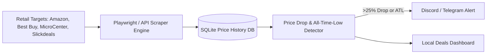
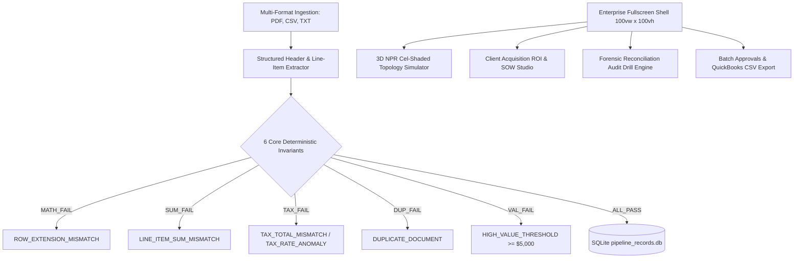
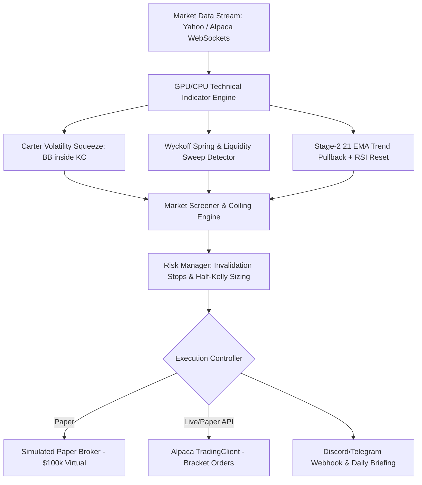
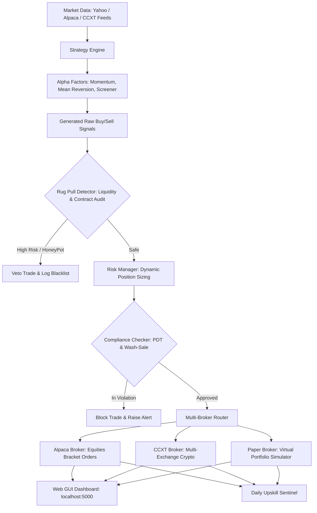

# Data, Finance & Commerce Enhancement Blueprint

## Target Projects
- [stock watch](file:///G:/My%20Drive/Antigravity/Projects/stock%20watch)
- [stock Bot traders](file:///G:/My%20Drive/Antigravity/Projects/stock%20Bot%20traders)
- [Track Home Value](file:///G:/My%20Drive/Antigravity/Projects/Track%20Home%20Value)
- [track most wanted](file:///G:/My%20Drive/Antigravity/Projects/track%20most%20wanted)
- [deal Finder](file:///G:/My%20Drive/Antigravity/Projects/deal%20Finder)
- [using ai agents for profit](file:///G:/My%20Drive/Antigravity/Projects/using%20ai%20agents%20for%20profit)
- [synergize and pay](file:///G:/My%20Drive/Antigravity/Projects/synergize%20and%20pay)

---

## 1. Track Home Value: Real Estate Intelligence & Tax Protest Modeling

### Target Property Baseline
- **Subject Address**: 1766 Crestridge Cir, Princeton, TX 75407 (Princeton Lakeside Estates, Collin County)
- **Key Metrics**: 2,982 sq ft | Built 2023 | No HOA / No MUD / No PID | ~$605,000 consensus valuation (~$202.88/sqft)

### Cutting-Edge Data Ingestion & Analytics
- **Multi-Portal Valuation Consensus**: Aggregate real-time appraisals across multiple sources:
  1. **Collin Central Appraisal District (CAD)**: Certified tax assessment and notice of appraised value.
  2. **Zillow Zestimate API / Scraping**: Automated market estimate and high/low confidence intervals.
  3. **Realtor.com / Quantarium**: Institutional valuation models.
  4. **Redfin Estimate**: Recent closed comparable sales within a 1-mile radius.
- **Automated Property Tax Protest Package Generator (Texas Form 50-132)**:
  - In Texas, county appraisals frequently outpace market reality.
  - Linked to automated Form 50-132 generation in `MCP` (`Tax_Summary_and_2027_Protest_Plan.md` and `Completed_Protest_Form_1766_Crestridge_Cir_Filled.pdf`).
  - **Account Mapping**: Collin CAD Account `# 2883011` | Geographic ID: `R-12836-00D-0190-1`.
  - **Statutory Grounds for Protest**:
    1. *Texas Tax Code § 41.41(a)(1)*: Incorrect appraised (market) value.
    2. *Texas Tax Code § 41.41(a)(2)*: Unequal appraisal compared to a representative sample of comparable properties in the neighborhood.
  - **Automated CMA Comparable Modeling**: Queries Collin CAD parcel records for comparable single-family homes in Princeton Lakeside Estates (2,700–3,200 sq ft, 2022–2024 build).
  - Automatically calculates median comp price/sqft, applies condition/feature adjustments, and synthesizes a presentation-ready protest evidence packet for the Collin County Appraisal Review Board (ARB).
- **Interactive Chart.js Dashboard**: Standalone dark-mode visualization plotting historical valuations, 12-month exponential moving averages, and cumulative equity accrual against mortgage amortization schedules.

---

## 2. Track Most Wanted: Automated Secondary Market & Inventory Sentinel

### Target Item Profile
- **Model**: ANTA KAI Hélà Style Limited "Ocean Eye" (Kyrie Irving signature lifestyle model)
- **Target Size**: **US Men's 12** (EU 46 / UK 11) | Primary SKU: `8125D1802S-1` | Target Price: $\le \$120.00$

### Headless Monitoring & Scraping Pipeline
- **eBay Browse API & Headless Poller**:
  - Connect to eBay's official REST Browse API using OAuth 2.0 Client Credentials to query active Buy It Now listings filtered by category (Men's Athletic Shoes), size (12), and condition (New with box).
- **Secondary Market Scraping with TLS Fingerprinting**:
  - Use `curl_cffi` (impersonating Chrome TLS fingerprints) or Playwright to safely monitor StockX, Kicks Crew, and Shoe Palace without tripping Cloudflare Turnstile barriers.
- **Automated Webhook Alerts**:
  - When an asking price drops below the \$120 alert threshold, fire an instantaneous Discord/Telegram webhook and send a Windows desktop toast notification with a direct purchase link:
```python
# Automated Webhook Notification on Price Drop
import requests

def send_deal_alert(item_name, price, platform, buy_url):
    webhook_url = "https://discord.com/api/webhooks/YOUR_WEBHOOK_URL"
    payload = {
        "embeds": [{
            "title": f"🚨 PRICE DROP ALERT: {item_name}",
            "description": f"Price dropped to **${price:.2f}** on **{platform}**!",
            "url": buy_url,
            "color": 3447003, # Ocean Blue
            "fields": [
                {"name": "Size", "value": "US Men's 12", "inline": True},
                {"name": "Target Alert", "value": "<= $120.00", "inline": True}
            ]
        }]
    }
    requests.post(webhook_url, json=payload)
```

---

## 3. Deal Finder: Multi-Store Price Drop & Arbitrage Engine

### System Architecture (`deal Finder`)
Build out the newly initialized `deal Finder` project into an automated bargain detection engine:



### Technical Pillars
- **Price History Benchmarking**: Store daily pricing across tracked PC hardware, gaming gear, and tech accessories in SQLite (`deals.db`).
- **All-Time-Low (ATL) Calculation**: Benchmark current prices against 90-day rolling minimums to eliminate fake markup/markdown promotions.
- **Fast Search & Coupon Extraction**: Automatically harvest active promotional codes and coupon checkboxes.
- **Checkout & Third-Party JS Supply-Chain Guards (Nov 2026 Threat Intel)**: Because retail and license checkout pipelines remain high-value targets (evidenced by the **Cleverbridge payment card/CVV checkout breach** and **Optimizely Web Experimentation `CVE-2026-132224`** JS injection wave added to CISA KEV on Nov 24, 2026), never automate raw payment credentials inside third-party scraped pages or unpinned script runners; enforce strict Content Security Policy (CSP), Subresource Integrity (SRI), and read-only price-scraping isolation (`deal Finder`, `track most wanted`, `synergize and pay`).

---

## 4. Antigravity Operations Engine: Ingestion, Reconciliation & Monetization

### Project Architecture: Ingestion & Reconciliation Pipeline (`using ai agents for profit`)
The newly production-hardened `using ai agents for profit` codebase serves as an institutional-grade, deterministic back-office document processing, discrepancy detection, and accounting data reconciliation engine (`http://127.0.0.1:8000`).



### Technical Pillars & Frontier Upgrades

#### 1. Deterministic Business Rules Engine (6 Core Invariants)
Bypasses hallucination risks by enforcing strict mathematical and accounting constraints via Python 3.12 and Pydantic v2:
1. **Row Extension Verification (`ROW_EXTENSION_MISMATCH`)**: Validates `Quantity × Unit Price == Line Item Total` within $\$0.01$ floating-point tolerance.
2. **Line-Item Subtotal Verification (`LINE_ITEM_SUM_MISMATCH`)**: Recomputes the algebraic sum of all item rows against the document's stated subtotal.
3. **Tax & Grand Total Math (`TAX_TOTAL_MISMATCH` & `TAX_RATE_ANOMALY`)**: Verifies `Stated Subtotal + Stated Tax == Grand Total`; automatically flags transactions where the effective sales tax rate exceeds $15.0\%$.
4. **Cryptographic Duplicate Sentinel (`DUPLICATE_DOCUMENT`)**: Blocks redundant submissions sharing the same `Vendor Name + Document Number` using SHA-256 state tracking.
5. **High-Value Executive Flag (`HIGH_VALUE_THRESHOLD`)**: Automatically routes any invoice $\ge \$5,000$ to the management approval drawer.

#### 2. 3D Non-Photorealistic (NPR) Pipeline Topology Simulator (`npr-3d-engine.js`)
- Interactive Three.js WebGL 3D architectural scene:
  - Custom cel/toon shader materials with discrete light stepping.
  - Procedural hand-drawn cross-hatching textures eliminating sterile CGI sheen.
  - Inverted-hull ink silhouette mesh outlines for technical blueprint aesthetics.
- Interactive step-by-step packet journey simulator across 4 real-world operational scenarios (Clean Invoice, Tax Anomaly, Duplicate Submission, High-Value Flag) with synchronized 3D camera sweeps and Web Speech API audio narration (`simulation-practice-engine.js`).

#### 3. Client Acquisition ROI & Statement of Work (SOW) Studio
Engineered for closing high-ticket client deals during live screen-share consultations:
- **Live ROI Calculator (`POST /api/roi/calculate`)**: Calculates client annual labor hours lost, cost of error-leakage, and projected net savings.
- **Dynamic SOW Generator (`POST /api/proposal/generate`)**: Generates custom Markdown and printable Statements of Work tailored to client transaction volume ($2,500 setup + $350/mo recurring maintenance retainer).

#### 4. Forensic Reconciliation Audit Drill Engine
- Gamified 6-challenge architectural verification deck featuring smart fuzzy keyword matching, progressive hints, SVG radial mastery progress rings, and synthesized audio coaching.

#### 5. Enterprise Fullscreen Layout ($100\text{vw} \times 100\text{vh}$) & ERP Integrations
- Matte dark console layout with collapsible navigation rail (`280px` $\leftrightarrow$ `64px`), sticky `Ctrl+K` command search, and 3-way dockable architecture inspector.
- One-click batch approval (`POST /api/documents/batch-approve`), QuickBooks-compliant CSV export, and async outbound webhook dispatch (`POST /api/export/webhook`).

### Portfolio Monetization Strategy (`synergize and pay`)
- **Packaged Commercial Solutions**:
  - Package `using ai agents for profit` as a turnkey B2B Back-Office Reconciliation appliance for local accounting and logistics firms.
  - Package `inspect my pc for improvements` + `improve gaming pc performance` into an open-source or commercial "PC Sentinel Optimizer" suite.
  - Package `comptia exam simulator` + `note taker` as a turnkey interactive Security+ study web application.
  - Package `Track Home Value` as a customizable property valuation template for real estate investors and homeowners.

---

## 5. Stock Watch: Quantitative Algorithmic Trading & GPU-Accelerated Backtesting

### Project Core & High-Performance Architecture (`stock watch`)
The newly deployed `stock watch` framework provides an institutional quantitative trading, technical analysis, and automated execution system built with modern Python and Astral `uv`.



### NVIDIA RAPIDS `cuDF` Acceleration (NVIDIA Frontier 2026)
Standard Python libraries (`pandas`, `ta-lib`) compute technical indicators sequentially on CPU cores, creating heavy latency during multi-year parameter sweeps or tick/minute bar backtests across hundreds of symbols.
- **NVIDIA cuDF vs. Polars Performance Trade-Offs (r/algotrading Frontier)**:
  - While `cudf.pandas` delivers 50×–100× acceleration across multi-million bar tick archives, community benchmarks demonstrate that for smaller universe sweeps (<100k bars) or iterative row-by-row loops, GPU memory transfer overhead (Host-to-Device PCIe copying) can exceed computation savings.
  - For localized sub-second CPU screening, leverage Rust-backed Polars (`pl.DataFrame`); for institutional multi-symbol tick-level backtests, mandate `cudf.pandas`.
- **Alpaca Free-Tier IEX Volume Distortion Normalization**:
  - Free Alpaca accounts route market data through Investors Exchange (IEX), representing ~2%–3% of total US equity market volume. While price tracks the national best bid/offer (NBBO), raw volume is heavily skewed.
  - Algorithms calculating volume-weighted indicators (Carter Squeeze volume spikes, Wyckoff Spring $2.0\times$ volume tests) must normalize against rolling IEX z-scores or switch to consolidated SIP data feeds (Alpaca Unlimited / Databento) to avoid false signals.
- **Zero-Code-Change `cudf.pandas`**:
  Execute any backtest or scanning command with GPU acceleration automatically by prefixing the runner with the NVIDIA cuDF pandas accelerator module, or installing it programmatically at runtime:
  ```powershell
  # Accelerate backtesting across thousands of bars using NVIDIA GPU
  uv run python -m cudf.pandas cli.py backtest NVDA --strategy squeeze --period 5y --show-trades
  ```
  ```python
  # Programmatic transparent GPU acceleration
  import cudf.pandas
  cudf.pandas.install()
  import pandas as pd  # All standard pandas operations now execute on the GPU with automatic CPU fallback
  ```
- **High-Throughput Vectorized Indicator Computation**:
  When processing massive tick/minute archives or scanning the entire Russell 2000, compute Bollinger Bands and Keltner Channels directly in GPU memory using `cudf`:
  ```python
  import cudf
  import cupy as cp

  def compute_squeeze_gpu(df: cudf.DataFrame, length: int = 20, bb_mult: float = 2.0, atr_mult: float = 1.5):
      """Compute Carter Squeeze indicators on NVIDIA GPU with microsecond latency."""
      # Simple Moving Average & Standard Deviation
      df['basis'] = df['close'].rolling(window=length).mean()
      df['dev'] = df['close'].rolling(window=length).std()
      df['bb_upper'] = df['basis'] + (df['dev'] * bb_mult)
      df['bb_lower'] = df['basis'] - (df['dev'] * bb_mult)

      # True Range & Keltner Channels
      prev_close = df['close'].shift(1)
      tr1 = df['high'] - df['low']
      tr2 = (df['high'] - prev_close).abs()
      tr3 = (df['low'] - prev_close).abs()
      df['tr'] = cudf.concat([tr1, tr2, tr3], axis=1).max(axis=1)
      df['atr'] = df['tr'].rolling(window=length).mean()
      df['kc_upper'] = df['basis'] + (df['atr'] * atr_mult)
      df['kc_lower'] = df['basis'] - (df['atr'] * atr_mult)

      # Squeeze Condition: Bollinger Bands compress inside Keltner Channels
      df['squeeze_on'] = (df['bb_upper'] < df['kc_upper']) & (df['bb_lower'] > df['kc_lower'])
      df['squeeze_fired'] = (df['bb_upper'] > df['kc_upper']) & df['squeeze_on'].shift(1)
      return df
  ```

### Quantitative Strategies & Invalidation Rules
1. **Carter Volatility Squeeze Breakout (`squeeze`)**:
   - **Squeeze Formation**: Bollinger Bands (20, 2.0) compress completely inside Keltner Channels (20, 1.5 ATR), signaling volatility compression and institutional liquidity absorption.
   - **Trigger / Entry**: Squeeze fires (BB expands outside KC) accompanied by MACD momentum histogram turning positive (long) or negative (short).
   - **Institutional Front-Running & Volume-Weighted Confirmation**: Standard retail breakout entries on BB/KC expansion are frequently exploited by institutional algorithms front-running breakout levels to generate retail liquidity traps. To neutralize this, `stock watch` mandates **Volume-Weighted Delta Absorption**: entry requires positive cumulative volume delta and price holding strictly above the session Volume Weighted Average Price (VWAP).
   - **Invalidation**: Initial stop placed at the opposite Keltner Channel or 1.5× ATR below entry.
2. **Wyckoff Spring Liquidity Reclaim (`spring`)**:
   - **Formation**: Price temporarily penetrates below a defined 20-day support baseline to sweep stop-loss orders.
   - **Trigger**: Intraday or daily candle closes back above the support baseline with relative volume $> 2.0\times$ 20-day SMA volume (evidence of smart-money absorption).
   - **Invalidation**: Absolute low of the spring tail (lowest tick of the sweep).
3. **Stage-2 21 EMA Pullback (`pullback`)**:
   - **Trend Filter**: 50 SMA $> 200$ SMA (Stan Weinstein Stage-2 uptrend).
   - **Trigger**: Pullback touches the rising 21 EMA with 14-period RSI dipping between 40 and 50 before bouncing.
   - **Invalidation**: Close below the 50 SMA.

### Dynamic Position Sizing & Capital Preservation
Eliminate arbitrary lot sizing by enforcing strict dollar-risk to technical invalidation:
- **Share Sizing Formula**:
  $$\text{Shares} = \left\lfloor \frac{\text{Portfolio Value} \times \text{Risk Fraction}}{\text{Entry Price} - \text{Stop Loss}} \right\rfloor$$
- **Half-Kelly Cap**:
  Sizing is dynamically constrained by the Kelly Criterion:
  $$f^* = \frac{p(b+1) - 1}{b}, \quad \text{Applied Fraction} = \frac{f^*}{2}$$
  Where $p$ is the historical win rate and $b$ is the win/loss payoff ratio.
- **ATR Trailing Invalidation**:
  Trailing stops adjust dynamically as price advances, locking in gains at $2\times$ and $3\times$ R-multiples.

### Automated Broker Execution & Ecosystem Integration
- **`alpaca-py` Zero-Slippage Bracket Order Automation**:
  Submit one-cancels-other (OCO) bracket orders using a parent `LimitOrderRequest` instead of a market order to eliminate entry spread slippage, and configure a `limit_price` on `StopLossRequest` to convert downside protection into a stop-limit:
  ```python
  from alpaca.trading.client import TradingClient
  from alpaca.trading.requests import LimitOrderRequest, TakeProfitRequest, StopLossRequest
  from alpaca.trading.enums import OrderSide, OrderClass, TimeInForce

  client = TradingClient(api_key="KEY", secret_key="SECRET", paper=True)

  # Construct zero-slippage bracket limit order
  bracket_limit_order = LimitOrderRequest(
      symbol="TDOC",
      qty=shares,
      side=OrderSide.BUY,
      limit_price=round(entry_limit_price, 2),  # Eliminates entry spread crossing slippage
      time_in_force=TimeInForce.GTC,
      order_class=OrderClass.BRACKET,
      take_profit=TakeProfitRequest(limit_price=round(target_price, 2)),
      stop_loss=StopLossRequest(
          stop_price=round(stop_price, 2),
          limit_price=round(stop_price * 0.995, 2)  # Stop-limit floor preventing gap-down catastrophe
      )
  )
  client.submit_order(bracket_limit_order)
  ```
- **Paper-to-Live Canary Execution, Intrabar Tick-State, Permutation Testing, Regime-Dependent Slippage & Local LLM Filing Sentiment (`r/algotrading` & GitHub Nov 2026 Frontier)**:
  - Paper trading APIs conceal real-world partial fills, spread-crossing latency, and WebSocket disconnect recovery, while 1-minute bar backtests and parameter-swept Opening Range Breakouts (ORBs) frequently suffer Sharpe-ratio collapse against true tick-level fills, live intrabar tick-state vs. historical reload divergence, unintended short skews across independent technical rules, and Ramsey-theory noise overfitting (`r/algotrading` Nov 2026). Mandate **parameter sensitivity curves, permutation testing, upper-tail p-value validation, and strict walk-forward out-of-sample discipline** alongside **sector-specific dip-buying batch limits** to prevent correlated sector drawdown concentration.
  - **Regime-Dependent Slippage, Limit Trade-Through Fills & 1x/2x/4x Cost-Frontier Stress Testing (`r/algotrading` Nov 25)**: Replace static basis-point slippage assumptions with separate modeling for **variable bid-ask spread** vs. **dynamic volatility-scaled market impact** (e.g., ATR-fraction slippage scaling during high-volatility news regimes), enforce strict **"trade-through"** fill assumptions on limit orders (never assume fills merely on price touch), and stress-test winning strategies across **1x / 2x / 4x slippage multipliers** to confirm expectancy survives execution friction. For options strategies, calibrate backtests against historical volatility smiles rather than constant-IV assumptions; pair quantitative technical screens with offline local-LLM SEC filing/earnings sentiment synthesis inspired by GitHub trending **`ZhuLinsen/daily_stock_analysis`** (routed locally via `ollama-mcp` / `Invoke-OllamaTandem.ps1` with zero strategy leakage); before scaling capital, cross-validate winning strategies on tick-granularity data and enforce a **1-share / micro-contract live canary phase** to validate order-lifecycle state machines, heartbeat reconnects, and live slippage deltas.
  - *Note*: Live execution frequently suffers from spread crossing costs, partial fills, and queue delays that synthetic backtests ignore (`r/algotrading` frontier).
  - Implement real-time slippage telemetry in `broker/alpaca_broker.py`:
  ```python
  def log_execution_slippage(signal_price: float, fill_price: float, bid: float, ask: float, order_side: str):
      """Log exact spread-crossing and latency slippage delta for model calibration."""
      spread = ask - bid
      slippage = (fill_price - signal_price) if order_side == "BUY" else (signal_price - fill_price)
      spread_penalty = (fill_price - ((bid + ask) / 2.0))
      print(f"[EXECUTION TELEMETRY] Slippage: ${slippage:+.4f} | Spread Cost: ${spread_penalty:+.4f} (Spread: ${spread:.2f})")
  ```
- **Cross-Portfolio Automation**:
  - **`automate my day` Integration**: Evening scans write top squeeze candidates to `deploy/coiling_watchlist.json`, which `automate my day` reads at 6:00 AM to announce high-probability setups in the morning audio briefing.
  - **`using ai agents for profit` Integration**: P&L and execution history from `bot/portfolio.json` are cryptographically verified with SHA-256 digests and ingested into the double-entry accounting ledger.

---

## 6. Stock Bot Traders: Institutional Multi-Broker Algorithmic Engine, Rug Pull Defense & Compliance Architecture

### Project Core & Ecosystem (`stock Bot traders`)
The newly deployed `stock Bot traders` project delivers an institutional-grade, multi-broker algorithmic trading framework capable of executing cross-asset strategies (US Equities via Alpaca and Crypto via CCXT), auditing regulatory compliance, preventing crypto rug-pull exploits, and delivering a real-time Web GUI dashboard.



### Core Architectural Pillars
1. **Rug Pull & Liquidity Cliff Defense (`core/rug_pull_detector.py`)**:
   - Detects fraudulent tokens, liquidity drains, and honeypots before trade execution:
     - **Liquidity-to-Market-Cap Ratio**: Requires pool liquidity $\ge 15\%$ of fully diluted valuation (FDV).
     - **Volume Cliff Anomaly**: Flags sudden hourly volume drops $> 75\%$ or uncharacteristic volume spikes unaccompanied by order book depth.
     - **Holder Concentration**: Queries top non-creator wallets; flags tokens where top 10 wallets control $> 20\%$ of circulating supply (excluding certified exchange addresses).
     - **Honeypot Tax Differential**: Simulates buy/sell gas execution and enforces that sell taxes do not exceed $10\%$.
2. **Regulatory Compliance Engine (`core/compliance_checker.py`)**:
   - **FINRA Pattern Day Trader (PDT) Protection**:
     - Monitors margin accounts with equity $<\$25,000$. Enforces a hard stop if 3 day trades have occurred within the rolling 5-business-day window to prevent 90-day account restrictions.
   - **IRS Wash-Sale Prevention**:
     - Maintains a 30-day lookback buffer of realized losses. Blocks re-entry into substantially identical securities within the 30-day window unless explicitly overridden for tax-loss harvesting.
   - **API Rate Throttling**:
     - Implements a token-bucket rate limiter adhering strictly to broker tier limits (e.g., 200 requests/minute on Alpaca; exchange-specific rate limits on CCXT).
3. **Multi-Broker Abstraction & Polymorphism (`brokers/`)**:
   - Built on a unified abstract base class (`brokers/base.py`):
     - `submit_order(order: Order) -> OrderResult`
     - `cancel_order(order_id: str) -> bool`
     - `get_positions() -> List[Position]`
     - `get_account_balance() -> AccountBalance`
   - **`alpaca_broker.py`**: Interfaced with `alpaca-py` for equities execution with native OCO bracket orders, trailing stops, and limit-with-offset protection.
   - **`ccxt_broker.py`**: Interfaced with CCXT for unified access to 100+ crypto exchanges (Binance, Coinbase, Kraken, OKX) with dynamic precision rounding and fee calculation.
   - **`paper_broker.py`**: Local deterministic simulator tracking cash balance, unrealized P&L, realized gains, and portfolio drawdowns stored in `.paper_portfolio.json`.
4. **Strategy Suite & Factor Vectorization (`strategies/`)**:
   - **Alpha Factors (`strategies/alpha_factors.py`)**: Vectorized momentum z-scores, rolling volatility ratios, and volume-weighted price trends.
   - **Momentum Crossover (`strategies/momentum_crossover.py`)**: Multi-timeframe EMA crossovers (9/21 EMA and 50/200 SMA golden crosses).
   - **Mean Reversion (`strategies/mean_reversion.py`)**: Bollinger Band statistical deviations with RSI extremes ($<30$ oversold, $>70$ overbought).
   - **Vector Screener (`strategies/vector_screener.py`)**: High-throughput universe filtering across customizable watchlists.
5. **Real-Time Web GUI Control Center (`gui/app.py` & `gui/templates/index.html`)**:
   - Flask-based dark-mode, glassmorphism dashboard running at `http://localhost:5000`.
   - Real-time equity curve plotting, open position cards, win-rate metrics, Sharpe ratio, and manual 1-click **Emergency Kill-Switch** to liquidate all open risk positions instantaneously.
   - **MCP Baseline 2.0 Integration**: Includes `mcp-baseline.js` (v2.0) and `mcp-registry.json` for live MCP telemetry (`Ctrl+M`) and in-app visual element inspection and hot-patching (`Ctrl+E`).
6. **Automated Daily Upskilling Sentinel (`scripts/daily_upskill.py`)**:
   - Continuously monitors algorithmic trading research, broker API deprecations, and market micro-structure updates.
   - Persists structured lessons, parameter backtest sweeps, and algorithmic evolutions into `knowledge_base/daily_upskill_log.md` (verified active through **November 24, 2026 17:00:59** settlement & **08:01:15** upskill run: `CHOP_BEAR` regime across 6 assets, top momentum `AAPL` +12.57% / Sharpe 2.20, `MSFT` +1.26% / Sharpe 0.31, `NTDOY` +0.43% / Sharpe 0.22, `NVDA` -20.74%, `BTC-USD` -23.92% / `ETH-USD` `Safe=True`; Nov 24 post-market settlement **`$100,045.49`** total equity, `$98,275.54` cash, 5.0000 `AAPL` @ `$345.16` -> `$353.99` **`+$44.15` / `+2.56%`** unrealized, 0.00% drawdown, 0.0/100 risk score, 0/3 PDT rolling day trades under FINRA 4210, and 100% SEC 15c3-5 risk gate compliance).

### Cross-Portfolio Synergy
- **With `stock watch`**: Squeeze signals identified by `stock watch/screener/scanner.py` feed directly into `stock Bot traders/strategies/vector_screener.py` for automated trade sizing.
- **With `using ai agents for profit`**: Executed trade tickets and fee receipts are ingested into the double-entry accounting ledger with SHA-256 cryptographic hashes.
- **With `automate my day`**: Daily P&L, Sharpe ratio, and active positions from `stock Bot traders` are reported in the 6:00 AM morning executive audio briefing.
- **With `baselines` & `ollama`**: Real-time strategy risk reviews, SEC filing sentiment checks, and quantitative parameter validation executed 100% offline via the **Ollama Tandem Protocol (`Invoke-OllamaTandem.ps1`, `tandem_bridge.py`)** with zero cloud leakage of proprietary trading logic or financial positions.
- **With `My Custom Gui`, `deploy` & `index folder`**: `stock Bot traders` Web GUI is accessible via quick-launch tiles on the Nexus Hub, cataloged in `index folder` (`05_Productivity_and_Finance`), and health checks are integrated into `deploy/Test-ProjectHealth.ps1`.


