# XR, Media & Gaming Enhancement Blueprint

## Target Projects
- [game studio](file:///G:/My%20Drive/Antigravity/Projects/game%20studio)
- [game mods](file:///G:/My%20Drive/Antigravity/Projects/game%20mods)
- [VR creation apps](file:///G:/My%20Drive/Antigravity/Projects/VR%20creation%20apps)
- [3d images](file:///G:/My%20Drive/Antigravity/Projects/3d%20images)
- [backgrounds for gaming,apps](file:///G:/My%20Drive/Antigravity/Projects/backgrounds%20for%20gaming,apps)
- [youtube shorts edit for gaming](file:///G:/My%20Drive/Antigravity/Projects/youtube%20shorts%20edit%20for%20gaming)
- [game review](file:///G:/My%20Drive/Antigravity/Projects/game%20review)
- [monopoly](file:///G:/My%20Drive/Antigravity/Projects/monopoly)
- [chess](file:///G:/My%20Drive/Antigravity/Projects/chess)
- [desktopscreensaver](file:///G:/My%20Drive/Antigravity/Projects/desktopscreensaver)
- [anime](file:///G:/My%20Drive/Antigravity/Projects/anime)
- [mobile game](file:///G:/My%20Drive/Antigravity/Projects/mobile%20game)
- [Record my Gameplay](file:///G:/My%20Drive/Antigravity/Projects/Record%20my%20Gameplay)
- [My Planetarium](file:///G:/My%20Drive/Antigravity/Projects/My%20Planetarium)
- [Scary Water Slides](file:///G:/My%20Drive/Antigravity/Projects/Scary%20Water%20Slides)
- [chancenvaders](file:///G:/My%20Drive/Antigravity/Projects/chancenvaders)
- [Game Library](file:///G:/My%20Drive/Antigravity/Projects/Game%20Library)
- [youtube channels](file:///G:/My%20Drive/Antigravity/Projects/youtube%20channels)
- [index folder](file:///G:/My%20Drive/Antigravity/Projects/index%20folder)
- [1st grade learning](file:///G:/My%20Drive/Antigravity/Projects/1st%20grade%20learning)
- [Motion](file:///G:/My%20Drive/Antigravity/Projects/Motion)
- [Highschool basketball](file:///G:/My%20Drive/Antigravity/Projects/Highschool%20basketball)
- [emulator and rom hunter](file:///G:/My%20Drive/Antigravity/Projects/emulator%20and%20rom%20hunter)
- [Google Flow- Movies](file:///G:/My%20Drive/Antigravity/Projects/Google%20Flow-%20Movies)
- [Google Flow-music](file:///G:/My%20Drive/Antigravity/Projects/Google%20Flow-music)
- [media player](file:///G:/My%20Drive/Antigravity/Projects/media%20player)

---

## 1. Game Studio: Next-Gen Unreal Engine 5 & ShadowBlade Battle Royale

### Featured Architecture: SHADOW BLADE - CRIMSON ECLIPSE
The C++ Unreal Engine 5 project in `game studio` (`ShadowBlade_Tekken_Naraka_UE5`) fuses three legendary combat paradigms into an Asian feudal Battle Royale:

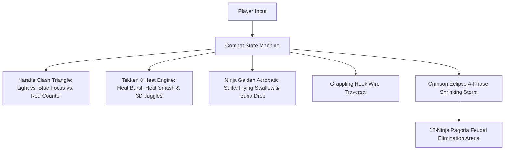

### Combat Mechanics Breakdown
1. **Naraka: Bladepoint Triangle**:
   - **Light Attack**: Fast attacks interruptable by Hyper-Armor.
   - **Blue Focus Attack**: Charged heavy slashes granting Hyper-Armor, breaking light attacks.
   - **Red Parry Counter & Golden Riposte**: Timed parry disarming opponents and unleashing a lethal Golden Riposte.
   - **Grappling Hook**: Instant wire zip toward pagodas, terrain, or enemy ninjas.
2. **Tekken 8 Heat & Juggle System**:
   - **Heat Burst (`[R]`)**: Immediate combat stance activation delivering armor absorption and frame advantage.
   - **Heat Smash**: Cinematographic finisher dealing heavy chip damage even through blocks.
   - **Airborne 3D Juggles & Wall Splats**: Float physics allowing multi-hit combo extensions against pagodas and courtyard walls.
3. **Ninja Gaiden Mobility**:
   - **Flying Swallow**: Mid-air decapitation dash.
   - **Izuna Drop**: 720° inverted corkscrew piledriver from an aerial launch.
   - **Soul Essence Absorption**: On-demand absorption of yellow and blue essence orbs to instantly charge Level 2 Ultimate Techniques (UT).
4. **Multi-Engine Production Implementations**:
   - **Rapid Web Prototype**: Playable in-browser via Three.js at `game studio/shadow_blade_br/index.html` (launch via `Launch_ShadowBlade_BR.bat`).
   - **Production C++ UE5**: Native C++ source modules in `ShadowBlade_Tekken_Naraka_UE5/Source/` configured with `DefaultEngine.ini` and `DefaultGame.ini` (launch via `Launch_ShadowBlade_UE5.bat`).
   - **Godot 4 3D Combat Arena (`ShatteredPagoda_Godot`)**: Full 3D samurai action experience featuring character models, arena geometry, forward+ clustered lighting, and discrete launchers (`Launch_Kagura_Godot3D.bat`, `Play_Kagura_Godot3D.vbs`).
   - **Chess Clash Godot (`ChessClash_Godot`)**: Godot 4 tactical chess battler with custom scripts and scenes (`Launch_ChessClash_Godot.bat`).
   - **Aether Ascent Spire (`aether_ascent_spire`)**: Roguelike deckbuilder build (`Launch_AetherAscent_Spire.bat`).
   - **3D WebGL Studio & Game Engine (`index.html`)**: Interactive 3D studio powered by `game-studio-scene.js` and `game-studio-engine.js` with real-time model previews and camera choreography.
   - **Turbo Type Rally 3D in Godot 4.3/4.4 (`TurboTypeRally_Godot`)**:
     - Fast-paced 3D arcade rally racing game driven by live typing speed and phonics accuracy (`scenes/Main.tscn`, `scripts/Main.gd`, `Launch_TurboTypeRally_Godot.bat`).
     - Leverages Godot 4.4 features: **Typed Dictionaries** in GDScript enforcing strict key-value typing for word lists and player statistics, **3D Physics Interpolation** eliminating vehicle render jitter on high-refresh displays, and native **Jolt Physics** integration delivering stable vehicle suspension, tire grip curves, and drift physics.
     - Embedded running game window and interactive in-game editing support for live parameter tweaking.
     - Procedural vehicle boost audio, tire screech sound synthesis, and celebratory audio triggers upon crossing speed thresholds.
   - **Paper Mario x Clair Obscur: Expedition 33 - 100 Trial Pipe RPG Prototype (`Paper_Mario_Expedition33_Pipe100.html`)**:
     - Groundbreaking hybrid combat prototype fusing Paper Mario's 100-floor Pit of Trials turn-based progression with *Clair Obscur: Expedition 33*'s reactive real-time QTE action commands.
     - **Active Defense & Rhythm Counters**: Precision-timed jump dodges (`[Space]`), directional deflect parries (`[A]`/`[D]`), and powerful counter-attacks with dynamic damage scaling based on millisecond execution windows.
     - **Papercraft Kinesthetics**: 2.5D paper cutout battle stage, springy accordion bounce animations, screen shakes, hit-stop freezes, and floating damage counters.
   - **3D ROM Studio & Disassembly Inspector (`rom_studio_3d.html`, `rom_studio_engine.js`, `rom_studio_scene.js`)**:
     - Full-screen 3D cartridge inspection and interactive arcade board viewer.
     - Real-time ROM disassembly view, header inspection, and live patch injector supporting BPS/UPS and IPS delta patches.
   - **Tactile Audio Feedback & Soundbyte Suite**:
     - Curated audio soundbytes in `assets/soundbytes/` (including iconic Michael Jackson 'Hee-Hee' audio triggers) delivering punchy, visceral sound design for counter attacks, parries, and floor clears.
   - **ChessTube Studio (`chesstube_studio/` — Automated Chess.com-to-YouTube Pipeline)**:
     - Production Python CLI (`cli.py`, `chesscom_api.py`, `renderer.py`, `music_rotator.py`, `obs_recorder.py`, `youtube_uploader.py`, `Invoke-ChessAutoUpload.ps1`, `Start-ChessUploadWizard.ps1`, `chess_upload_catalog.json`, verified active through **`2026-11-25 00:38`** with newly rendered `Snoweyes21_vs_chammmm00_Resignation`, `chammmm00_vs_Abatharizz9_Resignation`, `memo_insano1_vs_chammmm00_Resignation`, `LeeRuns_vs_chammmm00_Timeout`, and `Drugbad_vs_chammmm00_Timeout` packages).
     - Pulls recent Chess.com wins (`bullet`/`blitz`/`rapid`/`daily`), renders 30fps **16:9 (`1920x1080`)** + **9:16 Shorts (`1080x1920`)** with 4x-supersampled pieces, material advantage bar, live clocks, synthesized move/capture/check/checkmate SFX, pairs authentic *Yu Yu Hakusho* / *Rurouni Kenshin* tactical quotes and rotating nostalgic music tracks, generates `1280x720` winning-arrow thumbnails, and schedules YouTube Data API v3 uploads with pinned comments.
- **Automated Studio Quality Gate & Procedural Ink Studio Splats (`Test-StudioQualityGate.ps1`, `tools/Invoke-InkStudioSplatGenerator.ps1`)**: Strict pre-flight script auditing file integrity, WebGL rendering readiness, Meta Quest 3 / Xbox controller haptics, and engine launcher parity across UE5.8, Unity 6, and Godot 4, plus newly added **`@shapeshift-labs/ink-studio`** CLI integration (`agent-tools/ink-studio/repo/cli/ink-studio.js`) for zero-dependency SDF sculpting and pixel-art Gaussian splat scene generation (`game studio` & `3d images`), aligned with GitHub trending **`threejs-skills`** / **`zhuyansen/awesome-3d-skills`**.
- **Antigravity Engine Forge IDE (`engine_forge.html`, `engine_forge.js`, `Start-EngineForge.ps1`, `Launch_Engine_Forge.bat`)**:
  - Full-screen ($100\text{vw} \times 100\text{vh}$) AI Game Studio IDE unifying a Three.js PBR Viewport, Blueprint Node Graph (`combat` and procedural presets), Unreal Engine 5.8 MCP Bridge, GitHub AI Studio Multi-Agent Hierarchy (`Creative Director`, `Technical Director`, `Unreal 5.8 Specialist`, `Unity 6 (6000.4) Specialist`, `Godot 4.7 Specialist`, `AI & Combat Programmer`), and Udemy Game Dev Academy progress tracker.
  - *Immediate Frontier Upgrade*: Migrate `engine_forge.html` from legacy `three.min.js` (`r128` CDN fallback) to **Three.js r187** (`WebGPURenderer`, TSL, cube-target `PMREMGenerator`, EON rough diffuse BRDF) and wire its UE5.8 panel directly to Unreal Engine 5.8's official native **Unreal MCP Server**.
- **UE 5.8, Async Agent Harnesses, Godot 4.7 & `r/gamedev` Engine Boundaries**:
  - **Unreal Engine 5.8** (final planned major UE5 release before UE6): Adopt volumetric **Mesh Terrain** (true 3D overhangs, caves, cliffs with stackable non-destructive modifiers), **Lumen Probe Occlusion** (up to 2x faster GI for locked 60 FPS), **Fast Geometry Streaming**, the native **Unreal MCP Server** inside Unreal Editor, and async-first background build/tool execution (`unreal-agent-benchmark` pattern) so AI coding loops never stall waiting on C++ UBT/shader compilation.
  - **Godot 4.7 & `Godot-MCP`**: Leverage native **`AreaLight3D`** rectangular area lights with soft shadows, **True HDR output** on Forward+ and Mobile across Windows/macOS/Linux Wayland, experimental **Vulkan hardware ray tracing plumbing** (`raygen`/`miss`/`closest hit`, BLAS/TLAS via `RenderingDevice`), and community **`Godot-MCP`** scene/node orchestration alongside UE 5.8's native Unreal MCP Server. Per `r/gamedev`/`r/godot` Nov 2026 consensus, keep Three.js WebGPU focused on rapid browser demos/studios while routing full multi-system games to Godot 4.7 (agile indie iteration, zero royalties) or UE 5.8 (heavy physics/replication).
- **Master Game Studio Launcher (`GameStudio_Hub.ps1`)**: Unified PowerShell launcher orchestrating all sub-projects and PIE sessions.

---

## 2. Modern Game Modding & IoStore Asset Extraction (`game mods` & `REA`)

### Unreal Engine 5 IoStore Architecture (`.utoc` & `.ucas`)
Modern UE5 games (Tekken 8, Black Myth: Wukong, etc.) utilize the **IoStore (Zen loader)** format, splitting metadata (`.utoc`) from raw chunk data (`.ucas`).
- **FModel (`4sval/FModel`)**: Native parsing via `CUE4Parse` to browse, inspect, and export meshes, textures, animations, and audio.
- **`retoc` & `UnrealReZen`**: Command-line utilities for packing, unpacking, and converting Zen containers for mod creation.
- **Pak Mod Placement**: Inject cosmetic modifications into `Polaris/Content/Paks/~mods/`.
- **Integrity Validation**: Automated SHA-1 and CRC32 checksum validation in `rom_tools.py` ensuring patches do not corrupt clean ROMs or game assets.
- **Xbox PC GUI Dashboard & Grand ROM Palace 3D Studio (`xbox_pc_gui.html`, `tools/xbox_gui_server.py`, `tools/build_grand_rom_catalog.py`, `rom_studio_3d.html`, `rom_studio_engine.js`, `rom_studio_dashboard.js`, `rom_studio_audio.js`)**: Interactive local dashboard (`localhost:8888`) and Art Deco 3D cinema ROM studio managing a **759-game deduplicated retail ROM catalog across 18 consoles** (Dolphin `dolphin-2512-x64`, `ares v148`, PCSX2-Qt, RPCS3, DuckStation, ShadPS4, PPSSPP, Flycast, Mesen, NO$GBA, Ryujinx/Suyu) with 7-Zip auto-extraction and WinSta0 direct launch. Upgraded with **4 vehicle traversal modes** (`foot`, **`kart` Hyper-Veloce X1**, **`hoverboard` Blue Star Aero-Blade**, `drone`), **3-tier Mini-Turbo drift boost**, **Freeplay Basement & Neon Raceway lap/checkpoint portal**, **Web Gamepad API Xbox controller** support, **`rom_studio_dashboard.js`** Art Deco Library Overlay, and on **`2026-11-24 23:54`** (`?v=20261124z29`) with **`rom_studio_audio.js`** (zero-synth authentic per-room console soundbank via `assets/sounds/soundbank.json` + `/api/sounds`), `starlight_canyon_backdrop.jpg`, Flow Music BGMs (`rom02-velvet-palace-longform`, `rom03-console-vault-bgm`), and **5 standalone HTML5 arcade cabinets + web emulator** (`chess_arcade.html`, `connect4_arcade.html`, `air_hockey_arcade.html`, `pinball_arcade.html`, `space_invaders_frenzy.html`, `web_emulator.html`).
- **NVIDIA MotionBricks Smart-Primitives Kinematics (`rom_studio_motion.js` & `Motion` Project)**: Bridges NVIDIA Research's SIGGRAPH 2026 **MotionBricks** (`NVlabs/motionbricks`, staged in `Motion/https   hugging.txt` -> `townbox/motionbricks-playground`) generative character motion concepts (composable Smart Primitives, context-to-target damped pose blending, JSON trajectory playback) onto Three.js articulated Chao and Humanoid rigs inside Grand ROM Palace. Paired with newly initialized **`emulator and rom hunter`** for automated ROM/emulator curation, and tracking the Nov 24 GitHub Xbox Series X|S static recompilation & compatibility wave (**`Marvisak/VIctory`** 9.3k★, **`ivall/xcl`** 6.9k★ `kernelx.dll`/`d3d12_xs.dll`, **`4lwayz/portwatch-vi`**, **`ItsNotRexed/Leonida`**, **`R0Y00/Xbox2Windows` `gpu-check-v0.1.0`**, **`omonkeyz/xbox-emulator`**).
- **3D ROM Studio Launcher (`Start-3DROMStudio.ps1`, `Launch_3D_ROM_Studio.bat`)**: Dedicated PowerShell and batch launchers providing one-click startup for 3D cartridge inspection and live ROM modification directly inside `game mods` and `game studio`.

---

## 3. WebXR, Quest 3 & Three.js WebGPU / TSL

### Three.js WebGPURenderer & TSL (Three Shading Language 2026 / r184–r185 Standards)
Migrate `word-defender-xr.html`, 3D studio environments, and procedural WebGL scenes to **Three.js `WebGPURenderer`**, **TSL** (`three/tsl`), and the node-based **`RenderPipeline`**:
- **TSL Node-Based Shading**: Replaces error-prone raw GLSL strings with type-safe JavaScript node functions (`uv()`, `texture()`, `mix()`, `sin()`, `clipSpace`).
- **Cross-API Portability & Dynamic Transpilation**: TSL compiles automatically down to **WGSL** on modern WebGPU contexts, while compiling backward to **GLSL** on standard WebGL fallback contexts without rewriting shaders.
- **Three.js r184 Non-Blocking `compileAsync()`**: Asynchronous pipeline compilation on `WebGPURenderer` prevents main-thread rendering freezes when swapping complex PBR materials during gameplay.
- **Three.js r184 Compatibility & Upscaling Nodes**: Introduced native WebGL compatibility layers allowing TSL node materials to execute directly on `WebGLRenderer`, alongside built-in FSR 1 (FidelityFX Super Resolution) and TAAU (Temporal Anti-Aliasing Upsampling) post-processing nodes.
- **Three.js r185/r186 Full WebGPU & WebXR Multiview Consolidation**:
  - Delivers full WebGPU feature parity and brings native WebXR / VR immersive rendering directly into `WebGPURenderer`, eliminating legacy WebGL dependencies for Meta Quest 3 bare-hand tracking.
  - **Single-Pass Multiview Stereo Rendering (`multiview: true`)**: Activates GPU hardware-level multiview rendering across stereoscopic eye views. Drastically slashes CPU draw-call submission overhead by ~50% compared to traditional dual-pass rendering, maintaining locked 90/120 FPS in dense 3D environments.
  - **Native XR Layers & Transmission Corrections**: Implements hardware MSAA for native WebXR projection layers and handles refraction/transmission buffer corrections during stereo VR rendering, eliminating visual artifacting in glass/water shaders.
- **Three.js r186 Native Gaussian Splatting (`SPZLoader` & `GaussianSplatMesh`)**:
  - Native WebGPU Gaussian Splatting engine integrated directly into core Three.js with minimal overhead (~7KB).
  - Utilizes `CountingSort` TSL GPU compute pass (prefix sums, histogram, scatter via atomic operations) running on WebGPU without CPU bottlenecking.
  - Supports `.spz`, `.ksplat`, `.ply`, and `KHR_gaussian_splatting` glTF extensions for photorealistic 3D captures across `3d images`, `VR creation apps`, and `My Planetarium`.
  - Features `workgroupArray` compute nodes for high-throughput memory sharing within shader workgroups; streamlined TSL node API with deprecated `viewportResolution` and `rangeFog` removed.
- **Three.js r187 (October 30, 2026; ~80% of commits focused on `WebGPURenderer` & TSL) PBR & WebGPU Scheduling Breakthroughs**:
  - **PMREM Cube Render Target Overhaul (`PR #34585`)**: Drops the legacy `CubeUV` atlas in favor of native cube render targets for `PMREMGenerator`, reducing image-based lighting (IBL) color discrepancies by 37%–82% versus Blender Cycles and restoring clean roughness ramps.
  - **EON Rough Diffuse BRDF (`PR #34379`)**: Adds the **Energy-preserving Oren-Nayar (EON)** rough diffuse BRDF model to `MeshPhysicalMaterial`, correcting energy loss on matte/stone/fabric surfaces.
  - **Cooperative `compileAsync()` Scheduling (`PR #34816`) & TSL Type Promotion**: Caps concurrent shader compilation at **16 pipelines in flight** and cooperatively yields back to the main thread after **~8 ms slices**, slashing warm-up load times for dense TSL/node scenes without frame-drop jank; adds automatic type promotion rules to TSL math operations; completes removal of `r177`-deprecated `CubeUVReflectionMapping`; and updates `WebGLRenderer.setViewport()` / `setScissor()` behaviors on bound render targets.
  - **Chrome 157 WebGPU Subgroup Controls, Android WebGPU & `three-live` AI-to-glTF**: Chrome 157 (Nov 2026) adds WebGPU subgroup size controls for compute shaders (`GaussianSplatMesh` `CountingSort`) and rolls out WebGPU on Android 12+ Qualcomm/ARM GPUs, while Google-backed `three-live` compilers serialize AI-generated 3D scripts cleanly into binary glTF assets.
- **Meta Immersive Web SDK (`@iwsdk/core` 0.3.1), HavokPhysics WASM & `WorldTear` Passthrough AR (`VR creation apps/github-repos/WorldTear`)**:
  - Deployed **WorldTear** (Invisibility Cape on Quest 3) using `@iwsdk/core` 0.3.1, `super-three@0.181.0`, **HavokPhysics WASM**, `vite-plugin-mkcert` HTTPS, and W3C **WebXR Raw Camera Access (`'camera-access'`)** via `XRWebGLBinding.getCameraImage(view.camera)` with zero-allocation per-frame stereo texture binding (`uIsRightEye` / `uCameraLeft` / `uCameraRight`) and ECS Verlet cloth simulation poked by `world.input.xrOrigin.indexTipSpaces.{left,right}`.
  - *Immediate Upgrade Path*: Upgrade `WorldTear`'s `super-three@0.181.0` wrapper toward Three.js r187 WebGPU multiview once IWSDK supports `WebGPURenderer`, and preserve its `'camera-access'` raw-frame binding (distinct from IWSDK's `navigator.mediaDevices`-based `CameraSource` component).
- **Node-Based `RenderPipeline`**: Unifies multi-pass rendering, bloom, and depth-of-field under a composable node pipeline without legacy `EffectComposer` pass chains.
- **High-Pacing `Timer` Utility**: Deprecates legacy `THREE.Clock` in favor of the modern `Timer` module (`three/addons/misc/Timer.js`) for deterministic delta-time calculations.
- **Zero-Allocation Memory Optimization**: Eliminates per-frame internal object allocations, avoiding garbage collection spikes and micro-stutters during intensive 60/120 FPS XR scenes.
- **Quest 3 Bare-Hand Tracking with WebGPU Multiview**:
```javascript
import * as THREE from 'three/webgpu';
import { pass, bloom } from 'three/tsl';
import { XRHandModelFactory } from 'three/addons/webxr/XRHandModelFactory.js';

// 1. Initialize WebGPURenderer with hardware multiview and automatic WebGL 2 fallback
const renderer = new THREE.WebGPURenderer({ 
    antialias: true,
    multiview: true // Enables single-pass stereoscopic WebXR rendering
});
await renderer.init(); // Required in modern Three.js WebGPU architecture
renderer.xr.enabled = true;

const scene = new THREE.Scene();
const camera = new THREE.PerspectiveCamera(75, window.innerWidth / window.innerHeight, 0.1, 1000);

// 2. Configure Quest 3 Bare-Hand Tracking
const hand1 = renderer.xr.getHand(0);
const handModelFactory = new XRHandModelFactory();
hand1.add(handModelFactory.createHandModel(hand1, 'mesh'));
scene.add(hand1);

// 3. Setup RenderPipeline (Node-based post-processing with TSL & MRT)
const renderPipeline = new THREE.RenderPipeline(renderer);
const scenePass = pass(scene, camera);
const bloomPass = bloom(scenePass, { strength: 0.6, radius: 0.3 });
renderPipeline.outputNode = bloomPass;

// 4. Animation & Pinch Detection Loop
renderer.setAnimationLoop((t, frame) => {
    if (frame && hand1.joints) {
        const indexTip = hand1.joints['index-finger-tip'];
        const thumbTip = hand1.joints['thumb-tip'];
        if (indexTip && thumbTip) {
            const distance = indexTip.position.distanceTo(thumbTip.position);
            if (distance < 0.02) {
                triggerLaserBlast(indexTip.position);
            }
        }
    }
    renderPipeline.render();
});
```
- **Node-Based Post-Processing & RenderPipeline**:
  - Legacy `EffectComposer` is deprecated in `WebGPURenderer`. Three.js utilizes the node-based **`RenderPipeline`** (officially renamed from `PostProcessing` in Three.js `r183`) and TSL **`pass()`** compositions.
  - Automatically merges passes, manages history buffers, and leverages Multiple Render Targets (MRT) directly on the GPU to minimize draw calls and frame latency.
- **Spatial Audio**: Implement Web Audio API `PannerNode` with HRTF (Head-Related Transfer Function) spatialization so enemy audio cues shift realistically with head rotation.

---

## 4. YouTube Shorts Edit & Video Review Automation

### Automated Viral Clip Architecture (`youtube shorts edit for gaming` & `game review`)
Convert raw horizontal gameplay recordings (MP4/MKV) into viral vertical YouTube Shorts:

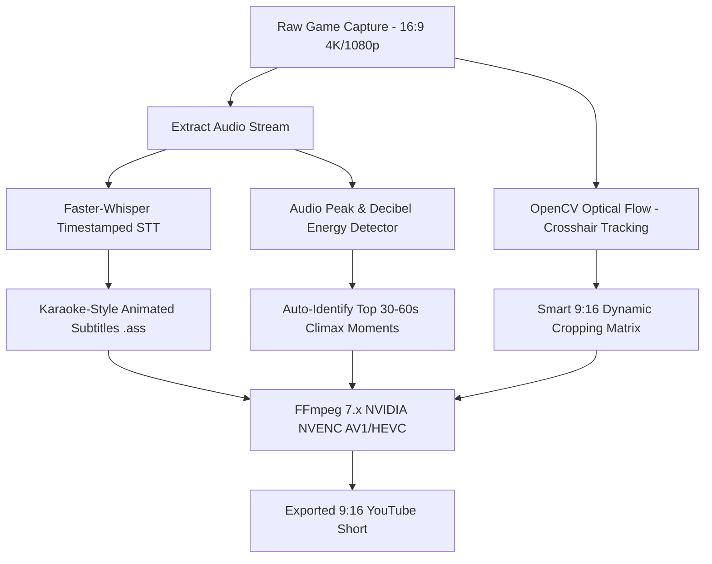

### High-Throughput FFmpeg NVENC & Integrated Local Auto-Clippers
- **Deployed NeonClipping Pipeline (`youtube shorts edit for gaming/Invoke-NeonClippingPipeline.ps1`), `Get-RemasterAudioTracks.ps1` & `PeakCut`**: Bridging victory clips from `Record my Gameplay/Recordings` directly into the audited local **`iamajmeena/neonclipping`** engine (`v1.0.0` staged in `agent-tools/neonclipping/repo/`, `v1.1.0` latest with audio-spike scoring & facecam layout detection) on `http://127.0.0.1:8770`, alongside **`haziqahmedqasmi/PeakCut`** and `smart_cutter.py` for automated climax detection and 9:16 vertical clip extraction. On **`2026-11-24 16:41`**, **`Get-RemasterAudioTracks.ps1`** added the **`Flow_Music`** category indexing `Google Flow-music/exports/youtube_remaster` and `vault/` directly into `Invoke-VideoAudioRemaster.ps1`.
Execute sub-minute renders using NVIDIA GPU acceleration:
```bash
# High-Efficiency AV1 NVENC Vertical Render with Burned-In Subtitles
ffmpeg -y -hwaccel cuda -hwaccel_output_format cuda -i input_clip.mp4 \
    -vf "crop=ih*9/16:ih:(iw-ih*9/16)/2:0,subtitles=karaoke.ass" \
    -c:v av1_nvenc -preset p7 -cq 22 -c:a aac -b:a 192k \
    output_short_9x16.mp4
```

### Video Game Review Scripts (`game review`)
- Maintain structured, timestamped narration templates (e.g. *A Plague Tale: Resonance Review*).
- Align B-roll clip markers with chapter timestamps for automated editing assembly.

---

## 5. Backgrounds, Chess & Classics

- **5-Layer Parallax Engine (`backgrounds for gaming,apps`)**: Maintain clean visual depth (Sky [0.0x], Distant Silhouette [0.15x], Midground [0.45x], Platforms [1.0x], Foreground [1.35x]) with automated seam feathering.
- **Stockfish 16+ WebAssembly (`chess`)**: Execute Stockfish 16 via WebAssembly in Web Workers for instant eval bar rendering and blunder coaching.
- **Monte Carlo Tree Search (`monopoly`)**: Dynamic MCTS decision engine for adaptive AI property trading.
- **Anime Library Pipeline (`anime`)**: AniList GraphQL API scraping and Plex/Kodi compliant `.nfo` metadata generation.

---

## 6. Mobile Gaming Architecture: Aether Ascent (`mobile game`)

### Project Core & Dual-Mode Combat Design
The **`mobile game`** project (**Aether Ascent**) is a production **React Native `0.88.1`**, **Expo `~58.0.23`**, **React `19.3.0`**, and **TypeScript `~6.0.3`** mobile application blending strategic 3-row battlefield warfare with deep roguelike deckbuilding progression.

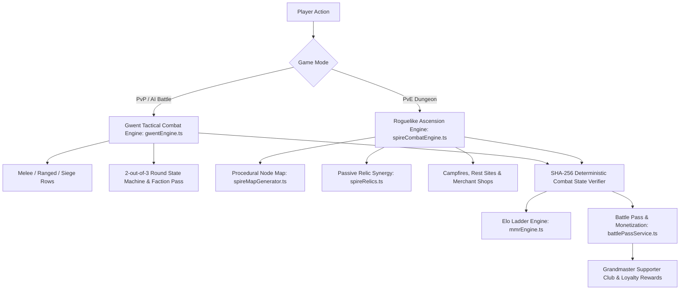

### High-Performance Mobile Game Loop (React Native New Architecture & Nitro Modules)
1. **React Native New Architecture (Fabric Renderer — `r/reactnative` Nov 2026 Universal Default)**:
   - Synchronous layout and UI rendering alongside Expo prebuilds/dev clients have become the universal default, eliminating bridge latency during high-frequency touch interactions (card drag-and-drop, targeting reticles, and holographic foil tilting).
2. **Margelo Nitro Modules (`margelo/nitro`, package `react-native-nitro-modules`), Callstack Partnership & Nitrogen Code Generator**:
   - For complex turn calculations (AI minimax evaluation, card effect cascades, and cryptographic hashing), Nitro Modules introduce **Hybrid Objects** with direct C++ JSI bindings.
   - Swift Nitro modules compile directly to C++ (leveraging Swift 5.9+ direct C++ interop), eliminating Objective-C message-passing overhead entirely. Android utilizes `fbjni` for high-speed cross-language communication with Kotlin/Java.
   - **Nitrogen Code Generator**: Parses TypeScript interface specs (`specs/CombatEngine.nitro.ts`) and auto-generates statically compiled C++ templates, Swift protocols, and Kotlin bindings, eliminating runtime reflection and dynamic type conversions.
   - **Throughput Benchmark**: Synchronous method execution completes in **~7 ms per 100,000 calls** (compared to ~115 ms for TurboModules and ~434 ms for legacy bridges), yielding a **15× performance increase**.
   - Zero-copy memory passing preserves 60/120 FPS frame pacing even during high-frequency particle simulations or rapid card animations:
```cpp
// Native C++ Hybrid Object in Nitrogen
#include <NitroModules/HybridObject.hpp>
#include <openssl/sha.h>

class HybridCombatEngine: public HybridObject {
public:
    explicit HybridCombatEngine(): HybridObject("CombatEngine") {}
    std::string computeDeterministicStateHash(const std::string& stateJson) {
        unsigned char hash[SHA256_DIGEST_LENGTH];
        SHA256((const unsigned char*)stateJson.c_str(), stateJson.length(), hash);
        // Return hexadecimal representation directly to JS
        char hex[SHA256_DIGEST_LENGTH * 2 + 1];
        for (int i = 0; i < SHA256_DIGEST_LENGTH; i++) sprintf(hex + (i * 2), "%02x", hash[i]);
        return std::string(hex);
    }
};
```
3. **Deterministic Turn Hashing & Anti-Cheat**:
   - In competitive multiplayer and ranked ladder progression, prevent client-side state manipulation by computing a cryptographic state digest at every turn boundary:
   ```typescript
   import { Crypto } from 'expo-crypto';

   export async function generateTurnDigest(
     matchId: string, 
     turnIndex: number, 
     playerHand: string[], 
     boardState: any
   ): Promise<string> {
     const payload = `${matchId}:${turnIndex}:${playerHand.sort().join(',')}:${JSON.stringify(boardState)}`;
     return await Crypto.digestStringAsync(Crypto.CryptoDigestAlgorithm.SHA256, payload);
   }
   ```
   - Before submitting match results to `mmrEngine.ts`, the sequence of turn digests is verified against deterministic game rules, ensuring complete ladder integrity.

### Anti-Slop Craftsmanship, Audio & Retention Architecture
- **Anti-Slop Clean Monetization (Zero Shovelware Ad-Traps)**:
  - In strict compliance with the project's [ai slop](file:///G:/My%20Drive/Antigravity/Projects/ai%20slop) standards, intrusive banner ads and forced video interstitial loops are completely eliminated.
  - Progression is driven exclusively by skill, strategic deck mastery, and cosmetics (foil card shaders, custom table felts, and victory animations).
- **Tiered Battle Pass (`battlePassService.ts`)**: 50-tier seasonal progression offering transparent cosmetic rewards, tracked in persistent offline storage (`storageService.ts`).
- **Tactile & Acoustic Polish (Kinesthetics)**:
  - Card movement features spring physics with dynamic velocity damping.
  - Employs `expo-haptics` for tactile impact sensations on card drops, attacks, and round victories.
  - Reactive sound buffers in `soundService.ts` ensure zero audio clipping or latency on multi-hit combos.

---

## 7. Smart Boss Fight Recorder & Computer Vision Capture Engine (`Record my Gameplay`)

### Project Core & Problem Statement
High-end action games (*Phantom Blade Zero*, *Black Myth: Wukong*, *Elden Ring*, *Sekiro*) feature grueling boss battles where players may attempt an encounter dozens of times before achieving a flawless victory. Manually managing recordings produces tens of gigabytes of failed attempts that clutter NVMe storage, or requires players to break immersion to alt-tab and delete files.

The **`Record my Gameplay`** system solves this by introducing a hands-free, autonomous recording controller for **OBS Studio (v30 / v31)** using **obs-websocket v5.x** and **OpenCV computer vision template matching**.

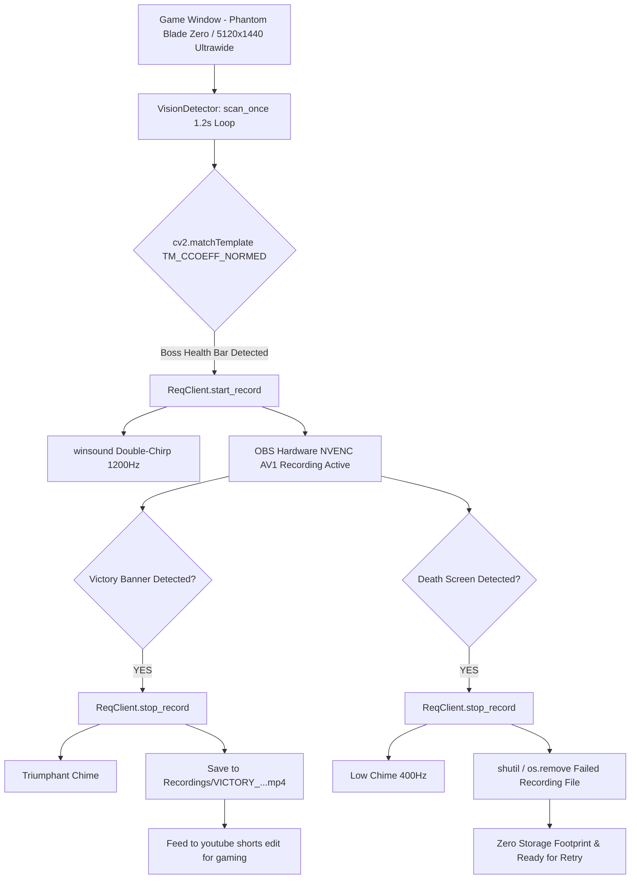

### Technical Pillars & Frontier Stack

1. **OBS WebSocket v5 Integration (`obsws-python`)**:
   - Communicates with OBS Studio over WebSocket protocol v5 (`localhost:4455`).
   - Uses `obsws_python.ReqClient` for deterministic recording triggers:
     - `client.start_record()`: Initiates recording session and captures start timestamp.
     - `client.stop_record()`: Flushes active buffer to disk and returns the absolute destination path (`res.output_path`).
   - Supports fallback manual hotkey bindings via `keyboard` library (`F7` fight start, `F8` victory, `F9` death/discard) with non-blocking threaded event hooks.

2. **Hardware-Accelerated NVENC AV1 Video Encoding**:
   - Configured for high-bandwidth ultrawide displays (5120x1440 32:9 or 2560x1440 16:9) at 60/120 FPS on RTX 4080.
   - Employs NVIDIA NVENC AV1 (utilizing `jim_av1_nvenc` in OBS 30.x or the modernized texture-based `obs_nvenc_av1_tex` / `av1_nvenc` in OBS Studio 31+) with CQP or CBR rate control (`p5`/`p7` presets, `hq` tuning, two-pass quarter-resolution `qres`), producing crystal-clear gameplay captures at 30% lower bitrates than H.264/HEVC.

3. **Computer Vision Template Matching (`vision_monitor.py` & `calibrate.py`)**:
   - **Full-Screen / Multi-Monitor Capture**: Utilizes `PIL.ImageGrab.grab(all_screens=True)` converted to NumPy BGR buffers to handle ultrawide and multi-display setups seamlessly.
   - **Normalized Cross-Correlation**: Evaluates matches using `cv2.matchTemplate(frame, template, cv2.TM_CCOEFF_NORMED)` against saved calibration templates (`boss_healthbar.png`, `victory_screen.png`, `death_screen.png`).
   - **Dynamic Downscaling Optimization**: Downscales high-resolution frames before correlation scans, dropping per-frame detection latency below **45 ms** to ensure zero frame-drops in the active game.
   - **Calibration Harness (`calibrate.py`)**: 1-click interactive CLI capturing ground-truth game states with a 4-second delay for player positioning.

4. **Automated Storage Management & Failure Purging**:
   - When defeat is detected or `F9` is pressed, `recorder.py` instantly stops the recording, polls the file handle until released by OBS, and invokes `Path(file_path).unlink()`:
   ```python
   def discard_attempt(self):
       """Stops OBS recording and purges failed attempt immediately from disk."""
       if not self.is_recording:
           return
       res = self.client.stop_record()
       self.is_recording = False
       self.play_sound("loss")
       
       # Retrieve recorded file path and purge
       file_path = getattr(res, "output_path", None) or self.last_recording_path
       if file_path and Path(file_path).exists():
           time.sleep(0.5)  # Allow OBS encoder handle closure
           try:
               Path(file_path).unlink()
               print(f"[PURGED] Deleted failed attempt: {file_path}")
           except Exception as e:
               print(f"[WARNING] Could not delete failed attempt: {e}")
   ```

5. **Cross-Project Synergy with YouTube Shorts Pipeline**:
   - Saved victory clips in `Recordings/VICTORY_*.mp4` are tagged with game name, date, time, and battle duration (e.g. `VICTORY_Phantom_Blade_Zero_BossFight_20261030_231500_3m42s.mp4`).
   - Directly consumed by [youtube shorts edit for gaming](file:///G:/My%20Drive/Antigravity/Projects/youtube%20shorts%20edit%20for%20gaming) via optical-flow auto-framing and Faster-Whisper karaoke subtitle generation, converting epic boss finishes into vertical content in under 60 seconds.

---

## 8. Antigravity Deep Space Planetary Observatory & Sector Atlas 2026 (`My Planetarium`)

### Astronomical Rigor & Interactive Exoplanetary Architecture (`G:\My Drive\Antigravity\Projects\My Planetarium`)
The **`My Planetarium`** project is a production-grade WebGL 3D interactive planetary observatory and project constellation orrery charting 64 discovered planetary bodies, orbital super-stations, and hyperspace relays across the Antigravity workspace. Framed with astronomical rigor and exoplanetary science nomenclature, it delivers complete physical metrics, atmospheric compositions, geological surveys, and native bidirectional prompting to Google Antigravity.

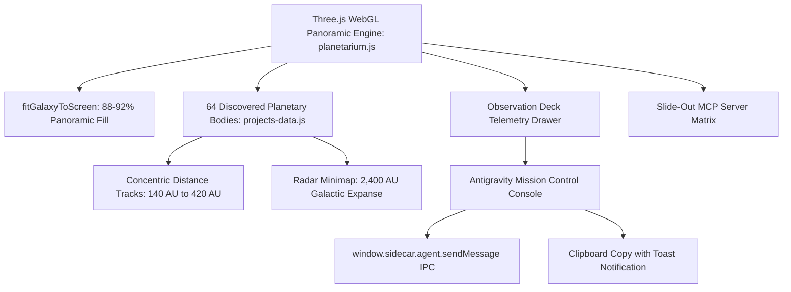

### Key Technical Pillars
1. **Interactive Antigravity Mission Control Console & Prompt Dispatch**:
   - Every planet hosts an observation deck with a 3D rotating hologram and 4 structured 1-click prompting templates:
     - `⚡ Execute Directive`: Generates an actionable prompt directing Antigravity to implement that project's exact next step.
     - `🔍 Deep Code Audit`: Commands Antigravity to run an anti-slop, architecture, and security inspection on the codebase.
     - `🧪 Test Suite (100%)`: Directs Antigravity to run unit and integration tests (Pytest/Pester).
     - `🚀 Verify Deploy`: Directs Antigravity to run diagnostic health checks and sync with `deploy/PROJECT_CATALOG.json`.
   - **Dual Dispatch Pathways**:
     - *Sidecar Native Dispatch*: When running inside Antigravity as a UI Extension panel (`.gemini/config/plugins/planetarium`), clicking **"🚀 Dispatch to Antigravity"** directly invokes `window.sidecar.agent.sendMessage(directive)` into the active chat session.
     - *Universal Clipboard Uplink*: When running standalone in desktop browsers, clicking **"Dispatch"** or **"📋"** copies the prompt to the clipboard with glowing visual confirmation.
2. **Panoramic Auto-Fit Scaling (`[F]`)**:
   - `fitGalaxyToScreen()` automatically scales the sector to fill **88–92% of the active viewport** across 16:9 and 16:10 widescreen monitors.
   - 2,400 AU galactic expanse with radar minimap displaying live camera viewport bounds and orbital drift.
3. **Ergonomic Keybindings & Navigation**:
   - `M`: Toggle planetary manifest catalog (all 64 planets).
   - `T`: Celestial tour (hands-free autonomous flight between worlds with audio chimes).
   - `F`: Auto-fit screen projection.
   - `[` / `]` or `←` / `→`: Cycle through planets in sector.
   - `Space`: Pause/resume planetary orbital drift.
   - `/`: Instant search & warp autocomplete.
4. **Baseline Aesthetics**:
   - Integrated with Antigravity High-Gloss Lacquer optics (`high-gloss-lacquer.css`, `high-gloss-lacquer.js`) and Still Cosmic Backdrop Engine (`cosmic-background.js`, `cosmic_cityscape.jpg`) with 0 animation loops for rock-solid 60 FPS performance.

---

## 9. Scary Water Slides: Channel Production Hub, 3D WebGL Simulator & Photoreal VFX Pipeline (`Scary Water Slides`)

### Production Architecture & Viral Channel Strategy (`G:\My Drive\Antigravity\Projects\Scary Water Slides`)
The **`Scary Water Slides`** project serves as the official production hub for an elite YouTube channel engineering impossible, hyper-sensory waterslide simulations and POV thrill rides for kids, tweens, and adrenaline enthusiasts. The project couples a playable WebGL 3D simulation with photorealistic terrain VFX compositing and strict YouTube packaging retention mechanics.

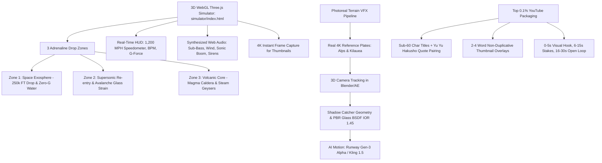

### Key Technical Implementations
1. **Interactive 3D Three.js Simulator (`simulator/index.html`)**:
   - **Zone 1 (Space Exosphere)**: 250,000 FT vacuum drop with floating zero-g water globules and realistic Earth curvature.
   - **Zone 2 (Supersonic Re-entry & Avalanche)**: Alpine blizzard, knife-edge crag skimming, and glass fracture alerts.
   - **Zone 3 (Volcanic Core)**: Direct plunge into bubbling red-hot magma caldera with heat distortion and geothermal steam vents.
   - **Camera Controls**: 1st-person rider POV, 3rd-person follow cam, and free drone cam with dynamic FOV compression.
   - **Zero-Dependency Web Audio Synthesis**: Generates low-end sub-bass rumble, high-velocity water rushing, sonic boom shockwaves, and structural alarm sirens purely via the Web Audio API without external audio assets.
   - **Instant 4K Frame Grabber**: Single-click high-resolution canvas capture to produce pristine thumbnail source images.
2. **Photorealistic Terrain & Slide Integration (`PHOTOREAL_TERRAIN_VFX_WORKFLOW.md`)**:
   - Real-world 4K environment reference plates (`assets/real_alps_avalanche_slide.jpg`, `assets/real_volcano_slide.jpg`).
   - 3D camera tracking solving sensor parameters and terrain parallax.
   - Spline tube modeling anchored with steel stanchions, shadow catcher planes casting natural ambient occlusion onto rock/snow surfaces, and PBR glass BSDF shaders (IOR 1.45, roughness 0.04) with animated turquoise water normal maps.
   - Fast AI motion generation via Runway Gen-3 Alpha and Kling 1.5 Image-to-Video models generating 4K 60FPS fluid motion.
3. **Top 0.1% YouTube Packaging & Retention Rules**:
   - **Titles**: Strictly under 60 characters (no mobile truncation), featuring authentic Yu Yu Hakusho quotes (Yusuke, Hiei, Kurama, Kuwabara, Younger Toguro) paired with high-concept mechanics.
   - **Thumbnail Overlays**: Max 2–4 words, strictly non-duplicative of the title text (`DO NOT JUMP!`, `CRUSH DEPTH`, `RADIATION LEAK`).
   - **Retention Curve (AVD)**: 0:00–0:05 instant visual drop validation (zero logos), 0:06–0:15 stakes and cost of inaction, 0:16–0:30 open loop tease.

---

## 10. Chancenvaders 1978: Museum-Grade Space Invaders Arcade Replica & Modern Kinesthetics (`chancenvaders`)

### Architectural Scope (`G:\My Drive\Antigravity\Projects\chancenvaders`)
The **`chancenvaders`** project is a museum-grade, hardware-accurate recreation of Tomohiro Nishikado's 1978 arcade classic *Space Invaders* (Taito / Midway), built in pure modern web technologies (HTML5 Canvas, procedural Web Audio API, and tactile arcade controls). In addition to 100% faithful Intel 8080 assembly logic (`invaders.asm`), it integrates high-velocity game juice, continuous swept-raycast hitboxes, a 5-tier collectible power-up pod ecosystem, and an Orbital Tower Ascension wave elevator.

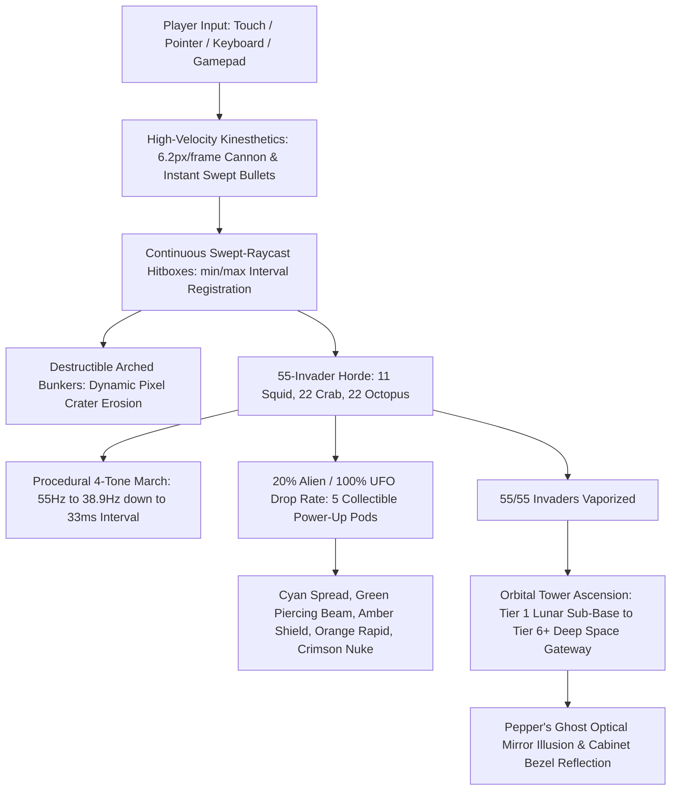

### Key Technical Pillars

#### 1. Hardware-Accurate Bitmask Engine & Spec Fidelity
- **Intel 8080 Spec Emulation**: Direct translation of original arcade memory bitmasks into JavaScript byte arrays (`sprites.js`):
  - **Row 0**: 11 × Squid (Small Invader, 30 pts, 8×8 px, 2 animation frames).
  - **Rows 1–2**: 22 × Crab (Medium Invader, 20 pts, 11×8 px, 2 animation frames).
  - **Rows 3–4**: 22 × Octopus (Large Invader, 10 pts, 12×8 px, 2 animation frames).
  - **Mystery Flying Saucer (UFO)**: 16×7 px, periodic traversal across top banner tier.
  - **Custom 5×7 Bitmap Font**: Embedded matrix rendering HUD, score tables, and attract loop without external web fonts or CORS latency.
- **Destructible Arched Bunkers (`bunkers.js`)**: 4 physical 22×16 pixel defense bunkers subjected to true per-pixel dynamic blast carving from player shots below, alien bombs above, and descending invader physical overlap.

#### 2. Continuous Swept-Raycast Hitbox Collision (Zero Bullet Tunneling)
At high velocities (cannon laser moving at 14.5 px/frame), discrete point-in-polygon checks cause "bullet tunneling" where projectiles leap completely through thin targets without collision. Chancenvaders implements continuous vertical swept-bounding-box intervals:
```javascript
// Continuous Swept-Raycast Collision Algorithm
function checkSweptLaserCollision(laser, target) {
    const minY = Math.min(laser.y, laser.prevY);
    const maxY = Math.max(laser.y, laser.prevY);
    
    // Check horizontal bounding tolerance (±3px)
    if (laser.x >= target.x - 3 && laser.x <= target.x + target.width + 3) {
        // Check vertical interval intersection
        if (maxY >= target.y && minY <= target.y + target.height) {
            return true; // 100% crisp hit registration even at peak laser velocity
        }
    }
    return false;
}
```

#### 3. Procedural Web Audio API Synthesizer (`audio.js`)
Zero external MP3/WAV files. All arcade audio is dynamically synthesized using discrete Web Audio API nodes:
- **Accelerating 4-Tone March**: Cycles through `55.0 Hz`, `49.0 Hz`, `43.6 Hz`, and `38.9 Hz` (A1, G1, F1, D#1). As alien count drops from 55 to 1, pacing dynamically accelerates from ~900ms down to ~33ms per step.
- **Player Laser Chirp**: Rapid downward exponential frequency sweep (1,400 Hz down to 160 Hz).
- **Alien Explosion**: Bandpass-filtered white noise burst with 200ms exponential decay.
- **Player Destruction**: Low-pass noise mixed with 320 Hz descending sawtooth buzz.
- **UFO Siren**: Continuous 500 Hz sawtooth wave modulated by a 6 Hz sine LFO.
- **25¢ Coin Chime**: Dual bell tone (987.77 Hz + 1,318.51 Hz).

#### 4. 1978 Pepper's Ghost Optical Mirror Illusion (`backdrop.js` & `style.css`)
Faithfully simulates the optical engineering of original 1978 Taito/Midway upright cabinets (and modern Arcade1Up/iiRcade cabinets):
- A physical illustrated lunar diorama (moon craters, mountain ridge, celestial planet, and twinkling starfield) sits behind a semi-transparent two-way mirror angled at 45 degrees.
- Glowing player lasers, bunkers, and invaders appear to float in true 3D optical space above the lunar surface.
- Supports 1978 Cellophane color strip overlays (Red top, White middle, Green bottom) and modern Retro Neon palettes.

#### 5. Exhilarating Power-Up Ecosystem & Orbital Tower Ascension
- **5 Collectible Power-Up Pods** (20% drop on aliens, 100% drop on UFOs):
  - `[S]` **Cyan Spread Laser**: 3-way divergent laser fan clearing multiple columns.
  - `[P]` **Neon Green Piercing Plasma Hyper-Beam**: Tears clean through entire vertical columns of aliens.
  - `[🛡]` **Amber Forcefield Shield**: Absorbs 2 direct hits and reconstructs 65% of eroded bunkers.
  - `[R]` **Orange Overdrive Rapid Fire**: Zero-cooldown Gatling laser protocol (up to 8 simultaneous beams).
  - `[N]` **Crimson Tactical EMP Nuke**: Screen-clearing shockwave vaporizing active bombs and the bottom enemy row.
- **Orbital Tower Ascension**: Clearing wave 55 triggers rocket thruster exhaust plumes and elevates the platform across 6 distinct altitude tiers (Lunar Sub-Base Crater $\to$ Orbital Elevator Station $\to$ Mesosphere Citadel $\to$ Stratosphere High Gantry $\to$ Thermosphere Apex Spire $\to$ Deep Space Gateway), awarding $+500 \times \text{Tier}$ bonus points.

### Cross-Portfolio Synergy
- **With `game studio`**: Serves as the retro arcade foundation alongside the UE5 3D combat engine (`ShadowBlade_Tekken_Naraka_UE5`).
- **With `Record my Gameplay`**: Captures high-score runs and victory ascensions via OBS WebSocket and NVENC AV1.
- **With `ai slop`**: Enforces strict anti-slop standards: zero emoji asset flips (100% bitmask sprites), responsive kinesthetic juice, and $\ge 48\text{dp}$ touch ergonomics.
- **With `deploy`**: Verified functional as a zero-dependency static web application ready for instant browser launch.

---

## 11. Game Library: Clean-Room Xbox PC App & Game Library Visual Reconstruction

### Workspace Architecture (`G:\My Drive\Antigravity\Projects\Game Library`)
The **Xbox PC App & Game Library Visual Reconstruction** serves as the reference implementation for **Workspace Baseline #8 (Visual-to-Code UI Reconstruction)**. It achieves a 1-to-1 pixel-faithful, responsive clean-room reconstruction directly from visual appearance, spatial grids, and lacquer surface optics—completely bypassing legacy Electron / React-Native-Windows DOM trees and hashed CSS stylesheets.

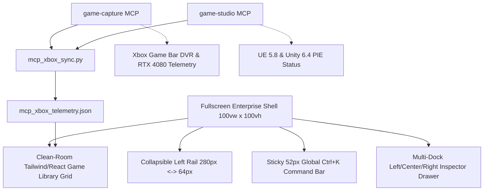

### Technical Pillars

#### 1. Fullscreen Enterprise Layout ($100\text{vw} \times 100\text{vh}$) & Zero Dead Margin Optics
- Eliminates page scrollbars and wasted margins using a strict viewport container:
  - Collapsible left navigation rail (`280px` expanded $\leftrightarrow$ `64px` collapsed) with smooth CSS transform transitions.
  - Sticky `52px` global command bar featuring `Ctrl+K` spotlight search, profile pill, and live MCP daemon indicator.
  - Multi-dock inspector drawer supporting 3-way layout docking (`Left`, `Center`, `Right`) for seamless game detail inspection.

#### 2. Live Model Context Protocol (MCP) Telemetry Bridge
Integrates local hardware and development engines via custom Python bridge `mcp_xbox_sync.py`:
- **`game-capture` Integration**:
  - Live Xbox Game Bar DVR capture directory polling (`C:\Users\chase\Videos\Captures` and `C:\Users\chase\Videos\NVIDIA`).
  - RTX 4080 Mobile GPU thermal, clock, and VRAM telemetry ingestion.
  - Instant trigger hooks for `Win+Alt+G` clip recording (`xbox_record_clip`) and screenshot capture (`xbox_take_screenshot`).
- **`game-studio` Integration**:
  - Enumerates active local Unreal Engine 5.8 and Unity 6 (`6000.4.7f1`) builds in `G:\My Drive\Antigravity\Projects\game studio`.
  - Supports one-click Play-In-Editor (PIE) launcher dispatching.

#### 3. Anti-Slop Visual Standards & MCP Baseline 2.0 Integration
- 100% vector dual-tone inline SVGs for all platform badges, cloud sync indicators, and rating stars (zero emoji asset flips).
- High-Gloss Lacquer material optics with subtle glassmorphic backdrop filters (`backdrop-filter: blur(16px)`).
- Strict $\ge 48\text{dp}$ touch targets with tactile spring click states (`active:scale-95`).
- **MCP Web Apps Baseline 2.0 Compliance**: Embeds `mcp-baseline.js` (v2.0) and `mcp-registry.json`, providing direct access to the `Ctrl+M` MCP Telemetry HUD and `Ctrl+E` in-app element inspection and hot-patching editor console.

---

## 12. Your Favorite Character's White Noise: Sleep Ambience & Channel Engine (`youtube channels`)

### Workspace Architecture (`G:\My Drive\Antigravity\Projects\youtube channels`)
An automated ambient video production and scheduled publishing pipeline engineered for YouTube sleep and study ambience channels. Designed around high Average View Duration (AVD) retention mechanics and algorithm-safe production rules.

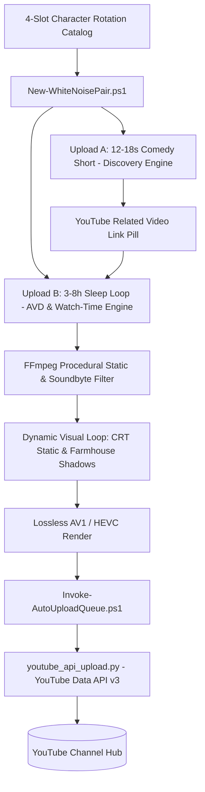

### Algorithmic Strategy & Channel Engineering

#### 1. The 2-Upload Funnel Strategy (Short $\to$ Long-Form)
- **Upload A: The YouTube Short (12–18 Seconds) — Discovery Engine**:
  - Leverages comedy and nostalgia in the Shorts feed (*"POV: You're trying to sleep in the Middle of Nowhere..."*).
  - Soothing static for 2–5 seconds $\to$ sudden soundbyte punchline (e.g. Eustace's *"STUPID DOG! You make me look bad!"*) $\to$ immediate return to calm white noise.
  - Links directly to the long-form video via the official **YouTube "Related Video" pill** above the Short's title.
- **Upload B: The Long-Form Video (3 to 8 Hours) — High-AVD & Watch-Time Engine**:
  - Starts immediately at `0:00–0:05` with the soundbyte (instant click validation).
  - Transitions into soothing farmhouse white/brown noise with soundbytes spaced at irregular, gentle intervals (every 12–20 minutes, low-pass filtered at $-14\text{ dB}$ below peak) so it never jolts sleeping listeners awake.

#### 2. Avoiding "Repetitious Content" Demonetization
YouTube flags static images with loops as repetitious / low-effort content. The automation pipeline eliminates this risk:
- Dynamic animated visual loops: CRT television scanlines, swaying porch shadow motion, subtle visual audio waveforms, and lamp flickering.
- Organic non-uniform audio curves: subtle room reverb and multi-band ambient layering (creaking wood, rain against window pane, soothing brown noise).

#### 3. 4-Slot Character Rotation System
Prevents audience burnout while capitalizing on cross-fandom nostalgia:
- **Slot 1 (The Anchor)**: Eustace Bagge (*Courage the Cowardly Dog*) — *"Stupid dog!"*, *"Nope, not gettin' out of this chair!"*, *"What did I do?"*
- **Slot 2 (The Eccentric)**: Rolf (*Ed, Edd n Eddy*) — *"You dare insult the son of a shepherd?"*, *"Life has many doors, Ed-boy!"*
- **Slot 3 (The Machine)**: Courage's Sarcastic Computer — *"You twit."*, *"Searching for idiot..."*
- **Slot 4 (The Nostalgia Wildcard)**: Squidward, Plankton, or Billy's Dad (*Grim Adventures*).

#### 4. Automated Publishing CLI Pipeline & 12-Episode Production Batch
- **12 Production Episodes Fully Rendered & Asset-Verified**:
  - `ep01-eustace-stupid-dog`: Eustace Bagge *"Stupid dog! You make me look bad!"* (Courage the Cowardly Dog)
  - `ep02-patrick-mayonnaise`: Patrick Star *"Is mayonnaise an instrument?"* (SpongeBob SquarePants)
  - `ep03-mojo-jojo-curses`: Mojo Jojo *"Curses! You have foiled my plan!"* (Powerpuff Girls)
  - `ep04-pinky-and-brain-tonight`: Brain *"The same thing we do every night..."* (Pinky and the Brain)
  - `ep05-donald-duck-tantrum`: Donald Duck *"Aw phooey!"* and explosive rage quacks (Disney Classics)
  - `ep06-chao-noises-yosh`: Chao creature soothing cries & chirps (Sonic Adventure / SA2)
  - `ep07-sa2-neutral-chao-garden`: Neutral Chao Garden waterfall & bell ambience
  - `ep08-sa2-hero-chao-garden`: Hero Chao Garden angelic cloud harp & rainbow fountain ambience
  - `ep09-sa2-dark-chao-garden`: Dark Chao Garden cave magma & eerie bubbling spring ambience
  - `ep10-sa1-station-square-chao-garden`: Station Square Chao Garden hotel lift & marble courtyard fountain
  - `ep11-sa1-egg-carrier-chao-garden`: Egg Carrier Chao Garden metallic airship & cybernetic sky deck
  - `ep12-sa1-mystic-ruins-chao-garden`: Mystic Ruins Chao Garden ancient Aztec stone & jungle waterfall
- **Queued Next-Wave Episodes (`ep13`–`ep16` in `character_rotation_catalog.json`)**:
  - `ep13-eustace-mallet`: Eustace Bagge *"That's it! I'm gettin' me mallet!"* (Brown Noise, 12-min interval)
  - `ep14-rolf-son-of-a-shepherd`: Rolf *"Life has many doors, Ed-boy!"* (Pink Noise, 11-min interval)
  - `ep15-courage-computer-twit`: Courage's Computer *"You twit."* (CRT White Noise, 9-min interval)
  - `ep16-patrick-leedle`: Patrick Star *"Leedle leedle leedle lee!"* (8-Hour Deep Sleep Brown Noise, 15-min interval)
- **Licensed Character Audio Manifest & 3D Ambience Studio**:
  - Deployed audio asset catalog in `assets/licensed/` with strict licensing descriptors (`Build-AudioManifest.ps1` refreshed **`2026-11-24 16:41`**):
    - **Music Categories**: `sonic_yyh`, `arcade_retro`, `perfect_dark`, **`flow_music`** (**Google Flow Music Originals — Monetization-Safe** synced from `Google Flow-music`), `chill`, `hype`, `tension`, `playful`.
    - **SFX Character Voice Lines & Legacy TTS Quarantine**: `kill`, `win`, `loss`, `tension`, and `footsteps` packs featuring Perfect Dark Elvis Maian, Guard, and Ed, Edd n Eddy Rolf; legacy System.Speech TTS `.wav` files are automatically quarantined to `assets/audio/_quarantined_tts`.
  - Automated manifest generation via `Build-AudioManifest.ps1` synthesizing `audio_manifest.json` and `audio_manifest.js`, paired with `character_rotation_catalog.json` (`2026-11-24 22:29`).
  - Interactive 3D Ambience Studio (`index.html`, `studio-engine.js`, `hallway-scene.js`, `high-gloss-lacquer.css`, `Start-HighlightStudio.ps1`) providing live in-browser preview, spatial audio positioning, and character voice trigger testing.
- **Full Asset Suite per Episode**:
  - Isolated WAV audio master (`assets/audio/`)
  - 1280x720 High-CTR YouTube Thumbnail with bold contrast text overlay (`assets/branding/`)
  - Vertical 9:16 Short MP4 (`output/*_SHORT_9x16.mp4`)
  - Horizontal 16:9 Long-Form Master Loop MP4 (`output/*_LONG_16x9.mp4`)
- **Automation Tooling (`character_rotation_catalog.json` refreshed `2026-11-23 14:29`)**:
  - `New-WhiteNoisePair.ps1`: Generates paired Short and Long-form assets with matching SEO tags, descriptions, and high-CTR thumbnail prompts.
  - `New-ChannelBranding.ps1`: Generates channel banner (`2560x1440`) and avatar (`800x800`).
  - `youtube_api_upload.py`: Headless YouTube Data API v3 uploader utilizing OAuth 2.0 refresh tokens, automatic category assignment (`24 - Entertainment` / `10 - Music`), and automated schedule queuing.
  - `Invoke-AutoUploadQueue.ps1`: Automated daily daemon checking `character_rotation_catalog.json` and dispatching scheduled uploads.
  - `Start-ChannelAndUploadWizard.ps1`: Interactive step-by-step setup and release wizard.

### Cross-Portfolio Synergy
- **With `youtube shorts edit for gaming`**: Shares vertical video reframing presets, animated `.ass` subtitles, and NVENC AV1 hardware encoding pipelines.
- **With `Scary Water Slides`**: Leverages top 0.1% YouTube packaging drawer mechanics and CTR thumbnail testing.
- **With `automate my day`**: Ingests upload status and watch-time telemetry into daily morning briefings.


---

## 13. Antigravity 3D Art Gallery Studio & Index Museum (`index folder`)

### Architectural Blueprint (`G:\My Drive\Antigravity\Projects\index folder\3d-gallery-studio.html`)
The **`index folder`** project hosts the **Antigravity 3D Art Gallery Studio & Index Museum**, an immersive first-person 3D WebGL exhibition space built with Three.js. It transforms the active **88-project** portfolio (90 top-level directories including `Google Flow- Movies`, `Bookmark-favorites`, `Motion`, `Highschool basketball`, `geminipc`, `Neon- orchestrator`, `emulator and rom hunter`, `Popular Github Projects`, and `increase my bing score`) into a virtual gallery walkthrough featuring 5 themed wings corresponding to the project categories:

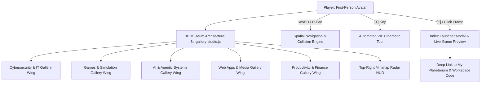

### Key Technical Pillars

#### 1. First-Person Ergonomic Navigation
- **Dual Control Schemes**:
  - Desktop: WASD / Arrow keys for directional walking, Mouse drag to look around, `Shift` to sprint.
  - Touch / Mobile: Virtual on-screen D-Pad and touch drag rotation.
- **Collision Detection & Room Bounds**: Catmull-Rom wall splines and bounding boxes constrain the player camera within the museum corridors and gallery pavilions.

#### 2. Automated VIP Highlight Tour (`[T]`)
- One-click cinematic tour interpolating the camera smoothly between preset viewpoint waypoints across all 5 exhibition wings.
- Features automatic exhibit pausing, dynamic title banners, and smooth camera bezier curves.

#### 3. Interactive Exhibit Frames (`[E]` / Raycasting)
- Approaching any exhibit painting or pressing `E` triggers the **Index Launcher Modal**:
  - Live interactive iframe previewing the running web app.
  - Project metadata, runtime stack tags, and operational health status.
  - Deep-link button to open the project's sector coordinates in **My Planetarium**.
  - One-click launcher to open the project's folder or source workspace.

#### 4. Minimap Radar HUD
- Real-time Canvas radar overlay plotted in the top-right corner.
- Renders player position coordinates, field-of-view viewing cone, and color-coded exhibit waypoint blips corresponding to category wings.

### Cross-Portfolio Synergy
- **With `My Planetarium`**: Shares 3D astronomical assets and bidirectional URL parameters allowing users to jump seamlessly between the 3D museum and the 3D deep space sector map.
- **With `deploy`**: Consumes `deploy/PROJECT_CATALOG.json` to generate live project exhibit placards and operational status badges.
- **With `ai slop`**: Enforces smooth 60 FPS spring physics, tactile raycasting feedback, and zero shovelware design.

---

## 14. Turbo Type Multi-Platform Suite: Cross-Engine Phonics & High-Speed Kinesthetics

### Architecture & Multi-Engine Parity (`game studio`, `1st grade learning`, `mobile game`)
The **Turbo Type** ecosystem unifies educational phonics learning and reflex-driven typing action across three synchronized engine runtimes:

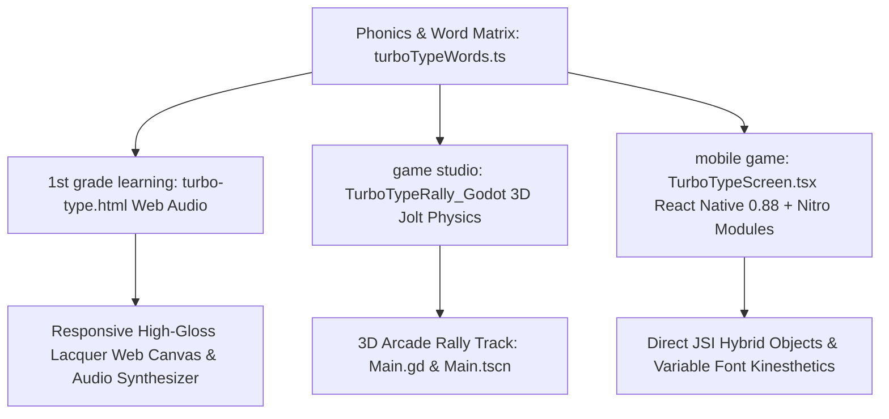

#### 1. Web Phonics Adventure (`G:\My Drive\Antigravity\Projects\1st grade learning\turbo-type.html`)
- Interactive, responsive web typing experience designed for elementary students and typing speed enhancement.
- Real-time words-per-minute (WPM), accuracy percentages, and streak multipliers.
- Procedural Web Audio API sound feedback: crisp letter keypress clicks, positive chord sweeps on word completion, and buzzer cues on mistakes.
- Celebratory canvas confetti particle burst upon clearing word tiers.
- Integrated into `index.html` and `typing.html` with GitHub Primer dark aesthetics and zero dead margins.

#### 2. Godot 4.3/4.4 3D Rally Racing (`G:\My Drive\Antigravity\Projects\game studio\TurboTypeRally_Godot`)
- Converts typing speed and accuracy into vehicle acceleration, nitrous boost, and drift control on a 3D rally circuit.
- **Godot 4.4 Engine Features**:
  - **Typed Dictionaries**: Enforces key-value type safety in GDScript (`scripts/Main.gd`) for dictionary lookups of vocabulary and physics parameters.
  - **3D Physics Interpolation**: Delivers silky smooth 144Hz+ rendering of vehicle bodies independent of lower physics tick rates (60Hz).
  - **Native Jolt Physics**: Core engine integration of Jolt physics for realistic multi-body vehicle dynamics, tire friction, and collision stability.
  - **Interactive In-Game Editing**: Ability to inspect nodes and tweak rally camera angles live during execution.
- Executed via `Launch_TurboTypeRally_Godot.bat` or through `GameStudio_Hub.ps1`.

#### 3. High-Performance React Native Mobile Engine (`G:\My Drive\Antigravity\Projects\mobile game\src\screens\TurboTypeScreen.tsx`)
- Native mobile typing challenge integrated into the Aether Ascent / Mobile Game suite (`src/screens/TurboTypeScreen.tsx`, `src/data/turboTypeWords.ts`, `src/screens/LobbyScreen.tsx`, `Start-MobileGames.ps1`).
- **React Native `0.88.1` & Expo `~58.0.23` Innovations**:
  - **W3C `EventTarget` Bubbling**: Standards-compliant event bubbling and capturing for touch and keyboard input events.
  - **Variable Fonts Support**: Utilizes `fontVariationSettings` on `<Text>` and `<TextInput>` for dynamic typographic scaling and kinetic letter bounce during rapid typing.
  - **Precompiled iOS XCFrameworks & React 19.3.0**: Modern Expo SDK 58 + React 19.3.0 binary distribution cutting native clean-build times.
  - **Margelo Nitro Modules**: High-performance statically-compiled JSI bindings providing zero-copy state sharing between native audio/haptic threads and the React rendering tree.
- Cross-linked with `mobile game` Lobby launcher and Anti-Slop touch ergonomics ($\ge 48\text{dp}$).

---

## 15. Newly Initialized Sports Analytics Workspace (`Highschool basketball`)
- **Role**: Dedicated sports analytics, scouting, and game film / shot-chart workspace (`G:\My Drive\Antigravity\Projects\Highschool basketball`).
- **Recommended Stack**: Python 3.12 (`uv`) + OpenCV court homography / shot-chart tracking + `100vw x 100vh` GitHub Primer dark telemetry console matching `aws-enterprise-baseline.css` and `MCP` Baseline 2.0 (`Ctrl+M` / `Ctrl+E`), with `iamajmeena/neonclipping` / FFmpeg `av1_nvenc` highlight reel clipping.

---

## 16. Google Flow Cinematic Anime & Short Film Studio (`Google Flow- Movies`)

### Architectural Blueprint (`G:\My Drive\Antigravity\Projects\Google Flow- Movies`)
Detected on **November 23, 2026** and massively expanded through **November 25, 2026 02:42 AM** (`181` files updated across EP01 & EP02), **`Google Flow- Movies`** establishes a repeatable generative anime and short-film production pipeline powered by **Google Flow** (`Nano Banana 2` image synthesis + `Veo 3.1` / `Veo 3.1 Lite` / `Omni 1.2 Flash` 24fps video generation + "Ingredients to video" reference consistency + object lasso / Start-to-End keyframe locking) paired with post-production sakuga compositing and dialogue-ducked scoring via `Google Flow-music`.

### Showcase Production: `dead-channel-13` (*Season 1 — Pilot EP01 & Episode 02*)
- **Production & Season Bible (`dead-channel-13/production_bible.md`, `season1_story_bible.md`, `shots.json`)**: 1999 Kanda-Akihabara sci-fi martial arts cel-anime sequence locked to 1990s hand-inked aesthetics (*Cowboy Bebop*, *Bungo Stray Dogs*, *Yu Yu Hakusho*, *Steins;Gate*) with strict Anti-Slop exclusions (zero 3D CGI, zero plastic skin shading) and locked multi-cut character descriptors (`Renji Takanashi`, `Toma Kurose`, `Sora Hayakawa`, `Kuroha "Vesper"`, `Masato Kurosawa "The Metronome"`).
- **Episode 01 Full Pilot & Episode 02 Full Episode (`2026-11-24`–`2026-11-25`)**:
  - **EP01 Full Pilot**: 4 complete acts (`ep01_cold_open_script.md`, `ep01_full_pilot_script.md`, `ep01_act2`–`act4_storyboard_sheet.png`) compiled into `DEAD_CHANNEL_13_EP01_FULL_PILOT_JP_SUB.mp4` (`137.7 MB`) and `DEAD_CHANNEL_13_EP01_FULL_PILOT_EN_DUB.mp4` (`152.2 MB`).
  - **EP02 Full Episode**: 3 acts (`ep02_script.md`, `ep02_act1`–`act3_storyboard_sheet.png`, 15 shots in `frames_ep2/` + `videos_ep2/` rendered through `2026-11-25 02:42 AM`) compiled into `DEAD_CHANNEL_13_EP02_FULL_EPISODE_JP_SUB.mp4` (`67.1 MB`) and `DEAD_CHANNEL_13_EP02_FULL_EPISODE_EN_DUB.mp4` (`74.0 MB`).
- **v2.0 *Dandadan* / *Yu Yu Hakusho* Sakuga Rebuild (`sakuga_v2_blueprint.md`)**:
  1. **Micro-Cut Compression (`0.4s–2.2s` Cuts)**: Slices combat on strike apexes to eliminate generative video drift beyond `~2.5s`.
  2. **Start -> End *Genga* Keyframe Locks + 14mm Fisheye Lenses**: Uses Google Flow Start/End frame anchors (`frames_v2/sakuga_kf1_fisheye_blitz.webp`, `sakuga_kf2_blade_clash_sakuga.webp`, `sakuga_kf3_masato_zerobeat_ecu.webp`) and Veo 3.1 "Ingredients to video" (up to 3 reference images) to constrain anatomy and momentum.
  3. **Non-Linear *Tame-Tsume* Speed Ramping & `12fps` On-Twos**: Ramps wind-ups `1.5x -> 2.7x`, drops melee peaks to held `on_twos` pairs, and injects `3–5` frame *Hakukoma*/*Kurokoma* B&W ink hit-stops (`rgb_split=6`, `±14px` shake) plus `dandadan_cyan` / `dandadan_crimson` duotone snaps.
  4. **Vacuum-Silence Audio Contrast (`0.20s–0.22s`) & Native Japanese Lip-Sync (`1.0x`)**: Drops music and rain to `0.03x` pre-impact and embeds quoted Japanese dialogue directly in prompts for native jaw/mouth-flap alignment, paired with **`Google Flow-music`** `Invoke-DeadChannelScoreMix.ps1` dialogue-ducked 4-stem score mixing.
- **Immediate Frontier Upgrades**: Automate shot-manifest -> Gemini API (`Nano Banana 2` + `Veo 3.1` frame chaining) batch orchestration via `shots.json`, generate `1280x720` High-CTR thumbnails + 9:16 teasers for `youtube channels` / `My Social Media`, and promote `Google Flow- Movies` in `deploy/PROJECT_CATALOG.json` & `index folder`.

---

## 17. Google Flow Music: Central Soundtrack, Stem & Cross-Project Integration Hub (`Google Flow-music`)

### Architectural Blueprint (`G:\My Drive\Antigravity\Projects\Google Flow-music` & `MCP/flow-music-mcp`)
Newly created on **November 24–25, 2026** (`222` active files through `02:36 AM`): a unified audio vault, EBU R128 loudness normalizer, stem blender/separator, adaptive game stem exporter, dialogue-ducked video score mixer, and 10-tool FastMCP server powering all creative, gaming, YouTube, and web app projects:
- **Vault & Soundtrack Packs (`vault/catalog.json` — `14` verified tracks as of `2026-11-25 02:36`)**:
  - `packs/dead-channel-13/`: 6 anime OP/ED/cue/character briefs + `shots.json`/`cues.json` timeline.
  - `packs/youtube-monetization-beats/`: 6 Content-ID-safe 90s neo-soul, JP jazz fusion, city pop & sleep beds.
  - `packs/game-studio-ost/`: 6 adaptive 4-stem (`drums`, `bass`, `instruments`, `vocals`) game & web app soundtracks, plus custom palace/anime blends (`chill01`–`03`, `hit01`, `rom02-velvet-palace-longform`, `rom03-console-vault-bgm`) built via `Separate-TrackStems.py`, `Build-SonicBebopBlend.py`, `Build-AnimeHitBlends.py`, `Build-ChillTokyoBlends.py`, `Build-YuYuSunsetBlends.py`, `Build-YuYuConnectedBlend.py`, and `Build-RomStudioYoutubeSuite.py`.
- **12 Target Project Loudness & Format Pipelines (`config/project-targets.json`, `Sync-FlowMusicVault.ps1`)**: Measures integrated loudness once per target (`-14.0 LUFS` for `youtube_channels` / `youtube_remaster`, `-16.0 LUFS` for `dead_channel_13` / UE5 / Unity / Godot / `mobile_game`, `-18.0 LUFS` for `My Planetarium` / `AAC`) and applies identical gain offset + limiter across `master` and all stems to preserve stem mix balance.
- **Adaptive Game Engine Templates (`game-audio/templates/`) & Score Mixing**: Ships `AdaptiveFlowMusicPlayer.gd` (Godot `AudioStreamSynchronized`), `AdaptiveFlowMusicController.cs` (Unity `AudioSettings.dspTime`), `import_flow_music_stems.py` (UE5 `AssetImportTask`), `flow-music-web-engine.js` (Web Audio API), `Invoke-DeadChannelScoreMix.ps1`, and **`MCP/flow-music-mcp`** (`10` FastMCP tools verified by `tests/test_vault_and_server.py`).
- **Cutting-Edge Google Frontier Upgrade**: Pair vault brief scaffolding (`New-FlowMusicTrack.ps1` / `flow_music_create_track_brief`) with **Google DeepMind Lyria 3.5 / Lyria Clip** (Gemini API / AI Studio 44.1/48 kHz stereo generation with structured verse/chorus/bridge & time-aligned lyrics) for 1-click original track synthesis.

---

## 18. SONA: Studio Audio & Video Media Player (`media player`)

### Architectural Blueprint (`G:\My Drive\Antigravity\Projects\media player`)
Newly built on **November 25, 2026 (`00:54`–`01:04 AM`)**: **`SONA — Studio Media Player`**, a zero-dependency native ES Module audio & video media player targeting both **PWA** (`index.html`, `manifest.webmanifest`, `sw.js`, `server.mjs`) and **Electron Desktop** (`electron/main.cjs`, `electron/preload.cjs`, `Launch-SONA.ps1`):
- **Core Audio/Video Engine (`js/engine/audioEngine.js`)**: 10-band biquad EQ (`32 Hz`–`16 kHz` with 7 studio presets: *Studio Flat*, *Deep Bass*, *Vocal Clarity*, *Acoustic Warmth*, *Electronic Club*, *Cinema Impact*, *Late Night*), preamp, stereo panner, dynamics compressor, and 1024-bin FFT/waveform `AnalyserNode` driving 5 real-time visualizers (`auroraShader.js`, `harmonicHalo.js`, `prismBars.js`, `oscilloscope.js`, `nebulaWarp.js`).
- **3-Pane Studio Workspace (`js/ui/`)**: Collapsible library/playlist rail, cinema stage (`stageController.js`), interactive waveform scrubber (`waveformScrubber.js`), WebVTT/SRT subtitles (`subtitles.js`), metadata parser (`metadata.js`), queue manager (`queueView.js`), and hardened Electron window (`contextIsolation: true`, `nodeIntegration: false`, `sandbox: true`).

### Cutting-Edge Frontier Upgrades (WebCodecs, AudioWorklet & PWA 2026 Best Practices)
- **WebCodecs (`VideoDecoder`) + WebGPU `OffscreenCanvas`**: For 4K/60fps local MKV/MP4 playback beyond `<video>` limits, pair a lightweight ESM demuxer with `VideoDecoder` rendering `VideoFrame` instances to a WebGPU `OffscreenCanvas` worker (always calling `frame.close()` immediately after draw to avoid VRAM leaks), while keeping audio routed through Web Audio API rather than `AudioDecoder`.
- **`AudioWorklet` + `SharedArrayBuffer` Lock-Free Ring Buffer**: Move custom DSP (EQ/stem crossfading/peak metering) off the main thread into a dedicated `AudioWorkletProcessor`, enabled by serving `Cross-Origin-Opener-Policy: same-origin` and `Cross-Origin-Embedder-Policy: require-corp` in `server.mjs`.
- **PWA `file_handlers`, Media Session API & Electron `powerSaveBlocker`**: Register `file_handlers` in `manifest.webmanifest` for OS double-click launch, bind `navigator.mediaSession.metadata` + hardware media keys, add `powerSaveBlocker.start('prevent-display-sleep')` in `electron/main.cjs`, and stream directly from `Google Flow-music/vault/catalog.json`.
